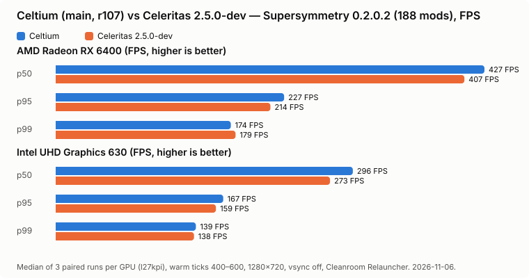
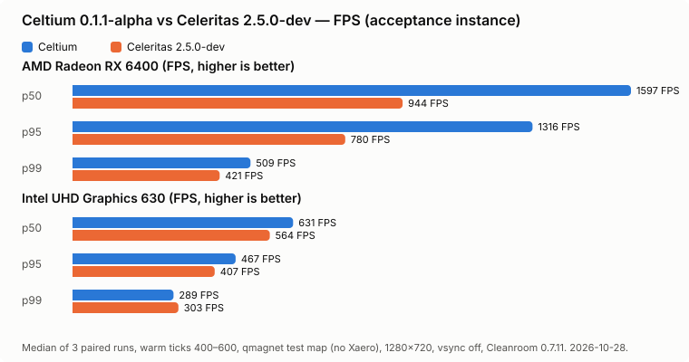

*Celtium was a historical proposed name for element 72, now known as hafnium. [Name origin](https://en.wiktionary.org/wiki/celtium).*

# Celtium

**A native Vulkan renderer for Minecraft 1.12.2 on CleanroomMC, built from Celeritas.**

<p>
  <a href="https://github.com/souta-lab/celtium/releases"></a>
  <a href="#requirements"></a>
  <a href="#requirements"></a>
  <a href="#requirements"></a>
  <a href="#requirements"></a>
</p>
<p>
  <a href="#performance"></a>
  <a href="#requirements"></a>
  <a href="#known-issues"></a>
  <a href="#license-and-attribution"></a>
</p>

Celtium creates the game window **without an OpenGL context**. Terrain, entities, items, particles, sky, clouds and
the GUI are drawn into Vulkan-owned images and presented through a Vulkan swapchain. It is a renderer replacement, not
an OpenGL-to-Vulkan translator: its native passes follow Minecraft's own terrain, model/item, entity/TESR, particle,
UI, texture and framebuffer semantics, and mods that call GL directly are served by a GL-less compatibility layer.

## Highlights

- **Faster than Celeritas in a real modpack.** In Supersymmetry 0.2.0.2 (188 mods), current `main` renders more FPS
  than Celeritas 2.5.0-dev at the median and at p95 on both tested GPUs, and is at parity at p99
  ([numbers](#performance)).
- **Runs large packs cleanly.** Enigmatica 2: Expert - Extended 1.87.3 reaches the world with **zero Vulkan validation
  errors** on AMD and Intel ([compatibility](#modpack-compatibility)).
- **No OpenGL context at all.** Window, swapchain, textures, framebuffers and post effects are Vulkan objects; the
  GL-less layer covers display lists, immediate mode, VBOs, FBOs, shader getters and legacy state for mods.
- **Measured, not claimed.** Every number in this README comes from a recorded run with its build, GPU, scene and
  pair count; validation-on legs back every correctness statement ([evidence](docs/evidence)).

## Performance

All numbers are **FPS (higher is better)**: the median over paired runs of the frames in a fixed warm window
(world ticks 400–600). p50 is the typical frame; p95/p99 are the slowest 5% / 1% of frames, i.e. stutter.
Celtium and the reference alternate pair by pair on the same machine, so drift cancels out.

### Modpack FPS: Supersymmetry 0.2.0.2 (188 mods) — current `main`

<picture>
  <source media="(prefers-color-scheme: dark)" srcset="docs/img/modpack-supersymmetry-dark.svg">
  
</picture>

| GPU | | Celtium | Celeritas 2.5.0-dev | Celtium vs Celeritas |
| --- | --- | --- | --- | --- |
| AMD Radeon RX 6400 | p50 | **427 FPS** | 407 FPS | **+2.5%** |
| | p95 | **227 FPS** | 214 FPS | **+7.0%** |
| | p99 | 174 FPS | 179 FPS | +0.7% (pair median) |
| Intel UHD Graphics 630 | p50 | **296 FPS** | 273 FPS | **+6.4%** |
| | p95 | **167 FPS** | 159 FPS | **+3.1%** |
| | p99 | 139 FPS | 138 FPS | +0.7% (pair median) |

**Setup:** Supersymmetry 0.2.0.2 (GregTech CEu based, 188 mods) on a Cleanroom Relauncher instance, save `qmagnet`,
pose `x=217.5 y=48 z=217.5 yaw=180 pitch=10`, render distance 12, GUI scale 3, 1280×720, vsync off, validation off.
Build r107 (`5ff004c26`), 3 pairs × 240 s per GPU (runs `l27kpi-amd` / `l27kpi-intel`, 2026-11-06).
The last column is the median of the per-pair ratios, so it can differ from the two FPS medians; a second AMD run
(`l28kpi-amd`) measured +8.9% / +10.5% / +0.9%. The project goal, every pair faster at every percentile, is **not yet
met**: one pair per GPU was slower at p99, which is within the pair-to-pair noise at that percentile.
Evidence: [docs/evidence/animated-sprite-uploads-2026-11-05.md](<docs/evidence/animated-sprite-uploads-2026-11-05.md>).

The 0.2.0 release (2026-11-04) measured on the same pack was still behind Celeritas (about 16% fewer FPS at p50);
the gap was closed on `main` after the release.

### Historical: 0.1.1-alpha on the small acceptance instance

<picture>
  <source media="(prefers-color-scheme: dark)" srcset="docs/img/benchmark-dark.svg">
  
</picture>

| GPU | p50 | p95 | p99 |
| --- | --- | --- | --- |
| AMD Radeon RX 6400 | **1597** vs 944 FPS | **1316** vs 780 FPS | **509** vs 421 FPS |
| Intel UHD Graphics 630 | **631** vs 564 FPS | **467** vs 407 FPS | 289 vs 303 FPS |

Celtium vs Celeritas 2.5.0-dev, 3 pairs, 2026-10-28. This instance is **not a modpack**: a few mods plus
Fugue/Scalar on Cleanroom 0.7.11, QMAGNET's Test Map. It shows the renderer's own cost with little mod load, and is
not comparable with the Supersymmetry numbers above.

## Modpack compatibility

| Modpack | Mods | Result | Run |
| --- | --- | --- | --- |
| Supersymmetry 0.2.0.2 | 188 | performance KPI pack (above); validation-on legs pass | `l27kpi-*` |
| Enigmatica 2: Expert - Extended 1.87.3 | ≈430 | **world reached, 0 validation errors, AMD and Intel**, also with Xaero's raw-framebuffer identity | `fx1-e2ee-amd`, `fx1-e2ee-intel`, `xr1-e2ee-xaero-amd` |
| SkyFactory 4 4.2.4 | 198 | **world reached, 0 validation errors, AMD and Intel** (one transient Intel sky frame open) | `sf4-amd`, `sf4-intel` |
| Enigmatica 2: Expert 1.93a | 270 | passes on both GPUs | [evidence](<docs/evidence/e2e-cleanroom07-2026-10-26.md>) |

E2E-E needs three pack-side substitutions for Cleanroom 0.7.14 (Fugue 0.25.5, CodeChickenLib 3.3.10, Trinity
without its ICBM hook); none of them is a Celtium change. The full list of packs run, with versions, builds, runs and
substitutions, is [docs/modpacks.md](<docs/modpacks.md>). Mod-level lists: [verifiedmods.md](verifiedmods.md) and
[notworkingmods.md](notworkingmods.md).

## Requirements

| Component | Requirement / what is verified |
| --- | --- |
| Minecraft | 1.12.2 |
| Loader | CleanroomMC **0.7.12-alpha** or later in the 0.7 line (SDL 3); 0.7.14 verified with E2E-E. The 0.6.x GLFW generation is refused by name. |
| LWJGL | LWJGL3 **3.4.3** (shipped by Cleanroom 0.7). Celtium bundles the matching `lwjgl-vulkan` bindings. |
| Java | Game JVM **Java 25+** (Java 27 verified); **JDK 25** to build. |
| Vulkan | 1.2+ loader and device with the required graphics/presentation, format and resource capabilities. |
| Verified GPUs / OS | AMD Radeon RX 6400 (RADV) and Intel UHD Graphics 630 (ANV) on Linux/Mesa. |
| Unverified | NVIDIA, other AMD/Intel models, Windows, macOS. |

Vulkan 1.2 alone is not a compatibility guarantee: features are chosen by device capability, not by GPU name.

## Install

1. Prepare a Cleanroom Relauncher instance (Cleanroom 0.7.12-alpha or later, LWJGL 3.4.3, Java 25+).
2. Put `celtium-forge-mc1.12.2-0.2.0.jar` into `mods/`. Use the plain jar, not `-dev` or `-reobf`.
3. Remove Celeritas: **install one renderer, not both** (the internal mod ID and resource namespace stay `celeritas`).
4. Use [Pulsar Lighting Engine](https://modrinth.com/mod/pulsar-lighting-engine), not Alfheim (unsupported).
5. Start the game, enter a world, and check the GUI, menus, creative tabs and tooltips.

Download: [Celtium 0.2.0](https://github.com/souta-lab/celtium/releases/tag/v0.2.0)
(sha256 `bf1193b6ba21dc51cd36a5b013607dd58a9ef8bcbc516ca8f24b0c247e9cccee`). The performance numbers above are from
`main`, which is newer than 0.2.0.

## Scope

- **Minecraft 1.12.2 on CleanroomMC only.** Stock Forge (Java 8/LWJGL2) and other LWJGL3 stacks are not supported.
- **One renderer at a time.** Competing renderer replacements are refused at startup rather than half-working.
- **Shadows and shader packs** are a separate addon (a Demonica fork, AGPL-3.0), not part of Celtium. Vanilla
  ShaderGroup, spectator effects and entity outlines are part of the base renderer.
- **GL-less is installed from the coremod transformer chain**, just before the window is created, and is applied only to
  mods that call GL directly.

## Known issues

- **Performance goal not yet met in every pair**: medians are ahead of Celeritas on both GPUs, but p99 is at parity
  and one pair per GPU was slower. The largest remaining CPU cost is mod HUD text/GUI drawing.
- **Not implemented**: cube maps, 3D textures, MSAA, compute, blit, copyImage, parts of DSA, and stencil (ModularUI's
  `Stencil#reset` uses mask `0x400`).
- **Xaero's Minimap radar entity icons** are not confirmed to draw.
- Menu, tooltip and creative-tab fixes are confirmed by scenes and still need a check in the tester's environment.

## Building and testing

Build with JDK 25 (the build also uses the JDK 21 compilation toolchain and the JDK 8 Minecraft toolchain):

```sh
JAVA_HOME=/usr/lib/jvm/java-25-openjdk-amd64 scripts/build.sh
```

The jar is written to `build-1122/build/libs/<version>/celtium-forge-mc1.12.2-<version>.jar`.

CPU checks (no GPU needed):

```sh
python3 -m unittest discover -s scripts/tests -p 'test_*.py'
scripts/cpu-contract/transformer-route-verify.sh
python3 scripts/check_agent_docs.py
python3 scripts/instrument-index.py --check
```

GPU runs, validation and the paired KPI: [docs/development.md](<docs/development.md>) and the
[leg runner](<scripts/gv-leg.sh>). Charts are generated from JSON by [scripts/bench_chart.py](scripts/bench_chart.py);
README rules: [docs/readme-rules.md](<docs/readme-rules.md>). Working agreements: [AGENTS.md](AGENTS.md).

## Documentation

- Current status and priorities: [docs/plan.md](<docs/plan.md>)
- Measurements and scene evidence: [docs/evidence](<docs/evidence>)
- Release notes: [0.2.0 (English)](<docs/releases/0.2.0-en.md>) · [0.2.0 (Japanese)](<docs/releases/0.2.0.md>)

## License and attribution

Celtium retains Celeritas' **LGPL-3.0** licensing and upstream history. See [COPYING](COPYING),
[COPYING.LESSER](COPYING.LESSER), and [the preserved upstream README and credits](docs/upstream-README.md).

The fixed source reference is
[GTNewHorizons/Celeritas at `989ebf2e52ceed052ec112a569e0c1d172095756`](https://github.com/GTNewHorizons/Celeritas/tree/989ebf2e52ceed052ec112a569e0c1d172095756).

## External optimization references

Optimizations are also derived from — or cross-checked against — the following projects. The design is re-implemented
against this renderer's GL-less contract rather than copied; **every derived change is checked against the source
license first.**

| Project | License | Used/referenced for |
| --- | --- | --- |
| [GTNewHorizons/Angelica](https://github.com/GTNewHorizons/Angelica) | LGPL-3.0 (plus its own notices for code adapted from Sodium/Iris, FalseTweaks, Beddium, Mesa) | item mesh cache (PR #21) |
| [RaphiMC/ImmediatelyFast](https://github.com/RaphiMC/ImmediatelyFast) | LGPL-3.0 | concept reference: sign/TESR text buffering, framebuffer-switch reduction, immediate-mode batching |
| [FalsePattern/FalseTweaks](https://github.com/FalsePattern/FalseTweaks) | LGPL-3.0 core — **mixed**: occlusion module is CoFHTweaks-derived and NOT LGPL; packing2d MIT-based | concept reference: packing, triangulator sorting |
| [makamys/Neodymium](https://github.com/makamys/Neodymium) | LGPL-3.0 | concept reference: bounded mesh/VBO reuse, tessellator-state capture |
| [GTNewHorizons/Hodgepodge](https://github.com/GTNewHorizons/Hodgepodge) | LGPL-3.0 | concept reference: renderer memoization, leak fixes |
| [embeddedt/ArchaicFix](https://github.com/embeddedt/ArchaicFix) | LGPL-3.0 — **occlusion module excluded** (not LGPL) | concept reference: cache lifetime, world-change freeing |
| [xCollateral/VulkanMod](https://github.com/xCollateral/VulkanMod) | LGPL-3.0 | closest architecture analogue (Vulkan replaces GL) |
| [embeddedt/ModernFix](https://github.com/embeddedt/ModernFix) | LGPL-3.0 | concept reference: dynamic/lazy model loading, faster startup, memory reduction |
| [malte0811/FerriteCore](https://github.com/malte0811/FerriteCore) | MIT | concept reference: dedup blockstate property maps, multipart model instances |
| [MoePus/Flerovium](https://github.com/MoePus/Flerovium) | LGPL-3.0 | modern (1.21): item render backface culling / fast math / LOD |
| [ded811/Meshelium](https://github.com/ded811/Meshelium) | LGPL-3.0 | preferred GPU-driven terrain reference |
| [MCRcortex/nvidium](https://github.com/MCRcortex/nvidium) | LGPL-3.0 | superseded by Meshelium as the mesh-shader reference |
| [IrisShaders/Iris](https://github.com/IrisShaders/Iris) | LGPL-3.0 | shaderpack pipeline reference |

## Coexisting optimization mods (not porting sources)

The test instance runs the standard 1.12.2 performance stack — these are **coexistence targets**, not reference
material:

- [embeddedt/VintageFix](https://github.com/embeddedt/VintageFix) (LGPL-3.0)
- [LoliKingdom/CensoredASM (LolASM)](https://github.com/LoliKingdom/CensoredASM) (LGPL-3.0)
- Reference list: [TheUsefulLists/usefulmods — Performance 1.12.x](https://github.com/TheUsefulLists/usefulmods/blob/main/Performance/Performance112.md)

1.12.2-native mods are therefore **not** part of the reference pool: the usable sources are 1.7.10 (GTNH: Angelica,
FalseTweaks, Neodymium, ArchaicFix, Hodgepodge) and modern Minecraft (VulkanMod, ModernFix, Flerovium, Meshelium,
nvidium, Iris).

ライセンスには細心の注意を払って作っています。GPLやLGPL以外のソースを取り込むことはありません。
