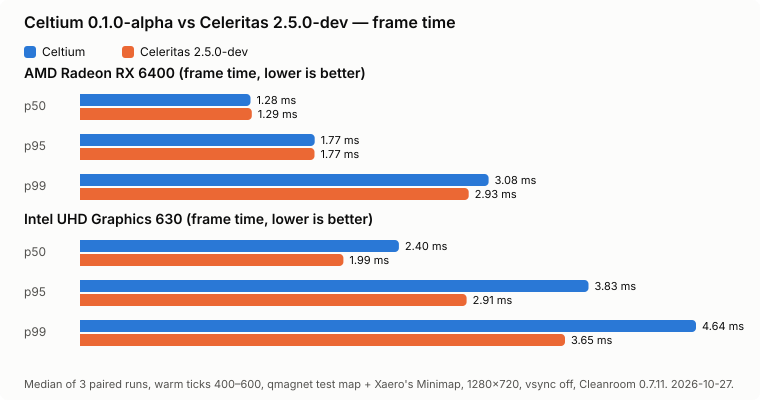

*Celtium was a historical proposed name for element 72, now known as hafnium. [Name origin](https://en.wiktionary.org/wiki/celtium).*

# Celtium

An experimental **native Vulkan renderer for Minecraft 1.12.2 on CleanroomMC**, built from Celeritas.

> **Experimental Vulkan-only renderer, not a finished performance mod.**
> Scoped terrain fixtures for E2E have passed on both test GPUs. That is not complete modpack compatibility or all-scene correctness. RLCraft 2.9.3 is out of scope: it does not start on Cleanroom even without Celtium.
>
> **native Vulkanで描画・提示する実装がありますが、描画・互換性・性能の受入は未完です。** 最新の判定と未解決項目は [現在表](<docs/plan.md>)だけで管理します。

Status reviewed: **2026-10-28** (release 0.1.0-alpha; AMD RX 6400 and Intel UHD Graphics 630 world legs and paired benchmarks).

**On `main`, not yet released:** stained glass, ice and slime no longer draw their back faces (the reported glass
flicker), lit models clamp their lighting like fixed-function GL, blocks mesh through Forge's block-model pipeline as in
upstream Celeritas, a world frame limit is honoured instead of the display refresh rate, and ~600 MB of unused vanilla
chunk buffers are no longer allocated when joining a world. Against Celeritas on the current main build (no Xaero):
AMD p50/p95/p99 0.62/0.62/0.81x; Intel 0.90/0.89/1.05x ([current table](<docs/plan.md>)).

<picture>
  <source media="(prefers-color-scheme: dark)" srcset="docs/img/benchmark-dark.svg">
  
</picture>

*Frame time against Celeritas 2.5.0-dev, lower is better. Conditions, ratios and verdicts: [Performance](#performance).*

## Current status

The mode documented here is the **Vulkan-only / GL-less mode**. It is on by default; no JVM argument is needed.
(`-Dceltium.vulkan.glless=false` turns it off for diagnosis only — the OpenGL path is not a supported renderer.)

It creates a window without an OpenGL context (`GLFW_NO_API`), renders into Vulkan-owned images, and presents the finished frame through a Vulkan swapchain. It does not depend on OpenGL drawing, GL readback, a GL/Vulkan bridge, GL swap or GL fallback.

Terrain, entities, items, particles, sky/clouds and GUI have native rendering paths. **Having a native path does not mean every scene or feature is correct.** Unsupported or incomplete paths can still produce missing or incorrect output.

Vulkan-only startup and presentation have been exercised on **AMD Radeon RX 6400 (RADV NAVI24) and Intel UHD Graphics 630 (CFL GT2) under Linux/Mesa**. Physical display scanout has not been measured.

See [the single current status table](<docs/plan.md>) for per-GPU verdicts, artifact scope and outstanding defects, and [the process re-audit](<docs/history/audit-2026-10-17-sol-review.md>) for corrected claims. In particular, the earlier blanket “resize/reload/minimize passed on both GPUs” claim was incorrect: a recorded Intel resize run failed Vulkan validation, and the named minimize run was AMD-only. Cloud input observations also did not establish complete image parity.

[User reports](<docs/reports/0.0.5-user-reported-defects.md>), [the performance design](<docs/performance_plan.md>) and [mod compatibility](<docs/mod-compatibility.md>) provide supporting detail, not independent current-state registers. [Historical records](<docs/history>) describe their particular builds, not latest-HEAD acceptance.

## Scope and compatibility

- **Minecraft 1.12.2 / CleanroomMC only.** Stock Forge with Java 8/LWJGL2 and other Forge + LWJGL3 replacement stacks are not supported.
- Ordinary gameplay/content mods are a compatibility goal. Minecraft/Forge public entry points, model data and event semantics are preserved where possible; compatibility is **not yet complete**.
- **Competing renderer replacements are not supported alongside Celtium.** Celtium replaces the renderer, so another renderer overhaul in the same instance is not a configuration this project tests. These mods are detected at startup and the game stops with a message naming them: **Custom Loading Screen, SmoothFont, Gnetum, Nothirium, Naughthirium** (each replaces a part Celtium draws natively: the loading screen, glyph drawing, the HUD, the terrain renderer). `-Dceltium.allowCompetitors=true` skips the check for diagnosis only. Ordinary optimization mods are different: the test instance runs the standard 1.12.2 performance stack as **coexistence targets** (see below), and the 268-mod E2E pack passes with StellarCore installed.
- **Lighting engine: use [Pulsar Lighting Engine](https://modrinth.com/mod/pulsar-lighting-engine), not Alfheim.** Alfheim is unsupported with Celtium: its client light pass re-marks the same chunk sections for rebuild every tick (measured in Enigmatica 2 Expert at ~80,000 marks a second over ~440 sections, fed back by LittleTiles), so distant terrain never settles. Celtium logs a warning at startup when Alfheim is installed.
- Celtium replaces Celeritas. **Install one, not both.** The internal mod ID and resource namespace remain `celeritas` for existing references.
- Shadows and shader packs are not part of Celtium itself: they are planned as a separate addon jar (a Demonica fork, AGPL-3.0), after the shaderless renderer and major gameplay mods work. Vanilla ShaderGroup, spectator effects and entity outlines remain part of the base renderer's scope.
- This is not a general OpenGL-to-Vulkan translator. Native passes follow Minecraft's terrain, model/item, entity/TESR, particle, UI, texture and framebuffer semantics.
- Mesh shaders are **not required or planned**. Optimizations must preserve a usable baseline on weaker GPUs.
- **GL-less is installed from the coremod transformer chain**, immediately before the window is created, so a mod that loads `org.lwjgl.opengl.Display` early cannot turn the run into a hybrid any more. This was a real failure until 2026-10-15: in the 268-mod pack RandomPatches defined `Display` at 8.975 s while the mixin list was still being built at 9.837 s, so the `GLFW_NO_API` hint was never applied and the window came up with a real OpenGL 4.6 context. The hint now comes from `CeltiumGllessWindowTransformer`. Read `CELTIUM_GLLESS` lines in the log to confirm which path a run took rather than assuming it.

The supported development direction is Vulkan-only. Old bridge/probe experiments and retained upstream OpenGL code are not a supported alternate renderer or a promise of custom OpenGL compatibility.

## Requirements and tested environment

| Component | Current requirement / verification |
| --- | --- |
| Minecraft | 1.12.2 |
| Loader | CleanroomMC **0.7.11-alpha** (SDL 3). Builds from 0.0.14 on detect the SDL 3 binding and **refuse to start on the 0.6.x GLFW generation** by name, instead of failing later in `GL.createCapabilities` — the window creation path and the `glfwIconifyWindow` fixture would both change |
| LWJGL | LWJGL3 **3.4.3** (the SDL 3 generation Cleanroom 0.7 ships). Vulkan bindings/native libraries must match the Cleanroom installation |
| Java | JDK 25 to build; the verified gameplay JVM is **Java 27** (Cleanroom 0.7.11 on the SDL 3 loader) |
| Celtium's own module bytecode | `--release 21`, class major 65 or lower; no Java 22+ API or preview dependency |
| Vulkan | 1.2+ loader and physical device, with the required graphics/presentation, format and resource capabilities |
| Verified GPUs / OS | RX 6400 and UHD 630 on Linux/Mesa |
| Other GPUs / OS | NVIDIA, other AMD/Intel models, Windows and macOS are unverified |

The exact minimum feature/format contract is still being audited and reduced. **Vulkan 1.2 support alone is not a compatibility guarantee.** Features are selected by device capabilities, not GPU name. Java 21 bytecode targeting does not constitute verification that the whole game launches on Java 21.

## Downloads

[**Celtium 0.1.0-alpha**](https://github.com/souta-lab/celtium/releases/tag/v0.1.0-alpha) (2026-10-27) is the newest published binary; see [its release notes](<docs/releases/0.1.0-alpha.md>). **0.0.14-alpha must not be used** (its indirect draw path discarded the item and colour families). Every release carries the limitations described above.

## Building and trying a development build

Run Gradle with JDK 25. The build also uses the JDK 21 compilation toolchain and the JDK 8 Minecraft preparation toolchain.

```sh
./gradlew -p build-1122 :forge122:packageJar
```

The packaged jar is written under a directory named after the version, which the build takes from `build-1122/build.gradle.kts` unless `-Pceltium_release_version` overrides it:

```text
build-1122/build/libs/0.1.0-alpha/celtium-forge-mc1.12.2-0.1.0-alpha.jar
```

Use a separate Cleanroom test instance and install the packaged Celtium jar (the plain `celtium-forge-mc1.12.2-<version>.jar`, not the `-dev` or `-reobf` one) instead of Celeritas; no JVM argument is required. Keep LWJGL/Vulkan bindings consistent with that instance. Development builds still carry the open defects listed above, so keep a working Celeritas setup to fall back to.

For reproducible validation and development, use [the current development procedure](<docs/development.md>) and the tracked [leg runner](<scripts/gv-leg.sh>). [AGENTS.md](<AGENTS.md>) contains working rules, [the objective](<docs/goal.md>) defines completion. The [verification skill](<.agents/skills/celtium-verify/SKILL.md>) is versioned with this checkout; it is not permission to start GPU work.

## Performance

Paired, interleaved runs against Celeritas 2.5.0-dev with the 0.1.0-alpha jar (`scripts/gv-kpi.sh`: same instance with
Xaero's Minimap, the qmagnet test map, warm world ticks [400, 600), 1280x720, vsync off, frame limit 260, periodic dumps
off; median of 3 pairs). Lower is better. The chart at the top is drawn from [the measured values](<docs/img/benchmark-0.1.0.json>)
by `scripts/bench_chart.py`.

| GPU | Celtium / Celeritas (p50, median of 3 pairs) | Verdict |
| --- | --- | --- |
| AMD RX 6400 | **0.992x** - parity; p95 equal, p99 3.08 vs 2.93 ms | no formal verdict (pairs not all one direction) |
| Intel UHD 630 | 1.205x - slower in all 3 pairs | no formal verdict in this run; the same build measured **SLOWER** (1.200x) with the load gate passed |

Moving through the world is where 0.1.0 changed most: the terrain occlusion search now runs on its own thread, which
took a flight replay's median frame from 1.03-1.34 ms to 0.74-0.89 ms on the AMD card. Intel is GPU-bound in this scene
and still behind; closing that gap is the current work in [the current table](<docs/plan.md>).

## License and attribution

Celtium retains Celeritas' **LGPL-3.0** licensing and upstream history. See [COPYING](COPYING), [COPYING.LESSER](COPYING.LESSER), and [the preserved upstream README and credits](docs/upstream-README.md). Third-party notices remain in the source tree and distribution.

The fixed source reference is [GTNewHorizons/Celeritas at `989ebf2e52ceed052ec112a569e0c1d172095756`](https://github.com/GTNewHorizons/Celeritas/tree/989ebf2e52ceed052ec112a569e0c1d172095756); Celeritas' upstream is [embeddedt/celeritas](https://git.taumc.org/embeddedt/celeritas).

## External optimization references

Optimizations are also derived from — or cross-checked against — the following projects. The design is re-implemented against this renderer's GL-less contract rather than copied; **every derived change names its source in the commit message, a code comment at the implementation site, and the pull request description**:

| Project | License | Used/referenced for |
| --- | --- | --- |
| [GTNewHorizons/Angelica](https://github.com/GTNewHorizons/Angelica) | LGPL-3.0 (plus its own notices for code adapted from Sodium/Iris, FalseTweaks, Beddium, Mesa) | item mesh cache (PR #21, after [PR #1034](https://github.com/GTNewHorizons/Angelica/pull/1034)); dropped-item render distance (PR #23, after [PR #653](https://github.com/GTNewHorizons/Angelica/commit/6cf119dfee1a2e6cc869a1f138513d659793d542)); candidates: upload arena, TESR mesh keys, instancing |
| [RaphiMC/ImmediatelyFast](https://github.com/RaphiMC/ImmediatelyFast) | LGPL-3.0 | concept reference: sign/TESR text buffering, framebuffer-switch reduction, immediate-mode batching |
| [FalsePattern/FalseTweaks](https://github.com/FalsePattern/FalseTweaks) | LGPL-3.0 core — **mixed**: occlusion module is CoFHTweaks-derived and NOT LGPL; packing2d MIT-based; triangulator sorting LGPL-2.1+ | concept reference: multithreaded mipmap generation, texture stitching, animated-texture optimization. The occlusion module is not used |
| [makamys/Neodymium](https://github.com/makamys/Neodymium) | LGPL-3.0 | concept reference: bounded mesh/VBO reuse, tessellator-state capture |
| [GTNewHorizons/Hodgepodge](https://github.com/GTNewHorizons/Hodgepodge) | LGPL-3.0 | concept reference: renderer memoization, leak fixes |
| [embeddedt/ArchaicFix](https://github.com/embeddedt/ArchaicFix) | LGPL-3.0 — **occlusion module excluded** (not LGPL) | concept reference: cache lifetime, world-change freeing |
| [xCollateral/VulkanMod](https://github.com/xCollateral/VulkanMod) | LGPL-3.0 | closest architecture analogue (Vulkan replaces GL, modern versions): combined render-layer draws (~80% fewer draw calls), upload buffer reuse instead of per-frame buffer recreation, redundant color-clear skipping |
| [embeddedt/ModernFix](https://github.com/embeddedt/ModernFix) | LGPL-3.0 (config derived from Sodium under LGPL-3.0) | concept reference: dynamic/lazy model loading, faster startup, memory reduction |
| [malte0811/FerriteCore](https://github.com/malte0811/FerriteCore) | MIT | concept reference: dedup blockstate property maps, multipart model instances (~200k→1.5k), cached shape internals |
| [MoePus/Flerovium](https://github.com/MoePus/Flerovium) | LGPL-3.0 | modern (1.21): item render backface culling / fast math / LOD, particle light caching, entity fast math |
| [ded811/Meshelium](https://github.com/ded811/Meshelium) | LGPL-3.0 (verified through the GitHub license API, 2026-10-25) | **preferred GPU-driven terrain reference** (over Nvidium): mesh-shader terrain on Vulkan through the cross-vendor `VK_EXT_mesh_shader`, drawing chunks that Sodium builds; GPU-side visibility and occlusion culling, distance culling of sub-pixel detail, capability detection from the driver with a clean opt-out when the feature is missing. The RX 6400 (RDNA 2) exposes mesh shaders, the UHD 630 does not, so any such path stays optional over the indirect-draw baseline |
| [MCRcortex/nvidium](https://github.com/MCRcortex/nvidium) | LGPL-3.0 (verified through the GitHub license API, 2026-10-19) | superseded by Meshelium as the mesh-shader reference (NVIDIA-only, GL). Kept for the "one draw per pipeline" shape: indirect draws built on the GPU. Its mesh-shader path is NVIDIA-only and is not portable, but the draw-merge argument is the one this renderer needs: combined draws are how the immediate path's ~920 ITEM batches a frame stop costing a driver call each |
| [IrisShaders/Iris](https://github.com/IrisShaders/Iris) | LGPL-3.0 (verified through the GitHub license API, 2026-10-19) | shaderpack pipeline: program parsing, uniform/framebuffer plumbing, shadow-map stages. Relevant to the shaderpack and native shadow-map items; the design is re-implemented against this renderer's Vulkan pipeline model |

## Coexisting optimization mods (not porting sources)

The test instance runs the standard 1.12.2 performance stack — these are **coexistence targets**, not reference material: porting their features into Celtium would either duplicate what they already do on the instance or conflict with them.

- [embeddedt/VintageFix](https://github.com/embeddedt/VintageFix) (LGPL-3.0) — the 1.12.2 superset: lazy model loading, blockstate/model dedup, texture memory release
- [LoliKingdom/CensoredASM (LolASM)](https://github.com/LoliKingdom/LoliASM) (LGPL-3.0) — string dedup, faster init; itself a superset of the other 1.12.2 texture/resource fixes
- Reference list: [TheUsefulLists/usefulmods — Performance 1.12.x](https://github.com/TheUsefulLists/usefulmods/blob/main/Performance/Performance112.md)

1.12.2-native mods are therefore **not** part of the reference pool: the usable sources are 1.7.10 (GTNH: Angelica, FalseTweaks, Neodymium, ArchaicFix, Hodgepodge) and modern Minecraft (VulkanMod, ModernFix, FerriteCore, ImmediatelyFast, Flerovium).

- **Item mesh cache** (`RenderItemMixin`, PR #21) — after [Angelica PR #1034, "Optimize in-world item rendering"](https://github.com/GTNewHorizons/Angelica/pull/1034) (VBO caching of held/dropped/GUI item geometry, ~4–6x on item-heavy scenes).

The inventoried candidates per project are kept in [docs/performance_plan.md](docs/performance_plan.md). Porting a listed item means: check the file/module license first (FalseTweaks and ArchaicFix contain non-LGPL islands), re-implement — do not copy code —, then credit in commit, code comment and PR.

**GPL and LGPL sources are used within their terms**, which for a GPL project means design reference only: adapting GPL code into this LGPL-3.0 renderer would relicense the combined work, so a GPL project is read for its technique and re-implemented here, with the source named in the commit, the code comment and the PR. LGPL-3.0 sources may be adapted, and where code is adapted rather than re-implemented the file keeps its notice and the adaption is named the same way.

Current Sodium source under its newer restrictive license (and any other source-available-but-not-free project) is not imported, not adapted, and not copied: published descriptions of its techniques are read the way a paper is read, and the resulting design is this renderer's own. **Provenance is never concealed** - every derived change names its source, because a change that has to hide where it came from is not one this project can ship. Independent optimization work and permitted source reuse must retain their provenance and applicable notices.
