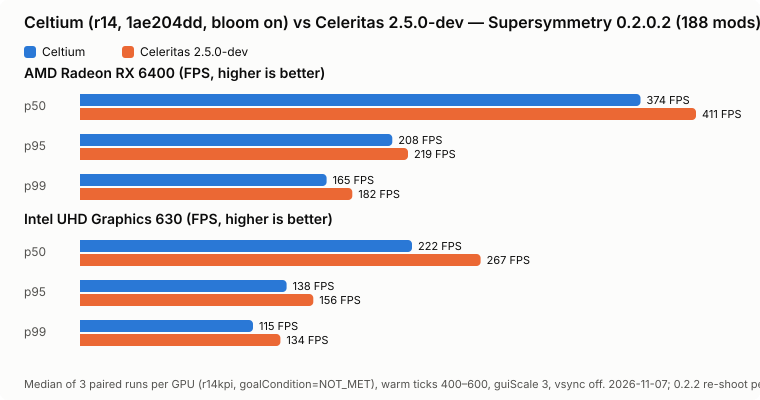
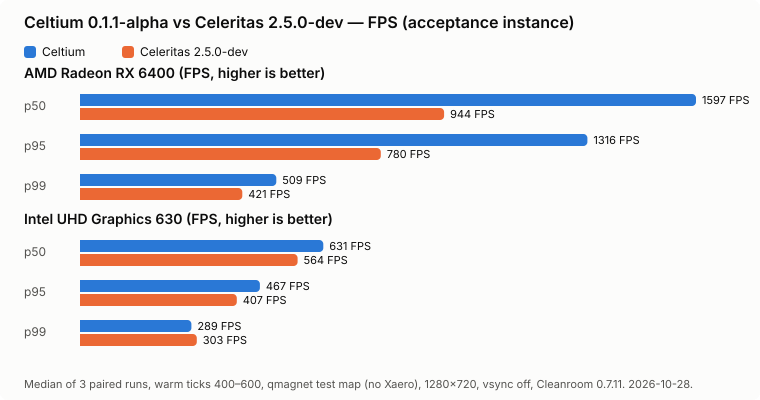

<p align="center">
  <picture>
    <source media="(prefers-color-scheme: dark)" srcset="docs/img/logo-dark.svg">
    
  </picture>
</p>

<h1 align="center">Celtium</h1>

<p align="center"><b>🌋 A native Vulkan renderer for Minecraft 1.12.2 on CleanroomMC, built from Celeritas.</b></p>

<p align="center">
  <a href="https://github.com/souta-lab/celtium/releases"></a>
  <a href="#-requirements"></a>
  <a href="#-requirements"></a>
  <a href="#-requirements"></a>
  <a href="#-requirements"></a>
</p>
<p align="center">
  <a href="#-performance"></a>
  <a href="#-requirements"></a>
  <a href="#-known-issues"></a>
  <a href="#-license-and-attribution"></a>
</p>

<p align="center"><sub><i>Celtium was a historical proposed name for element 72, now known as hafnium.
<a href="https://en.wiktionary.org/wiki/celtium">Name origin</a>.</i></sub></p>

## 📑 Contents

- [✨ Highlights](#-highlights)
- [🚀 Performance](#-performance) — [📊 modpack FPS](#-modpack-fps-supersymmetry-0202-188-mods--r14) · [⏳ historical](#-historical-011-alpha-on-the-small-acceptance-instance)
- [🧩 Modpack compatibility](#-modpack-compatibility)
- [📋 Requirements](#-requirements) · [📦 Install](#-install) · [🎯 Scope](#-scope) · [🚧 Known issues](#-known-issues)
- [🔧 Building and testing](#-building-and-testing) · [📚 Documentation](#-documentation)
- [📜 License and attribution](#-license-and-attribution) · [🔗 External optimization references](#-external-optimization-references)

Celtium creates the game window **without an OpenGL context**. Terrain, entities, items, particles, sky, clouds and
the GUI are drawn into Vulkan-owned images and presented through a Vulkan swapchain. It is a renderer replacement, not
an OpenGL-to-Vulkan translator: its native passes follow Minecraft's own terrain, model/item, entity/TESR, particle,
UI, texture and framebuffer semantics, and mods that call GL directly are served by a GL-less compatibility layer.

## ✨ Highlights

- **Measured honestly against Celeritas in a real modpack.** In Supersymmetry 0.2.0.2 (188 mods), enabling mod shader
  programs by default (r14, `1ae204dd`) draws GTCEu's 15-pass bloom chain natively with `goalCondition=NOT_MET`
  (−9.0% FPS on AMD RX 6400 and −16.9% FPS on Intel UHD 630 at p50, pair median; [numbers](#-performance)); round 15
  (`0.2.2`) timing re-measurement is pending.
- **Runs well-known packs.** SkyFactory 4, All the Mods 3, RLCraft, SevTech: Ages, Project Ozone 3 and Nomifactory CEu
  (r126, pre-r14 picture re-shoot pending) are **verified** with zero Vulkan validation errors, full log review and
  same-pose Celeritas picture comparison on AMD and Intel; Supersymmetry and E2E-E (≈430 mods) reach the world with
  zero validation errors (**partial**, full log/picture review pending) ([what verified means](docs/modpacks.md))
  ([compatibility](#-modpack-compatibility)).
- **No OpenGL context at all.** Window, swapchain, textures, framebuffers and post effects are Vulkan objects; the
  GL-less layer covers display lists, immediate mode, VBOs, FBOs, shader getters and legacy state for mods.
- **Measured, not claimed.** Every number in this README comes from a recorded run with its build, GPU, scene and
  pair count; validation-on legs back every correctness statement ([evidence](docs/evidence)).

## 🚀 Performance

All numbers are **FPS (higher is better)**: the median over paired runs of the frames in a fixed warm window
(world ticks 400–600). p50 is the typical frame; p95/p99 are the slowest 5% / 1% of frames, i.e. stutter.
Celtium and the reference alternate pair by pair on the same machine, so drift cancels out.

### 📊 Modpack FPS: Supersymmetry 0.2.0.2 (188 mods) — r14

<picture>
  <source media="(prefers-color-scheme: dark)" srcset="docs/img/modpack-supersymmetry-dark.svg">
  
</picture>

| GPU | | Celtium | Celeritas 2.5.0-dev | Celtium vs Celeritas (pair median) |
| --- | --- | --- | --- | --- |
| AMD Radeon RX 6400 | p50 | 374 FPS | **411 FPS** | −9.0% |
| | p95 | 208 FPS | **219 FPS** | −5.3% |
| | p99 | 165 FPS | **182 FPS** | −10.2% |
| Intel UHD Graphics 630 | p50 | 222 FPS | **267 FPS** | −16.9% |
| | p95 | 138 FPS | **156 FPS** | −7.7% |
| | p99 | 115 FPS | **134 FPS** | −7.4% |

**Setup and verdict (`goalCondition=NOT_MET`):** Supersymmetry 0.2.0.2 (GregTech CEu based, 188 mods) on a Cleanroom
Relauncher instance, KPI world scene (`qmagnet`, GUI scale 3, vsync off, validation off). Build r14 (`1ae204dd`) vs
Celeritas 2.5.0-dev (`567dcf8a`), fixture `f15ba461`, 3 pairs × 240 s per GPU (runs `r14kpi-amd` / `r14kpi-intel`,
2026-11-07). The table shows the median rep's FPS (`1000 / ms`) per arm, and the last column is the FPS change
derived from the median of the per-pair ratios, so it can differ from the ratio of the two medians. Earlier `r107` /
`r13` runs showed higher FPS only because `modPrograms` defaulted to off and skipped GTCEu's 15-pass bloom chain, which
[docs/goal.md](<docs/goal.md>) excludes as dropped rendering. Round 15 (`0.2.2`, window-poll skip and chain-pair depth
discard) has not yet been re-measured in a paired KPI run on an idle machine (pending).
Evidence: [docs/evidence/mod-program-default-2026-11-07.md](<docs/evidence/mod-program-default-2026-11-07.md>),
[docs/evidence/window-poll-and-chain-depth-2026-11-07.md](<docs/evidence/window-poll-and-chain-depth-2026-11-07.md>).

### ⏳ Historical: 0.1.1-alpha on the small acceptance instance

<picture>
  <source media="(prefers-color-scheme: dark)" srcset="docs/img/benchmark-dark.svg">
  
</picture>

| GPU | p50 | p95 | p99 |
| --- | --- | --- | --- |
| AMD Radeon RX 6400 | **1597** vs 944 FPS | **1316** vs 780 FPS | **509** vs 421 FPS |
| Intel UHD Graphics 630 | **631** vs 564 FPS | **467** vs 407 FPS | 289 vs 303 FPS |

Celtium vs Celeritas 2.5.0-dev, 3 pairs, 2026-10-28. This instance is **not a modpack**: a few mods plus
Fugue/Scalar on Cleanroom 0.7.11, QMAGNET's Test Map. It shows the renderer's own cost with little mod load, and is
not comparable with the Supersymmetry numbers above.

## 🧩 Modpack compatibility

"Verified" in [docs/modpacks.md](<docs/modpacks.md>) means all three on AMD RX 6400 and Intel UHD 630: (1) zero Vulkan
validation messages, (2) `latest.log` and `debug.log` read in full, and (3) world picture compared against Celeritas
2.5.0-dev at the same pose and seed.

| Modpack | Mods | Result | Run |
| --- | --- | --- | --- |
| Supersymmetry 0.2.0.2 | 188 | **partial** — world reached, validation 0 on AMD and Intel; calibrated picture gate PASSED (`wl1-amd`/`wl1-intel`); full log review pending | `l27kpi-*`, `r14kpi-*` |
| Enigmatica 2: Expert - Extended 1.87.3 | ≈430 | **partial** — world reached, validation 0 on AMD and Intel, also with Xaero's raw-FBO identity; picture gate PASSED (`fx1`); full log review and same-pose Celeritas picture pending | `fx1-e2ee-amd`, `fx1-e2ee-intel`, `xr1-e2ee-xaero-amd` |
| SkyFactory 4 4.2.4 | 198 | **verified** — world reached, validation 0, full log review and same-pose Celeritas picture on AMD (0.68 / 0.03%) and Intel (0.86 / 0.07%) | `w-sf4-amd`, `w-sf4-intel`, `w-sf4-ref` |
| All the Mods 3 6.1.1 | 250 | **verified** — world reached, validation 0, full log review and same-pose Celeritas picture on AMD (7.39 / 6.61%) and Intel (7.45 / 6.61%); upper-sky band residual (defect 10) tracked | `r125-atm3-amd`, `r126-atm3-intel`, `r125-atm3-ref` |
| RLCraft 2.9.3 | 165 | **verified** — world reached, validation 0, full log review and same-pose Celeritas picture on AMD (7.04 / 6.39%, `r129-rl-amd` 6.76 / 5.87%) and Intel (6.95 / 6.02%); Bloodmoon removed (Cleanroom 0.7.14 incompatible); AMD fixture reports `FAILED_PRESENTED_IMAGE` from defect 6 (presented counter; picture present, validation 0) | `w-rlcraft-amd`, `w-rlcraft-intel`, `w-rlcraft-ref`, `r129-rl-amd` |
| SevTech: Ages 3.2.3 | 247 | **verified** — world reached, validation 0, full log review and same-pose Celeritas picture on AMD (1.22 / 0.41%) and Intel (1.22 / 0.40%) | `w-sevtech-amd`, `w-sevtech-intel`, `w-sevtech-ref` |
| Project Ozone 3 3.4.11F | 262 | **verified** — world reached, validation 0, full log review and same-pose Celeritas picture on AMD (5.46 / 1.04%) and Intel (5.17 / 1.19%) | `w-po3-amd`, `w-po3-intel`, `w-po3-ref` |
| Nomifactory CEu 1.7.7 | 149 | **verified (pre-r14)** — world reached, validation 0, full log review and same-pose Celeritas picture at r126 on AMD (3.28 / 0.06%) and Intel (3.30 / 0.07%); **picture re-shoot pending** after r14 enabled mod shader programs by default | `w-nomi-amd`, `w-nomi-intel`, `w-nomi-ref` |
| Enigmatica 2: Expert 1.93a | 270 | world reached on both GPUs (2026-11-05; superseded by E2E-E) | [evidence](<docs/evidence/e2e-cleanroom07-2026-10-26.md>) |

E2E-E needs three pack-side substitutions for Cleanroom 0.7.14 (Fugue 0.25.5, CodeChickenLib 3.3.10, Trinity
without its ICBM hook); none of them is a Celtium change. The full list of packs run, with versions, builds, runs and
substitutions, is [docs/modpacks.md](<docs/modpacks.md>). Mod-level lists: [verifiedmods.md](verifiedmods.md) and
[notworkingmods.md](notworkingmods.md).

## 📋 Requirements

| Component | Requirement / what is verified |
| --- | --- |
| Minecraft | 1.12.2 |
| Loader | CleanroomMC **0.7.12-alpha** or later in the 0.7 line (SDL 3); 0.7.14 verified with E2E-E. The 0.6.x GLFW generation is refused by name. |
| LWJGL | LWJGL3 **3.4.3** (shipped by Cleanroom 0.7). Celtium bundles the matching `lwjgl-vulkan` bindings. |
| Java | Game JVM **Java 25+** (Java 27 verified); **JDK 25** to build. |
| Vulkan | 1.2+ loader and device with the required graphics/presentation, format and resource capabilities. |
| Verified GPUs / OS | AMD Radeon RX 6400 (RADV) and Intel UHD Graphics 630 (ANV) on Linux/Mesa. |
| Unverified | NVIDIA, other AMD/Intel models, Windows, macOS. |

Vulkan 1.2 alone is not a compatibility guarantee: features are chosen by device capability, not by GPU name.

## 📦 Install

1. Prepare a Cleanroom Relauncher instance (Cleanroom 0.7.12-alpha or later, LWJGL 3.4.3, Java 25+).
2. Put `celtium-forge-mc1.12.2-0.2.2.jar` into `mods/`. Use the plain jar, not `-dev` or `-reobf`.
3. Remove Celeritas: **install one renderer, not both** (the internal mod ID and resource namespace stay `celeritas`).
4. Use [Pulsar Lighting Engine](https://modrinth.com/mod/pulsar-lighting-engine), not Alfheim (unsupported).
5. Start the game, enter a world, and check the GUI, menus, creative tabs and tooltips.

Download: [Celtium 0.2.2](https://github.com/souta-lab/celtium/releases/tag/v0.2.2).
The r14 performance numbers above predate round 15 (`0.2.2`); post-`0.2.2` paired KPI re-measurement on current `main`
is pending.

## 🎯 Scope

- **Minecraft 1.12.2 on CleanroomMC only.** Stock Forge (Java 8/LWJGL2) and other LWJGL3 stacks are not supported.
- **One renderer at a time.** Competing renderer replacements are refused at startup rather than half-working.
- **Shadows and shader packs** are a separate addon (a Demonica fork, AGPL-3.0), not part of Celtium. Vanilla
  ShaderGroup, spectator effects and entity outlines are part of the base renderer.
- **GL-less is installed from the coremod transformer chain**, just before the window is created, and is applied only to
  mods that call GL directly.

## 🚧 Known issues

- **Performance goal not yet met (`goalCondition=NOT_MET` in r14)**: with mod shader programs enabled by default,
  GTCEu's 15-pass bloom chain adds per-window overhead (~15 windows/frame), leaving p50/p95/p99 behind Celeritas on
  both GPUs; a paired KPI re-measurement for `0.2.2` / current `main` is pending.
- **Open rendering and fixture defects**: ATM3 upper-sky band (defect 10, Astral Sorcery skybox), GTCEu bloom halo
  (bloom-layer terrain geometry is usually not built), menu-boundary batch drops (defect 5), and RLCraft AMD fixture
  presented-frame counting (defect 6).
- **Not implemented**: cube maps, 3D textures, MSAA, compute, blit, copyImage, parts of DSA, and stencil (ModularUI's
  `Stencil#reset` uses mask `0x400`).
- **Xaero's Minimap radar entity icons** are not confirmed to draw.
- Menu, tooltip and creative-tab fixes are confirmed by scenes and still need a check in the tester's environment.

### If a patch group is quarantined

Celtium applies its mixin patches in named groups. If a patch in a switchable group fails to apply, that launch
still fails — but the failure is recorded in `config/celtium-patches.cfg`, and from the next launch the whole
group is skipped by name (the log line `CELTIUM_PATCH_SKIPPED` names the group and the remedy), so the game
reaches the menu without that group instead of failing at the same patch every time.

- **Retry a quarantined group** (for example after updating a mod it clashed with): delete its
  `quarantine.<group>` line from `config/celtium-patches.cfg`. Nothing clears a quarantine automatically.
- **Switch a group off deliberately**: add `off.<group>=true` to the same file, or pass
  `-Dceltium.patch.<group>=off` for one launch. The switchable groups are `tweaks`, `shaders`, `sky`,
  `particles`, `text` and `model_phase_instrument`; what each group costs when off is printed in the
  `CELTIUM_PATCH_TABLE` log line at startup.
- Four groups — renderer core (`mechanism`), terrain geometry, entities and textures — are essential: they
  cannot be switched off or quarantined, and a failure there stays fatal (`CELTIUM_PATCH_ESSENTIAL`).

## 🔧 Building and testing

Build with JDK 25 (the build also uses the JDK 21 compilation toolchain and the JDK 8 Minecraft toolchain):

```sh
JAVA_HOME=/usr/lib/jvm/java-25-openjdk-amd64 scripts/build.sh
```

The jar is written to `build-1122/build/libs/<version>/celtium-forge-mc1.12.2-<version>.jar`.

CPU checks (no GPU needed):

```sh
python3 -m unittest discover -s scripts/tests -p 'test_*.py'
scripts/cpu-contract/transformer-route-verify.sh
python3 scripts/check_agent_docs.py
python3 scripts/instrument-index.py --check
```

GPU runs, validation and the paired KPI: [docs/development.md](<docs/development.md>) and the
[leg runner](<scripts/gv-leg.sh>). Charts are generated from JSON by [scripts/bench_chart.py](scripts/bench_chart.py);
README rules: [docs/readme-rules.md](<docs/readme-rules.md>). Working agreements: [AGENTS.md](AGENTS.md).

## 📚 Documentation

- Current status and priorities: [docs/plan.md](<docs/plan.md>)
- Measurements and scene evidence: [docs/evidence](<docs/evidence>)
- Release notes: [0.2.2 (English)](<docs/releases/0.2.2-en.md>) · [0.2.2 (Japanese)](<docs/releases/0.2.2.md>) (earlier notes in `docs/releases/`)

## 📜 License and attribution

Celtium retains Celeritas' **LGPL-3.0** licensing and upstream history. See [COPYING](COPYING),
[COPYING.LESSER](COPYING.LESSER), and [the preserved upstream README and credits](docs/upstream-README.md).

The fixed source reference is
[GTNewHorizons/Celeritas at `989ebf2e52ceed052ec112a569e0c1d172095756`](https://github.com/GTNewHorizons/Celeritas/tree/989ebf2e52ceed052ec112a569e0c1d172095756).

The 0.3.0 release also incorporates knowledge derived from
[VLOD-ZDOV/VulkanMod-Next](https://github.com/VLOD-ZDOV/VulkanMod-Next) (LGPL-3.0), the successor to VulkanMod;
code taken from it is credited in code comments.

## 🔗 External optimization references

Optimizations are also derived from — or cross-checked against — the following projects. The design is re-implemented
against this renderer's GL-less contract rather than copied; **every derived change is checked against the source
license first.**

| Project | License | Used/referenced for |
| --- | --- | --- |
| [GTNewHorizons/Angelica](https://github.com/GTNewHorizons/Angelica) | LGPL-3.0 (plus its own notices for code adapted from Sodium/Iris, FalseTweaks, Beddium, Mesa) | item mesh cache (PR #21) |
| [RaphiMC/ImmediatelyFast](https://github.com/RaphiMC/ImmediatelyFast) | LGPL-3.0 | concept reference: sign/TESR text buffering, framebuffer-switch reduction, immediate-mode batching |
| [FalsePattern/FalseTweaks](https://github.com/FalsePattern/FalseTweaks) | LGPL-3.0 core — **mixed**: occlusion module is CoFHTweaks-derived and NOT LGPL; packing2d MIT-based | concept reference: packing, triangulator sorting |
| [makamys/Neodymium](https://github.com/makamys/Neodymium) | LGPL-3.0 | concept reference: bounded mesh/VBO reuse, tessellator-state capture |
| [GTNewHorizons/Hodgepodge](https://github.com/GTNewHorizons/Hodgepodge) | LGPL-3.0 | concept reference: renderer memoization, leak fixes |
| [embeddedt/ArchaicFix](https://github.com/embeddedt/ArchaicFix) | LGPL-3.0 — **occlusion module excluded** (not LGPL) | concept reference: cache lifetime, world-change freeing |
| [xCollateral/VulkanMod](https://github.com/xCollateral/VulkanMod) | LGPL-3.0 | closest architecture analogue (Vulkan replaces GL) |
| [VLOD-ZDOV/VulkanMod-Next](https://github.com/VLOD-ZDOV/VulkanMod-Next) | LGPL-3.0 | VulkanMod successor; optimization knowledge referenced in the 0.3.0 release |
| [embeddedt/ModernFix](https://github.com/embeddedt/ModernFix) | LGPL-3.0 | concept reference: dynamic/lazy model loading, faster startup, memory reduction |
| [malte0811/FerriteCore](https://github.com/malte0811/FerriteCore) | MIT | concept reference: dedup blockstate property maps, multipart model instances |
| [MoePus/Flerovium](https://github.com/MoePus/Flerovium) | LGPL-3.0 | modern (1.21): item render backface culling / fast math / LOD |
| [ded811/Meshelium](https://github.com/ded811/Meshelium) | LGPL-3.0 | preferred GPU-driven terrain reference |
| [MCRcortex/nvidium](https://github.com/MCRcortex/nvidium) | LGPL-3.0 | superseded by Meshelium as the mesh-shader reference |
| [IrisShaders/Iris](https://github.com/IrisShaders/Iris) | LGPL-3.0 | shaderpack pipeline reference |

## 🤝 Coexisting optimization mods (not porting sources)

The test instance runs the standard 1.12.2 performance stack — these are **coexistence targets**, not reference
material:

- [embeddedt/VintageFix](https://github.com/embeddedt/VintageFix) (LGPL-3.0)
- [LoliKingdom/CensoredASM (LolASM)](https://github.com/LoliKingdom/CensoredASM) (LGPL-3.0)
- Reference list: [TheUsefulLists/usefulmods — Performance 1.12.x](https://github.com/TheUsefulLists/usefulmods/blob/main/Performance/Performance112.md)

1.12.2-native mods are therefore **not** part of the reference pool: the usable sources are 1.7.10 (GTNH: Angelica,
FalseTweaks, Neodymium, ArchaicFix, Hodgepodge) and modern Minecraft (VulkanMod, ModernFix, Flerovium, Meshelium,
nvidium, Iris).

ライセンスには細心の注意を払って作っています。GPLやLGPL以外のソースを取り込むことはありません。
