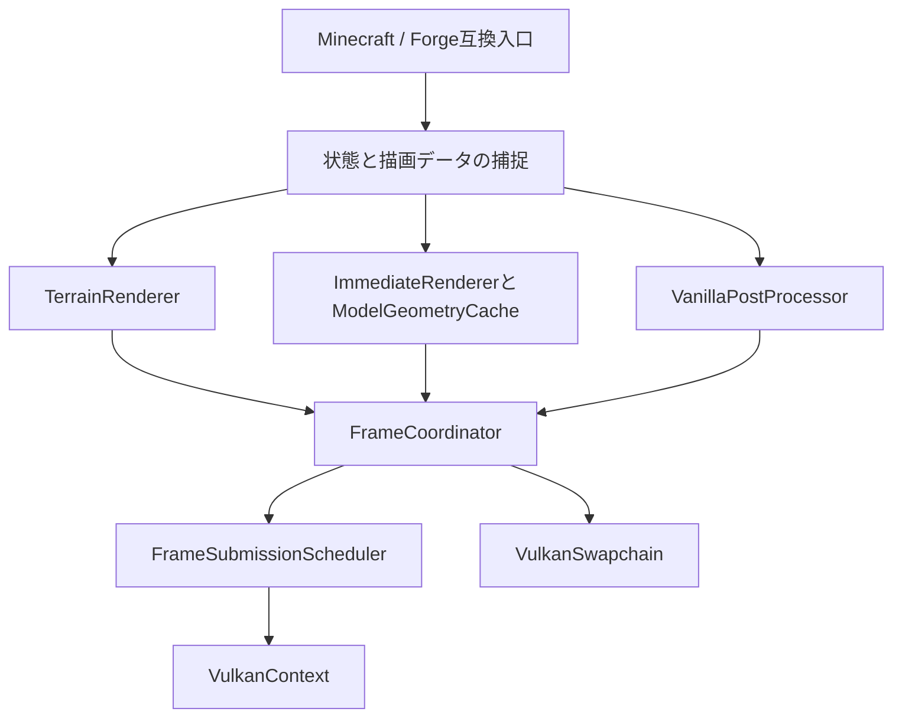
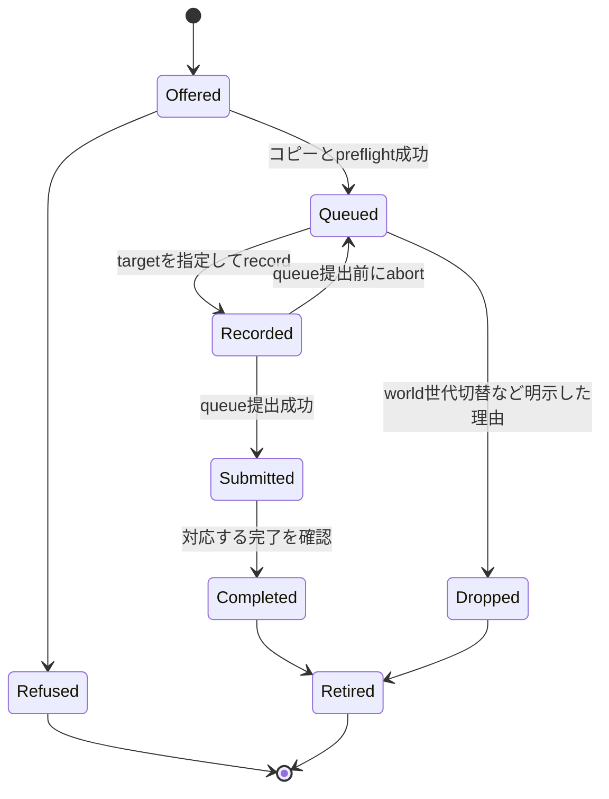

# Celtium refactoring plan

**巨大backendを、Minecraftの描画単位と資源所有に沿って段階的に分ける。既に成立したGL-less描画、CeleritasのCPUエンジン、直近の非同期提出とGUI batch統合を維持し、各領域を別々に改良できる構造にする。**

作成日: 2026-10-12 JST。これは既存コードを読んだ設計・移行計画であり、分割実装や新しいGPU受入の完了報告ではない。

現在の機能受入と優先順は [docs/plan.md](docs/plan.md)、objectiveは [docs/goal.md](docs/goal.md)、性能改善は [docs/performance_plan.md](docs/performance_plan.md) が管理する。本書はその構造面の実行方法を定める。受入済み／未検証の一覧をもう一つ作らず、実装が着地した時点で `docs/plan.md` の該当行を更新する。

## 1. 読取点と進行中の変更

ユーザーの提示文は `08ccae1` を基準にしていた。本書ではその後のコードを確認した。

| 読取 | 固定点 | 用途 |
| --- | --- | --- |
| 主要Javaソースの読取コピー | `0a8b8d25307bf62d93dc8629eaae76319b4c6ee5`。採取時のdirtyは `VulkanTextureRegistry.java` | backendの責務・呼び出し・所有関係の分析 |
| 追加読取 | `46854aa951c768756e6f29868f6cb3bf9f43a30c`、2026-10-12 14:56 JST | 進行中の `TextureCopyService` 抽出と最新計画の確認 |
| 追加読取時のdirty | `VulkanTerrainGpuBackend.java`、`MinecraftMixin.java`、未追跡 `TextureCopyService.java` | 完成済みコードと混同しない作業中差分 |
| 保存前の追加確認 | `7d48f0741a32bc16577fb7e6032bd16a84709558`、作業ツリーclean | PR #3/#4/#5の統合差分、warm計測、frame semaphore削減、texture write serialを確認 |
| Celeritas比較基準 | `989ebf2e52ceed052ec112a569e0c1d172095756` | 残すCPUエンジンと追加境界の確認 |

初回コピーの `VulkanTerrainGpuBackend.java` は **14,052行**、追加読取のdirtyでは **13,815行**。後者には作業中の抽出が入っているので、行数の減少を受入済みリファクタとして数えない。

保存前の `7d48f0741` では **14,106行**で、三つの抽出先classはまだmainに存在しない。14:56のdirty案と、その後のperformance統合済みmainは別の読取点である。以下の移行は統合後のmainへ適用し、古いdirty差分をそのまま戻さない。

初回backendのSHA-256は `e06dfa5d91e7a16101b3144644fd5a27ed2d9c2690f1759b32f4600bf6089848`。読取コピーとmanifestは開発機の `.celtium-work/refactoring-plan-20261012/` に保存した。以下のbackend行番号は、特記しない限りこの初回コピーを指す。実装時は**名前で再検索し、最新HEADとdirtyを再確認する**。

### 1.1 差分の再計数

固定Celeritasと `0a8b8d253` のtracked Javaを同じパスで比較した。テストを含み、dirtyと生成物は含まない。

| モジュール | 新規 | 変更 | 同一 | 削除 |
| --- | ---: | ---: | ---: | ---: |
| `common/` | 7 | 11 | 313 | 0 |
| `forge122/` | 32 | 9 | 59 | 1 |
| `celtium-vulkan/` | 59 | 0 | 0 | 0 |

削除されたForge側Javaは `CeleritasLwjgl3ifyCompat.java`。nativeモジュールの59ファイルには7テストが含まれる。既存のCPU側を大きく残し、描画入口とGPU実装を追加した構造という判断は現在も成立する。

### 1.2 既に始まっている抽出を使う

`docs/plan.md` §0.367には次の直列作業がある。これを別の新クラスでやり直さない。

| 作業 | 読取時点の状態 | 本書での扱い |
| --- | --- | --- |
| task-63: `TextureCopyService` | 563行の未追跡ファイルとbackendのdelegateがdirtyに存在。未受入 | 先に整合・受入・commitする。コピーの状態所有者として継続利用 |
| task-64: `PublishedFrameTextures` | task-63待ち、調査段階 | 画像の公開名・世代・aliasの管理を抽出する最初の単位 |
| task-65: `BackendReport` | 準備文書と `verify_line_check.py` がcommit済み、task-64待ち | 書式互換を保つ抽出。これだけで診断の所有分離が完成したとはしない |

関連準備: [task-65の調査](docs/history/2026-10-12-task65-prep.md)。表は14:56の調査状況であり、保存前mainの着地判定ではない。本書の作成で担当、task依存、稼働中のgoalを変更しない。

## 2. 現在の集中はどこにあるか

低水準のpipeline、mesh、texture、targetは別クラスに存在する。しかし、選択・順序・失敗復旧・寿命を結び付ける判断がbackendに集まっている。

下表の `VK/` は `celtium-vulkan/src/main/java/org/soutalab/celtium/vulkan/`、`COMMON/` は `common/src/main/java/org/embeddedt/embeddium/impl/render/chunk/backend/`、`FORGE/` は `forge122/src/main/java/org/taumc/celeritas/` を指す。

| 責務 | 現行の読取入口・所有物 | 分割で解く問題 |
| --- | --- | --- |
| windowとworldの寿命 | backend `createForWindow`、`celtium$adoptTerrainState`、`delete`、`celtium$releaseWorldResources` | terrainのdetachとrenderer全体のshutdownを同じ `delete()` に載せている |
| terrain | `render`、`uploadMeshes`、`uploadRegion`、`recordRenderPass`、`RegionResources`、`writeUniforms` | regionとterrain pipelineの詳細がframeの段取りと混在 |
| 捕捉した描画状態 | `VulkanGlState`、backendのfog、world snapshot、lightmap座標、stubのscissor等 | どの入口が正で、いつdraw用snapshotになるかが複数箇所に分散 |
| immediateの受理とmerge | `submitImmediateBatchTimed`、`closeCurrentImmediateGroup`、`immediateGroups` | 受理条件、コピー、材質選択、target判断、計測を一つの関数で実行 |
| immediateのrecord | `prepareImmediate`、`drawPendingImmediate`、多数のpipeline cache | `Object pipeline` と `int[] state` の型・添字契約がbackend内に広がる |
| font | `celtium$fontAppend`、pending font bytes、matrix/color境界 | glyphの先行batchを他のdrawより前に閉じる規則がbackend全体と結合 |
| model | `celtium$buildModelMeshes`、`celtium$drawModelList`、`modelMeshes` | compile generation、借用mesh、world終了、即時queueの責任が絡む |
| texture | `VulkanTextureRegistry`とbackendのatlas/lightmap直接参照、announce/invalidate群 | 更新を適用したimageとdescriptorのsample先、delete責任を揃える必要がある |
| targetと画像alias | main/off-target/chain-pairのframebuffer、`publishedFrameTextures`、`framebufferColorTextures` | identity、実image、世代、読み書きlayout、公開texture名の対応が散在 |
| post | `celtium$postChainRun`、adoption/publication群、`VulkanPostChain` | post executorがある一方、入力の実体・順序・commit判定はbackendが担当 |
| commandと完了 | backendの4 command slots／submit sequence、`VulkanContext`のdeferred submits | render、upload、presentで異なる完了台帳を使う。単純に数値を統合できない |
| 回収と診断 | static `VulkanRetireQueue`、`verificationSummary`、公開static counter | グローバルな寿命台帳と具体backendへの診断依存が残る |

### 2.1 インターフェースと入口にも集中がある

- `COMMON/TerrainGpuBackend.java` はterrainのrender/uploadだけでなく、matrix、fog、texture、FBO、immediateのメソッドを持つ。default no-opは能力不足を型から判別しにくい。
- `TerrainGpuBackends.current()` が描画全体の入口になり、textureの起動前通知を `Object[]` のpending listで保持する。
- `FramebufferMixin`、`ShaderGroupMixin`、font capture、`CeltiumGlStub`などが具体 `VulkanTerrainGpuBackend` へcastする。
- `WorldVertexBufferUploaderMixin` はbackendの公開static計測フィールドへ直接書き込む。`CloudDrawProbeMixin` もその値を読む。
- `ImmediateDrawTarget` / `ImmediateDrawTargets` はcommonとnativeの両方にある。固定HEADのtracked Java検索では定義とholder内部以外の参照がない。**静的検索だけで「実行されない」と確定せず**、生成物・Mixin plugin・反射入口を確認してから整理する。
- Mixin一覧はJSONの `client` 配列からではなく `CeleritasVintageMixinPlugin.getMixins()` の走査で集める。ファイル移動時はこの発見規則と実行時の適用も検証する。

### 2.2 既存の良い分離を保持する

`ImmediateGroup` は既に名前付きのgroupになり、`GroupStamp` はframe／target generation／world epoch／借用を区別する。`VulkanCommandBufferState` はcommand bufferごとの状態、`GllessFrameTarget.RecordingSnapshot` は未提出recordのrollbackを担う。

`VulkanFrameArena`、`VulkanContext`のdeferred upload、frame slotのpoll、`retireSequence`、GUIの軸並行matrixを適用してmergeする経路も既存実装である。抽出のために毎windowの全量wait、毎drawの独立buffer、glyph単位の提出へ戻さない。

保存前mainには `FrameImageTarget.needsFrameSemaphores()` によるGLLessの自己同期pair削減と、stubの `textureUploadSerial` による未変更pixelの読取・hash省略も入った。これらを新classで失わない。計測側にはworld内のterrain／flush／chunkUpload分解、warm到達、section churn、`presentedDumpEvery` が追加されている。対象fixtureのp99 spikeが定期PNG書込みに帰属したという新しい証拠は [docs/perf-status.md](docs/perf-status.md) にあり、古いfixture p99を通常プレイのrenderer費用として固定しない。

## 3. 固定する仕様と移行の原則

1. Minecraft 1.12.2 / CleanroomMC専用。検証基準はCleanroom 0.6.13-alpha、LWJGL 3.4.1、ゲーム／build JDK 25。Celtiumのrelease上限は21、class majorは65以下、previewとJava 22+ APIは使わない。
2. 製品の主経路はGL-less native Vulkan。GL context、GL readback、bridge、copyback、GL fallbackへ戻して抽出を通さない。比較の原版は固定Celeritas。native imageの診断readbackはGL readbackとは別に扱う。
3. Minecraft／Forge公開署名・event順・model data・通常content/gameplay modの入口を可能な限り維持する。他renderer overhaul／描画最適化modとの共存は要件にしない。
4. CPU meshing、visibility、sort、BatchAssemblerを二重実装しない。native terrainは既存ordered batchのconsumerとして残す。
5. GPU名ではなく能力で選ぶ。mesh shader、bindless、特殊vendor機能を新しい基盤の必須条件にしない。AMD RX6400とIntel UHD630で成立させる。
6. 一つの状態・資源には一人の所有者と一つの正を置く。新旧cacheやmirrorを永久併存させない。抽出用の薄いdelegateは許可するが、責任と撤去段階を明記する。
7. 汎用OpenGL command stream、GL API全体のエミュレータ、Zink、万能DI/ECS/render graphを新設しない。描画の意味に沿った小さな契約で分ける。
8. shader packは本体＋主要modのshaderless成立後。vanillaのShaderGroup、outline、spectatorは本体として残す。将来の拡張口だけを本書に置く。

## 4. 目標構造

### 4.1 描画の判断と提出の判断を分ける

`RenderTargetRegistry`、texture registry、buffer／arena／descriptor／pipelineは必要なrendererから明示的に利用する共通基盤とする。上図は制御の委譲関係であり、すべてのデータ依存を一列に流す設計ではない。

`FrameCoordinator` はframe境界、順序、targetの切替、postからpresentへの引き渡しを調整する。頂点format別shader選択、model cacheの構築、textureのpixel変換、診断書式は持たない。

### 4.2 クラスの責任と移すもの

以下は新設／改組の提案名。既存クラスに同じ役割が着地していれば、そのクラスを拡張し、同義の新クラスを足さない。

| 所有者 | 移す状態・処理 | 持たせない責任 |
| --- | --- | --- |
| `VulkanRenderer` | windowからshutdownまでのroot、構成要素の生成、terrain attach/detach、互換入口のinstall | renderer各系統のcacheと描画詳細 |
| `TerrainRenderer` | region resources、terrain pipeline、shared index、terrain uniforms、mesh upload／draw／failed uploads | swapchain、font、model、post |
| `ImmediateRenderer` | 受理／preflight、open group、pending／recorded group、合法な隣接merge、record、format別pipeline選択 | GPU完了の独自判定、window生成 |
| `ModelGeometryCache` | compile generation、model meshの構築・交換・借用、cache budget／invalidation | per-draw transform／light／hurt tint、独自frame提出 |
| `FontBatch` | pending glyph verticesとmatrix/color/texture境界、先行batchのclose | 独自queue submit、font文字幅の再定義 |
| `CapturedRenderState` | `VulkanGlState`を利用したmutableな捕捉状態とworld camera、fog／lightmap等の整合 | Vk handle、texture pixel原本、target資源の所有 |
| `RenderTargetRegistry` | framebuffer identityからnative targetへの解決、size／format／generation、attachment別名、clearの所属 | mod名での場当たり的routing、実描画の受理 |
| `PublishedFrameTextures` | FBOのsample名と実image/view世代、publish/unpublish、aliasの追跡 | 借用imageのdestroy、独自の「別layout台帳」 |
| `TextureCopyService` | コピー要求、境界確認、native copy／必要なreadback、コピー計測 | targetの生成・任意framebufferの推測採用 |
| `VanillaPostProcessor` | post入力確認、順序境界、adoption、`VulkanPostChain`呼出、record tokenのcommit | generic GLSL互換、shader pack実装 |
| `FrameCoordinator` | frame／world／target境界、flush理由、先行drawとclear、post→present、失敗復旧の段取り | region／glyph／model／textureの詳細 |
| `FrameSubmissionScheduler` | render slotのcommand/fence/state、提出ticket、poll、限定wait、quarantine、完了通知 | 材質選択、batchの意味、画像ゲートの解釈 |
| device単位のretirement管理 | recorded参照と最終submitの所有、遅延destroy、shutdown時の排水 | counterの増加だけによる完了認定 |
| `BackendReport`と領域別statistics | reportの組立、boundedな計測、immutableな報告snapshot | 描画状態の変更、恒久的にbackend全fieldを公開する権限 |

`VulkanTerrainGpuBackend` は移行中、既存consumer向けfacadeを維持する。terrain実装の抽出後はterrain adapterへ縮める。全rendererの親として名前だけ変える案にはしない。

## 5. 守る契約

### 5.1 状態は入口で一度捕捉し、drawではそのsnapshotを使う

現行 `celtium$captureState()` は15要素の `int[]`、groupはmatrix／fog／light／color／scissor／polygon offsetなどを別fieldに持つ。これを以下の三つに分ける。

- **PipelineState**: vertex layout、primitive topology、blend factors/equations、color mask、depth test/write/compare、cull等のpipeline選択に必要な値。
- **DrawState**: projection/modelView/texture affine、color、combine、fog、lighting、lightmap coords、viewport/scissor、polygon offset。受理時の値として扱う。
- **DrawDestination**: target identityとgeneration、world epoch、frame ID、必要なattachment参照。

最初は現行添字とshader ABIを完全に保つ名前付きviewから移す。matrixをglyph／頂点ごとにcloneする設計にはしない。snapshotの配列を渡すなら所有移譲または借用期間を明示し、producerが書き換えられない契約にする。

Mixinとstubが同じ呼出を二重に適用しないよう、producerを一覧化する。既に責任を固定したForgeのmatrix入口を保持する。direct GLを使う既知の入口は必要な範囲の捕捉に限定し、native rendererは `GL11.glGet*`／stubの全台帳を毎回読んで状態を作らない。

**材質・mergeの同一性とpipeline cache keyは別にする。** matrixを跨ぐGUI mergeは既存の軸並行／unlit／fogなし条件を保つ。透明、glint、hurt overlay、GUI paint順は隣接mergeのみ。hash値だけを同一性として使わず、必要fieldの等値と世代を確認する。

### 5.2 groupの移動は明示的な所有移譲

受理は「geometryを保持できた」、recordは「commandに書いた」、submitは「queueへ渡った」、completeは「該当使用が終わった」。提出前のabortと、queueへ渡った後のtimeoutを同じrollbackにしない。

`ImmediateRenderer` がqueued／recordedを持ち、成功したsubmitで最終使用ticketと一緒に回収側へ移す。借用model meshはcacheがownerでありgroup retireからdestroyしない。record前でも参照中の資源をreload／cache evictionで破棄しない。

目標の会計は、同一world epoch・同一batch単位で `accepted = queued + recorded + submitted未完了 + completed + dropped`。group数、頂点数、batch数を足し合わせない。再試行で同じbatchを新しいacceptとして数えない。

GL-lessの `false` は「GLが描く」ではない。未描画の拒否と、native presentが実内容を引き受けた画面合成の省略を別の結果にする。bridge由来のコメントとdefault no-opがこの違いを隠さないよう、内部結果を型化し、互換のbooleanへ変換するのは入口だけにする。

### 5.3 commandと資源完了の対応

| 状態・資源 | 唯一の判断根拠 | 禁止する近道 |
| --- | --- | --- |
| command bufferの再利用 | そのslotの完了、`VulkanCommandBufferState` | 「別frameが終わった」のでreset |
| arena slice／group geometry | その使用を覆うsubmit ticketとCPU参照の終了 | 全体completion counterが増えたので解放 |
| upload staging | 対応するdeferred submitの完了 | render fenceの一つがsignalしたので再利用 |
| pipeline／descriptor／image | recorded参照の終了と最終GPU使用完了 | reloadされた時点で即destroy |
| present-wait semaphore | swapchain側のpresent完了／再利用契約 | render fenceだけで再signal |
| 未提出layout／clear | recording transactionをcommit、abortなら復元 | recordしただけで実行済みにする |

render側の `submitSequence`、contextのdeferred fence、static `completedEpoch()` は同じ単位ではない。**完了件数を最終使用sequenceの代わりにしない。** schedulerへ移す時は `(device, submission domain, sequence)` または同等のticketを持たせ、既存各台帳の正しい完了通知を接続する。

まず現行の4 command slots、2 arena slots、upload slotsとfence所有をそのまま移す。数を揃える変更、timeline semaphore化、queue追加は別の性能変更とし、抽出の前提にしない。後続の共通completionサービスはdevice単位とし、複数のownerの裸sequenceを `max()` で統合しない。

GLLessの `needsFrameSemaphores=false` を維持し、旧bridgeのwait/done pairを「共通interfaceだから必要」と再導入しない。一方、同じqueueという理由だけでproducer/consumer間のmemory dependencyやimage barrierまで消さない。presentのacquire／render-finished契約はこの自己同期pairと別に扱う。

`VulkanRetireQueue` のstaticな全量 `flush()` は移行対象。途中段階では既存の安全な完了／idle境界を維持し、device単位のownerへ移した後に最終使用ticketで部分回収する。**回収しやすくするために通常frameへ新たな `vkDeviceWaitIdle` を足さない。**

### 5.4 target、texture alias、layout

`Framebuffer`の公開オブジェクト、互換の数値ID、native image/view、attachment generationを区別する。現行の `System.identityHashCode` 等の入口IDを突然公開APIで置換せず、内部では登録されたidentityと世代を解決する。

- targetの資源を持つownerだけがimage/viewを破棄する。texture registryに公開する外部image wrapperは借用で、sampler／descriptor側の寿命だけを所有する。
- 同じimageの複数texture名は同じlayoutの事実を共有する。`VulkanGlTexture`の既存layout ledgerとrecord／commit／abandonを再利用する。
- main/default-pair/chain-pairを区別し、bind／read／postのそれぞれがどの実imageを指すか明示する。今のpair分岐を抽出しながら、全FBOを同じpairへ推測で割り当てる恒久設計にはしない。
- clearはtargetに所属する順序イベント。先行geometryを閉じてから、指定されたcolor/depth/stencilだけを消す。menuがdepthだけclearする場面を毎frameの全面color clearへ変えない。
- target再作成時はgenerationを進め、古いgroup／framebuffer／descriptor／公開名を一つの変更で無効化する。recorded使用とin-flight使用を両方考慮する。
- atlas／lightmapをterrain側が見るときはregistryのimageへの借用handleとする。直接参照とregistryが別imageを更新する分裂を再導入しない。
- 未変更判定は既存write serialとresource generationを保持する。世代交換／ID再利用／mip patchのserial契約を読み、毎drawの全pixel hashへ戻さない。

汎用FBOエミュレータを先に作らず、現在描いているmain／menu／outline／vanilla postと主要modの実在する用途をtarget契約に載せる。

### 5.5 texture copyの抽出と最適化は別の変更

dirtyの `TextureCopyService.Host` はbackendの多数のfieldを読む暫定境界である。先に既存動作を抽出してから、`ReadSource`（image/view、extent、layout、generation、内容version）と明示的なordering操作へ狭める。

現行copyはnative image→CPU readback→texture uploadを使い、同一frameの同じcopy要求を再使用する。ソースコメントにも、panoramaの後続blurが前のpassの結果を見るvanillaとは異なる簡略化が記載されている。

したがって「抽出で同じ画」を「vanillaと完全一致」と読み替えない。後続のOPT-26/27として、形式・領域・aliasの条件を満たすnative GPU copy/blitへ移し、**producerの内容versionが変われば再copyする**。単にframe IDとrectangleが同じだから再利用しない。origin、Y反転、mip、overlap、更新順を受入れる。

### 5.6 threadと寿命

render threadがcapture状態、group queue、target、Vk command recordingを所有する。既存Celeritas workerはmesh結果を渡し、API変更でrender thread外にlive Vulkan ownerを漏らさない。

起動前texture通知は `TextureAnnouncement` の型付きでboundedなqueueへ寄せる。旧 `Object[]` を維持した第二queueを追加しない。原本のownership、ID再利用／delete、後続通知、backend install時の再生順、overflowの診断を定める。

報告はrender threadで領域別の安定したsnapshotを取り、shutdown/watchdog threadはそれを読む。複数volatile fieldや `ConcurrentHashMap` があるだけで、state全体が整合しているとは扱わない。

## 6. 移行順とcommitの単位

単位は一つの所有／状態契約がproducerからconsumerまで揃う変更とする。表の段階を細かい関数移動だけで完了にせず、不要になった旧ownerを同じ段階で撤去する。

| 段階 | 実装単位 | 出口と必要な確認 | 競合する領域 |
| --- | --- | --- | --- |
| R0 | 現行抽出前のHEAD／dirty／jar／scene／flagsと受入証拠を固定 | 変更後の比較元が特定でき、進行中修正が保全される | 全担当。GPU runは一つ |
| R1a | task-63 `TextureCopyService` の整合・抽出 | 公開署名を維持、copy counterに一owner、compile、menu copy／Y originの画 | copy、menu、loading |
| R1b | task-64 `PublishedFrameTextures` | 公開名とborrowed imageの所有が分かれ、attach中sample遷移・resize/reloadが正しい | FBO、post、texture |
| R1c | task-65 `BackendReport` | 同一入力の書式互換。counterのwriter／意味が変わっていない | 診断、fixture |
| R2 | 領域別statisticsと捕捉state／group snapshot | backend全fieldへの公開依存を縮め、state境界のdrawが同じ値を使う | state、GUI、hurt、fog |
| R3a | `ModelGeometryCache` | generation／借用／invalidate／world teardownを一ownerへ。旧mapとbuilder撤去 | model、TESR、resource reload |
| R3b | `FontBatch`とimmediateの受理／queue／recordを抽出 | 先行glyphのclose、隣接merge、target別queue、abort時再queueが同じ | GUI、font、particle |
| R4 | `TerrainRenderer`、region資源、upload／ordered draw | Celeritas CPU側を保ち、failed uploadの再build、sort／compact／indirect経路が同じ | terrain、性能担当 |
| R5 | `RenderTargetRegistry`と`VanillaPostProcessor` | main／default／chain／postの実imageが明示され、alias/layout/clearの所有が一意 | FBO、outline、loading |
| R6 | `FrameSubmissionScheduler`とdevice単位retirement | slot、deferred upload、present、回収の対応が保たれ、通常frameの全量waitを増やさない | sync、memory、perf |
| R7 | `VulkanRenderer` root／`FrameCoordinator`と狭い互換入口へ収束 | window寿命とworld寿命が分離、具体backend castと広すぎるinterfaceを撤去 | startup、Mixin、build |
| R8 | 残る重複・legacy bridge依存・build経路を根拠付きで整理 | GLLess通常起動、主要mod、release bytecode／jar／docsの一致 | 配布、互換 |

依存は **R0→R1→R2**、そこからmodel/font/immediateとterrainの分割、次にtarget/post、最後にsubmission/lifetimeとroot/interfaceの収束。既に安定したdomainは順序を短縮できるが、未提出資源や所有者不明のstateを次へ押し付けない。

### 6.1 最初の三抽出をどう完成へつなげるか

task-65の準備案は、reportから287 private fieldを読むためpackage-privateへ広げるもの。機械的な書式移動の案として読んだが、**これを恒久的な責任境界には採用しない**。

一度に289個のaccessorや巨大snapshot recordを作る代わりに、terrain／immediate／texture／target／submission／model／fontごとのstatisticsをdomainと一緒に移す。reportはそれらの読み取り用snapshotを組み合わせる。必要な暫定visibility拡張には使用者とR2〜R7での撤去先を記録し、他のrendererからの書き込みを禁止する。

R1ではcopy→publication→reportの既存順を維持する。R2以降のdomain移動で初めて根本の所有分離を完成させる。単に `BackendReport` が巨大backendを読み、`CopyHost` がすべてのfieldを公開する状態で終了しない。

### 6.2 rootとterrainの寿命を明確にする

現行ではwindow-time backendをworldがadoptし、`windowOwned` の `delete()` でworld資源だけを消してmenu用deviceを残す。この**有効な動作は保持する**。

最終形では `attachWorld`、`detachWorld`、`shutdownWindow` を別の操作にする。world専用region、model依存、world epochと、windowに残るswapchain、menu／loading、device、texture資源の寿命を表に固定する。`TerrainGpuBackend.delete()` はterrain adapterのdetachへ結び、renderer全体のdestroyを暗黙に呼ばない。

### 6.3 publicな互換入口は最後に狭める

common側の `TerrainGpuBackend` を、render/upload/update/timings/memory/deleteなどterrain操作へ戻す。捕捉state、immediate、texture、target/post、frame/presentは小さなinterfaceに分ける。

`RendererHooks`等の入口holderは一つに集約してよいが、その中にGPU handleや二つ目のcacheを持たせない。Mixinは必要なcapabilityだけを呼び、native実装の具体classへcastしない。default no-opから明示的な未対応結果へ移す際、Minecraft/Forgeの公開署名は変えない。

二組の未使用候補 `ImmediateDrawTarget(s)` は全consumer／生成物を確認して一本化または削除する。ミキシン間で直接メソッドを呼ばず、共有bridgeは通常Javaクラスに置く。Cleanroomの実在API・正式Accessor・直接LWJGL3を優先し、反射loaderの整理はpackage／source-set／初期化順を確認してから行う。

## 7. 検証は三種類に分ける

### 7.1 同じ入力で契約と書式を確かめるCPU検査

既存検査を先に使う。今回、これらの再実行や変更はしていない。

| 既存検査 | リファクタで維持する対象 |
| --- | --- |
| `VulkanCommandBufferStateTest` | bufferごとの状態、target、pending reset禁止、未提出abort |
| `ForeignLayoutLedgerTest` | record/commit/abandon、同imageのwrapper間のlayout共有 |
| `OffTargetPairRoutingTest` | 現行pairのrouting。より一般的なmod targetの正しさを代用しない |
| `PostChainBlockLayoutTest`、`shader_push_constant_check.py` | push／UBOのmember offsetと実SPIR-V ABI |
| `VulkanGlStateTest` | matrix stack、乗算順、pipeline／push stateの区別 |
| `VulkanImmediateDrawerTest` | quad、line等のtopologyとindex契約 |
| `TextureContractCheck.java` | slice、mip patch、patch外保存、異なるtargetのgroup保持 |
| `GlyphAddressCheck.java`、font系check | glyph address、読み書きwindow、shadow/mainの内容 |
| `swapchain_create_args_check.py` | surface能力からのcreate argument選択 |
| `verify_line_check.py` | 固定されたreport文字列の比較と差分の可視化 |

追加は、所有契約を壊せば失敗する不足検査だけ。例えばsubmit前失敗でqueueに戻る、他targetを失わない、borrowed meshを解放しない、recorded参照のあるtextureを交換しても破棄しない、というもの。実装の写しや各getterの試験を増やさない。

**report文字列の完全一致は、同一の値を渡したformatterの検査に使う。** GPU runの取り直しではframe数、時刻、Millis等も変わる。同じflagsだけで15,824文字が一致するとは限らない。

現行のstrict checkerがFAILしたら、その結果を残し、相違fieldを調べる。`--structural` はdiagnosticであり受入にはしない。特に `errors`／`skipped`／`Count` を一律volatileとして無視すると本当の退行を隠す。同一capture時点の不変fieldと処理会計、実行時間等を分け、同一入力のreplay実験を用意してから判定法を整える。baselineの上書きで抽出成功にしない。

PR #4はreportに `queueSubmitCalls` を追加している。task-65の保存済みbaselineがその前の出力なら、現在の抽出前jarとの不一致を先に記録・説明し、統合後コードの入力／出力をR0で固定する。古いschemaとの比較失敗を新しい抽出の退行とも、無条件の正常とも扱わない。

### 7.2 nativeの抽出前後と原版の画を確かめる

参照は二つ保持する。

1. **変更直前の受入済みCeltium jar**: 構造変更が既存動作を変えていないこと。
2. **固定Celeritas jar**: 既存のnative不具合や簡略化を、そのまま正しさとして固定しないため。

最低限の場面を変更domainに合わせて選ぶ。

| 変更領域 | 小さな場面 | 統合段階の場面 |
| --- | --- | --- |
| state／immediate | fog on/off、hurt tint、scissor境界、polygon offset、GUI matrix | 昼夜／Nether／透明block／held & dropped item／mod GUI |
| font／model | ASCII／Unicode／shadow、model再compile、glint | F3／tooltip／sign、entity animation／TESR／主要mod item |
| target／copy／post | main↔default↔chain、clear順、panorama、outline、post input | menu→loading→world、resize、spectator ShaderGroup、resource reload |
| terrain | solid／cutout／translucent、upload失敗・再build | camera移動、遠景、dimension切替、compact/indirectの実有効状態 |
| submit／lifetime | submit前fault、timeout、slot圧力、target交換 | world退出再入、reload、resize/minimize/restore、shutdown |

同じfixture、描かれたcamera、scene、animation位相、capture frame/tickで比較する。レポートが記すcameraとrendererが描いたcameraは別々に保存する。差があるときは2 jar／同じcamera、または同じjar／2 camera等で説明を分離する。

必要な証拠はjar/SPIR-V hash、HEADとdirty patch、effective flags、GPU/driver、actual scene/pose/tick、exit/verdict、validation、画像差。VUID 0やcounter一致だけでは画の受入にならない。失敗するpicture gateは測定誤りを実験で示すまで失敗証拠として扱う。

提出画像とcompositor/window出力の既存証拠を保持する。present経路を変えた段階では再確認する。GL framebufferのdumpをGLLessの画として比較しない。

### 7.3 性能の非回帰を確かめる

リファクタはFPS向上を自動的に意味しない。hot pathに抽象を置く場合も、interface呼出、snapshot copy、boxing、allocation、同期、logの追加費用を測る。

- 同一jar群／設定／sceneのcoldと到達したwarm windowを分け、p50/p95/p99、CPU／GPU時間、allocation、native memory、upload bytes、queue depthを記録する。
- `FramePassTimings`、既存benchmark／Prism harness、JFR等の既存手段を使う。world tick上限の手前で終わるwarm runを性能受入にしない。
- `frameFenceWait`、slot reuse、ring pressure、deferred waits、submit数を既存の単位で比較する。0だったcounterが同じ場面で増えたら原因を調べる。
- frame rate cap／vsync／present mode／diagnosticsを揃える。60Hzの提示間隔を原版GPU描画時間として倍率化しない。
- AMDでdomainの問題を先に潰し、まとまった段階でIntelも受入れる。sync、memory、feature/format、layout変更は早めに両方へ掛ける。
- 無差分の再試験を反復しない。安いcompile／CPU契約を実装中に使い、関連producer/consumerが揃ってから必要なGPU場面を取る。

性能を改善する変更は `docs/performance_plan.md` のOPT番号と対応させ、構造移動のcommitと分けて効果を比較する。見た目、event、tick、animation頻度を落として高速化しない。

## 8. 性能・mod・shaderの仕事との接続

| 後続仕事 | リファクタ後の主な場所 | 維持する条件 |
| --- | --- | --- |
| OPT-03/10: stateとshader data、bind/merge | captured state、ImmediateRenderer、pipeline群 | accept時snapshotと透明／GUI順序 |
| OPT-04/05/07/08: arena/upload/完了 | scheduler、context、arena、retirement | 現行非同期化を保持し、弱いGPUへ待ち／memoryを押し付けない |
| OPT-09/11/32: terrain batch／packing | TerrainRenderer、既存CPU producer | sorted index、offsetの単位、画、mesh shader不要 |
| OPT-12/13: descriptor/sampler/pipeline cache | texture registry、pipeline owner | ABI、target compatibility、generation、in-flight寿命 |
| OPT-14/16/18: model／TESR／font | model cache、immediate、font batch | unknown/dynamicをstatic扱いしない、NBT/animation/transform保持 |
| OPT-26/27: copy/post/present | target registry、copy、post、coordinator | 内容version、依存、layout、clear、実present |
| 通常modの描画 | Forge公開入口→必要なcapture→native domain | modごとに巨大backendへ例外を積まない。未対応は明示 |
| 後続shader pack | shader-planの実行、post/material境界 | 本体＋主要mod完了後。汎用GLSL互換を今回の抽出へ混ぜない |

CeleritasのCPU engineと一般的なGPU基盤は引き続き使う。現行Sodiumの制限付きソースのコピー、機械的翻訳、改名、cherry-pickを新しい構造の近道にしない。外部実装を採用する際の出典・ライセンス根拠は既存計画と同じ規律で残す。

## 9. 並列作業と停止／ロールバック条件

### 9.1 分割前後の編集所有

巨大backendを同時に編集できるのは一人。他担当は抽出対象の調査・新しい独立ファイル・CPU契約の準備を進め、backend側の必要変更をその所有者へ渡す。

抽出後はterrain、immediate/model、texture/target、frame/sync、Forge入口、診断/fixtureを別ownerへ分けられる。ただし同じqueue・image・completionの契約を変える仕事は一つの統合単位にする。worktreeだけ分けても所有競合は解決しない。

各段階でinterface、resource owner、触るfile、依存を先に決める。抽出と機能修正の大きな差分を混ぜない。主担当のdirtyをstash／reset／rebase／cleanしない。意味のある単位でcommitし、既存の運用どおり `git push origin main` する。

### 9.2 その段階を着地させない条件

- accepted geometryがlost／重複する、別targetのgroupを消す、借用資源を破棄する。
- Vulkan validationの新しいエラー、picture gate失敗、未到達fixture、欠落verdictがある。
- normal frameへ全量waitを再導入する、hot path allocation／p95/p99／memoryが比較可能な場面で悪化し理由を説明できない。
- 新classが旧backendの全fieldへ依存し、writerも旧classに残り、撤去先が定まらない。
- 新しいdelegateやlab flagを外すと正当性が失われる、旧実装と新実装が二重に動く。

これはプロジェクトを止める条件ではなく、その変更を受入れず原因を修復する条件。関連commit単位で戻せるようにし、他担当の有効な変更を巻き戻さない。

## 10. 構造としての完了条件

次をコード・実行・受入表で確認できた時に、このリファクタを完了とする。

- terrain、immediate、model、texture/target、post、frame/submit、診断に独立したownerがある。rendererのrootに全domainのmutable fieldを移しただけではない。
- terrain interfaceはterrainを表し、Forge/Minecraft入口に具体 `VulkanTerrainGpuBackend` castやstatic診断fieldへの直接書込みが残らない。
- windowのrendererはmenu/loading/world退出を通じて生存し、world資源はdetachできる。全shutdownとworld detachが別の契約である。
- accept／record／submit／complete／dropの区別が型と会計に現れ、未提出rollback・提出後quarantine・borrowed mesh・世代切替の責任が一意である。
- texture aliasとactual image、layout、clear、最後の使用とdestroyの対応をownerから追える。
- 既存CPU meshing/visibility/sort/batch、非同期提出、GUI/font最適化、主要mod公開入口を維持し、AMD/Intelで該当場面の画と性能の非回帰を受入れている。
- dead候補、重複holder、不要bridge依存は実際のconsumerと生成物を確認して整理し、配布jarとdocsが一致する。

行数、ファイル数、クラス名の変更を完了条件にしない。通常の不具合・最適化・mod対応が、関係するdomainだけの変更で進められることを実際の次の仕事で確かめる。

## 11. 読み直す原典と主なコード入口

実装担当は先に `scripts/mc-sources.sh` を実行する。生成済み原典は `.celtium-work/mc-sources/net/minecraft/`。SRG／難読化名は同helperの `--srg`／`--notch`、Cleanroom patchは `--cleanroom` で引く。Mixinの読みだけでhookが死んでいると結論せず、runで発火を確認する。

今回確認した原典:

- `client/renderer/EntityRenderer.java`: `updateCameraAndRender`、`renderWorldPass`。sky→terrain→entity/particle/weather→translucent/hand、post、GUIの実際の呼出位置。
- `client/renderer/RenderGlobal.java`: sky VBO、cloud、damage overlayの状態とdraw入口。
- `client/shader/ShaderGroup.java`: program一覧、framebuffer resize、shader順序とtime。
- `client/gui/GuiScreen.java`: world/menuの背景描画。

native実装の移動範囲は次の名前から読む。lineは初回snapshotの検索補助である。

| ファイル・入口 | line／主な範囲 |
| --- | --- |
| `VK/VulkanTerrainGpuBackend.java`: window/world lifecycle | `createForWindow` 410、adoption 462、world release 8566、delete 8632 |
| 同: terrain | render 651、upload 8321/8766、record 9131、uniform 9727、pipeline 9829 |
| 同: state/group/font | state setters 2404、font append 4551、submit 4817/4887、capture state 6203、close 7645 |
| 同: immediateの選択とrecord | prepare 7127、flush 6809、draw 12741、retire 5865 |
| 同: model | build 10073、drawModelList 10384 |
| 同: target/post/present | bind 4200/4237、framebuffer 9445、post 10579、publish 10926、present 11134 |
| 同: slot/submit/completion | command資源 12464、begin 12566、submit 13398、poll/confirm 13678/13710 |
| `VK/VulkanContext.java` | deferred submit、upload ring、poll/await、device初期化 |
| `VK/ImmediateGroup.java`、`ImmediateGroupQueue.java` | snapshot／stamp／retire sequenceとtarget別queue |
| `VK/GllessFrameTarget.java`、`FrameImageTarget.java` | recording snapshot、pair、clear、frame/semaphore契約 |
| `VK/VulkanTextureRegistry.java`、`VulkanGlTexture.java` | announce／forget／external wrapper／layout ledger |
| `VK/VulkanPostChain.java` | `recordPasses`、`commitPasses(recordingToken)`、adopted/owned target |
| `VK/VulkanFrameArena.java`、`VulkanDynamicMesh.java`、`VulkanRetireQueue.java` | arena region、borrowed mesh、delay destroy |
| `VK/VulkanSwapchain.java`、`SwapchainCreateArguments.java` | acquire/present/再作成、surface能力からの選択 |
| `VK/gl/CeltiumGlStub.java` | direct入口、VBO、texture、FBO等の必要な捕捉 |
| `FORGE/mixin/core/`、`FORGE/impl/font/CeltiumFontGlyphCapture.java` | uploader、state、framebuffer、ShaderGroup、font、swap入口 |
| `COMMON/TerrainGpuBackend.java`、`TerrainGpuBackends.java`、`TerrainBackendLoader.java` | 広い境界とholder、起動前通知、生成順 |

既存方針との接続: [構造修復の原方針](docs/handoff-structure-recovery-2026-10-10.md)、[GPU待ち排除の契約と証拠](docs/perf-render-thread-drains-handoff.md)、[runtime検証手順](docs/runtime-validation.md)、[vanilla受入](docs/vanilla-acceptance.md)、[mod互換](docs/mod-compatibility.md)。古いdesign/P2文書は経緯として読み、現在のGL-less製品仕様を縮める根拠にしない。
