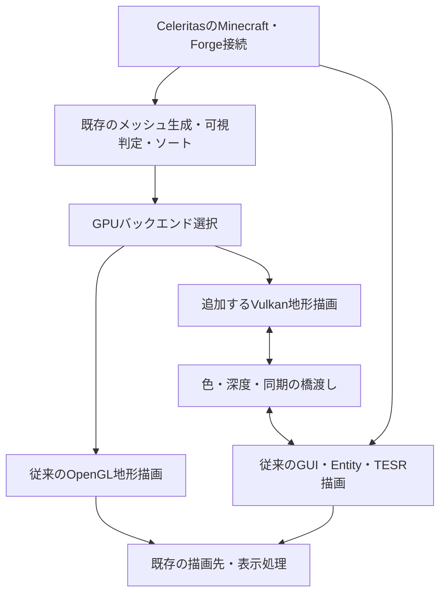

# Celeritas fork：Cleanroom 1.12.2 ネイティブVulkan地形バックエンド開発計画

> **Stage record, superseded.** This document records what was done during a stage and is kept for evidence.
> The single current plan is [`docs/plan.md`](plan.md); where this file contradicts it, the plan wins. (The link was `../plan.md`, which resolves to a non-existent file at the repository root; corrected 2026-10-11.)

改訂：2026-10-08。既存のCleanroom＋Celeritas環境で大多数のModが安定して動くことを開発の前提にする。実装を開始したが、以下の全工程が完了しているわけではない。性能改善と対応範囲は実測で確定する。

## 0. 現在の状態

> **この節は 2026-10-08 時点の記述であり、現在の状態ではない。** 現在の受入状況は
> `docs/scope-and-limits.md` §0（要件とその強制箇所の表・実測の対応・未検証の明示）と `docs/plan.md` の現状表が唯一の根拠である。
> 以下の「現段階の地形バックエンドはOpenGL」「Vulkan地形描画は未実装」は**その後閉じた**: 地形・即時系・GUI/HUD は
> native Vulkan で描画され、`-Dceltium.vulkan.glless=true` では GL context なしで起動・提示まで到達する。
> 節全体は設計時の判断の来歴として残す。

2026-10-08、Celtiumとして実装を開始。Celeritasの履歴を継承し、Linux向けのGL/Vulkan能力診断、独立CLI、1.12.2の診断コマンドを最初の開発対象にする。

現段階の地形バックエンドはOpenGL。Forge jarの生成・内容検査と、本人が用意したCleanroom 0.6.13-alphaでの上流／forkの固定flat world描画・診断コマンド実行を確認した。別のinterop実験でRX 6400とUHD 630のRGBA8/D32外部画像import、D24 renderbufferとのGPU深度変換、両方向の遮蔽、binary semaphore、resize、未完了資源のretirement、同期・コピー費用を確認した。実Cleanroomの既存FBOでも両GPUで往復した。Vulkan地形描画は未実装であり、probe診断は引き続き能力の問い合わせのみ。[再現手順](interop-validation.md)

## 1. 開発するもの

**Celeritasをforkし、既存の最適化・Mod対応・Minecraft接続を継承したまま、地形のGPUバックエンドへネイティブVulkanを追加する。**

メッシュ生成、頂点の圧縮、更新スケジューラー、可視判定、半透明ソート、TESRの可視リスト等を継承する。GUI、Entity、TESR、粒子、空、手、描画イベントは、現在のCleanroom＋Celeritasが使っているOpenGL経路で動かす。

LWJGL 3環境へModを移行する作業や、旧ModのOpenGLを一般的に模倣する層の開発は、本計画の中心に置かない。既存の安定した環境からVulkan化で生じる差分に集中する。

Zinkは必須依存・初期成果物・開発の通過条件から外す。通常のOpenGLドライバとVulkanの相互運用を本線にする。ZinkによるGLドライバの選択は、後から試せる独立した選択肢として扱う。

### 完成時のモード

| モード案 | 地形 | その他の描画 | 役割 |
| --- | --- | --- | --- |
| `backend=opengl` | 現行CeleritasのGLバックエンド | 現行のOpenGL | 既存機能を使う基準・復帰先 |
| `backend=vulkan` | CeleritasのCPU処理＋ネイティブVulkanバックエンド | 同じ通常OpenGL | 開発する主機能 |
| Zinkを使う実験構成 | 上記いずれか | OpenGL → Zink → Vulkan | 本線とは別に検証する追加構成 |

初期alphaはOpenGLを既定値とし、対応環境でVulkanを選べる形にする。対応が確認できた構成から、後で自動選択を検討する。

図は責務の接続を示す。Vulkan選択時には地形と旧GL描画を元のレイヤー順で実行する。両バックエンドで同じ地形を常時二重に描く構成にはしない。

## 2. 継承する範囲と変更する範囲

| 項目 | 方針 |
| --- | --- |
| Forgeモデル・ブロック描画の接続、既存のMod修正 | 元のCeleritasを継承 |
| チャンクのメッシュ生成・AO・頂点色・光量計算 | 継承し、生成結果をVulkanへ渡す |
| COMPACT／VANILLA_LIKE頂点形式 | 継承し、Vulkanで同じ形式を復号する |
| 可視セクション判定・非同期graph更新 | 継承し、結果をバックエンド共通の描画範囲へ渡す |
| 半透明のソート処理 | 継承し、並べ替えたindexをVulkanへuploadする |
| region単位の管理・バッチ化・キャッシュ方針 | 意味と最適化を継承し、GL資源に依存する部分を分離 |
| Entity／TESRの可視判定・描画接続 | 継承し、実描画は従来GLで行う |
| GPU upload、buffer arena、fence、地形draw | GL実装を残してVulkan実装を追加 |
| atlas／lightmap | 元のGL資源を維持し、Vulkan側の資源へ追従させる |
| 地形用シェーダー | 標準の見た目・既存の頂点形式を再現するVulkan版を追加 |
| window、入力、swap、他Modのraw GL呼び出し | 現在のCleanroomの処理を継続 |

この区分は「CPUコードをすべて無変更で流用できる」という意味ではない。描画リストやキャッシュにもGL resource handleとの結合があるので、GPU配置情報を受け取る境界だけを調整する。可視判定・ソート・メッシュ生成のアルゴリズムを同時に入れ替えない。

## 3. 対象版とforkの維持方針

開発対象は、本人が使用している安定したCleanroom＋Celeritasの配布版を第一候補にする。まず、そのjarと上流commitの対応を確認する。Vulkan化のためだけにCleanroom、Java、window APIを一斉更新しない。

参考として、先の調査では以下のソースを確認した。

| 対象 | 調査時のコミット |
| --- | --- |
| CleanroomMC/Cleanroom | `ee62a3c2bdde19873c480b0ea0b563c80b60bc68` |
| GTNewHorizons/Celeritas・ミラー | `989ebf2e52ceed052ec112a569e0c1d172095756` |
| CleanroomMC/Kirino-Engine | `b16f183bf43397f9a57f233ea4c788716997bf22` |

これらは調査の再現点であり、本人の配布版や検証済みセットを表すものではない。確認したCleanroomソースはJava 25／SDL 3／LWJGLYへ進んでいるが、実際の開発環境は使用版の構成に合わせる。[S1]

Celeritasの本来の上流は`git.taumc.org/embeddedt/celeritas`。forkのbaseを固定し、GPU境界・Vulkan実装・相互運用の変更を分けて管理する。[S2]

### forkを選ぶ理由

確認した実装では、`RenderDevice.INSTANCE`がGL実装を参照し、`CommandList`、`DrawCommandList`、regionのGPU資源管理にもGL型がある。GPU backendを交換するための独立した公開APIが完成しているという前提は置かない。[S9、S11]

まずfork内部へ地形に必要なバックエンド境界を追加する。Mod全体を大規模な汎用レンダリングエンジンへ作り直さない。既存のGL型を一括renameして、すべての描画を新APIへ移す改修にも広げない。

- 1.12.2の`forge122`と必要な`common`の変更を中心にする。
- mod ID、主要な既存API、設定項目、Minecraft hookをできるだけ維持する。
- 内部クラスへ注入する追加Modには、必要な対応差分と対応版を記録する。
- 元のCeleritasとforkを同時に入れる配布にはしない。
- Vulkanを選ばない場合に新しい依存や初期化が既存GL経路を壊さないようにする。
- 分離境界が固まった後に、上流への取り込みや公開フック化を検討する。

## 4. 現行コードへの接続点

以下は確認したコミットに対する改修候補であり、すべてをこの名前のまま固定する要求ではない。

| 現行の接続点 | 改修内容 |
| --- | --- |
| `RenderGlobalMixin.renderBlockLayer` | Celeritasの既存の地形接続を足場にし、呼び出し順・前後のGL処理を維持 |
| `CeleritasWorldRenderer`／`SimpleWorldRenderer` | backend選択とframe／layer情報を接続。TESR呼び出しを維持 |
| `VintageRenderSectionManager`／`RenderSectionManager` | ビルダーとgraph処理を継承し、upload・draw・GPU寿命管理の選択点を作る |
| `ChunkBuildOutput`／`BuiltSectionMeshParts` | NativeBuffer、頂点範囲、sort結果をbackendへ渡す境界 |
| `RenderRegionManager`／`RenderRegion.DeviceResources` | GL arenaとVulkan arenaの所有・配置・破棄を分離 |
| `DefaultChunkRenderer`・描画batch生成 | GL実装を維持し、同じ可視リストと範囲からVulkan drawを生成 |
| `ChunkMeshFormats`／頂点形式 | COMPACTとVANILLA_LIKEを同じデータ形式で利用 |
| `GLStateManagerFogService`／`ChunkRenderMatrices` | 既存のfog、行列、lightmap等をパス単位の入力へ渡す |

実コードの確認範囲には、COMPACT／VANILLA_LIKEの選択、TESRのForge render pass判定とbatch呼び出し、NativeBufferの解放処理が含まれる。[S11]

### バックエンド境界の案

以下の名前は新設する責務を表す。現行Celeritasに存在する公開API名ではない。

| 責務案 | 保持する内容 |
| --- | --- |
| `TerrainBackend` | upload、layer描画、破棄、reload、診断 |
| `MeshUpload` | 頂点／indexデータ、頂点形式、pass、面別範囲、世代 |
| `GpuMeshPlacement` | backendごとの配置先、offset、範囲、最終GPU使用 |
| `TerrainPassContext` | 行列、camera、fog、lightmap、描画先、blend／depth条件 |
| `TerrainDrawPacket` | 既存の可視セクション・region・sort順を反映した描画範囲 |

GL専用の`CommandList`へVkBufferを無理に詰める方式にはしない。現在のGL実装はGL backend内で使い、共通の境界に必要な値だけを出す。

まずGL backendだけでこの境界を通し、元の版と表示・性能・Mod動作を比較する。必要のない仮想呼び出し、allocation、state取得をdrawごとに増やさない。

## 5. 通常OpenGLとVulkanの相互運用

地形をVulkanに移しても、既存Modのraw GL呼び出しは現在のコンテキストとドライバへ流す。Vulkan側は地形描画用のdeviceと資源を持ち、結果を既存のGL描画先へ渡す。windowやpresentを別のVulkan実装に置き換えることは初期範囲に含めない。

GLとVulkanが同じGPUにアクセスするだけで、textureやdepthをそのまま共用できるとは扱わない。外部メモリと外部同期の能力を確認する。Khronosに相互運用のサンプルがあるが、対象driverでの深度やModの描画先は別途実証する。[S8]

### 最初の実証条件

1. GLとVulkanのGPUをUUID等で照合する。
2. GLの`GL_EXT_memory_object`、`GL_EXT_semaphore`とOS別のhandle機能を確認する。
3. Vulkanで外部画像・外部セマフォのimport／export能力を問い合わせる。
4. 使用するcolor／depth／stencil形式、画像用途、sample数の組み合わせを確認する。
5. GL→Vulkan→GLのセマフォと画像layout、必要なownership移行を実装する。
6. GLで書いた深度がVulkanで効き、Vulkanで書いた深度がGLのEntity／TESR描画で効くことを確認する。
7. resize、最小化、複数frameの資源使用、終了と再生成を確認する。

外部セマフォはbinaryで始める。Vulkan内部にtimelineを使う場合でも、GL側との相互運用で同じ機能を使えるとは仮定しない。

### 初期実装：元のFBOを保つGPUコピー

元のFBO番号、texture番号、depth renderbuffer等を維持する。Vulkanで外部共有可能な描画先を確保し、GLへimportした一時FBOを橋渡しに使う。

各地形レイヤーを元の位置で、次の順序で実行する。

1. 現在のGL描画先の色・深度、必要ならstencilを一時描画先へGPUコピーする。
2. GLの処理完了をVulkanへ通知する。
3. Vulkanはコピー済みの内容をLOADし、対象レイヤーの地形を描く。
4. Vulkanの処理完了をGLへ通知する。
5. 結果を元のFBOへGPUコピーし、GL状態とCeleritasの状態cacheを整える。
6. 元のEntity／TESR／イベント等の描画へ戻る。

CPUへの画面readbackは使わない。コピー可能な形式・sample数を確認し、深度をコピーできない条件を成功扱いにしない。色だけを合成して地形の遮蔽を再現したことにもならない。

copy方式は互換性を確認する足場であり、完成時の高速化を保証しない。API間同期とコピーを含むframe timeを測り、必要なら共有描画先によるゼロコピーを次に実装する。

### 共有描画先の扱い

ゼロコピーでは、管理できる描画先だけをGL／Vulkan共有資源へ置き換える。depth renderbufferの構造、attachment、texture再割り当て等を前提とするModに影響し得るため、構成別に対応を確認する。

GL／Vulkan間のGPU切り替えは元の描画順を保てる範囲でまとめる。EntityやTESRをまたいでSOLIDとTRANSLUCENTを勝手に連結しない。`glFinish`や`vkDeviceWaitIdle`を毎パスの通常処理に置かない。

## 6. Vulkan側へ移すGPU処理

### メッシュ転送と寿命

Celeritasの生成結果を、Vulkan backendが所有するstaging領域へ渡す。頂点・indexのNativeBufferを、非同期GPU転送が参照し続ける状態で解放しない。[S11]

Vulkan用のregion arena、転送batch、buffer拡張、index部分更新、使用済み資源の遅延破棄を追加する。world／sectionの世代と最終使用submissionを記録し、古い非同期結果と再利用後のメモリを混同しない。

開発中に同じpassのGL／Vulkan結果を切り替えて比較する機能は用意できるが、常時二重uploadや二重常駐を完成版の必須条件にしない。VulkanからGLへ復帰する場合にはrenderer再構築・再uploadが必要になり得る。

### 地形描画

- COMPACT／VANILLA_LIKEの頂点をそのまま受け、shaderで対応する復号を行う。
- SOLID、CUTOUT_MIPPED、CUTOUT、TRANSLUCENTを順に追加する。
- AO、頂点色、lightmap、fog、alpha cutout、mipmap、filteringを再現する。
- camera相対座標・region offset・projection等は既存の入力を使う。
- GL／VulkanのY方向、clip-space深度、face winding、viewport、scissor、blend、depth、stencil、polygon offsetを比較する。
- 既存の半透明sort結果をindex更新へ反映し、sortアルゴリズムを同時に変更しない。

最初はindexed drawで正しさを確認し、次に既存のregion／batch方針を利用したmulti-draw indirect、uploadのまとめ処理、pipeline cacheを追加する。GL版にあるバッチ化を無視した単純な1セクション1drawを最終版として性能比較しない。

Vulkan 1.2系を設計上の基準とし、実際に必要なfeatureと外部共有能力を問い合わせる。dynamic renderingやsynchronization2等は対応範囲と実装負担に応じて追加する。初期版でmesh shaderや新しいGPU cullingを必須にしない。
**実装での強制箇所（2026-10-11 実測）**: loader 1.2以上は `celtium-vulkan/src/main/java/org/soutalab/celtium/vulkan/VulkanContext.java:86-87,154`、device の `apiVersion >= 1.2` は `:759-763`、CPU device の除外は `:756-758`、必須 device extension は `:795-803`（有効化 `:838-839`）、graphics+transfer queue は `:806-831`。要件・挙動・実測の対応表は `docs/scope-and-limits.md` §0。

### atlasとlightmap

元のGL textureを維持する。ブロックatlas、mipmap、アニメーション部分更新、lightmapの既知のCPU uploadをVulkan側にも反映する。GPUだけで更新されるものは、確認済みの共有・GPUコピー経路で追従させる。

resource reloadでは、atlas世代、頂点形式、pipeline、未完了uploadを整理する。アニメーションのために毎frame atlas全体をCPUへ取り戻さない。GL／Vulkan両側のtexture保持によるVRAM増加も計測する。

shader packや他ModのGL programを、そのままVulkan programとして使えるとは扱わない。初期版はCeleritasの標準地形描画を対象にし、既存のshader機能はOpenGL backendで継続できる構成を維持する。

## 7. 既存Mod互換性の守り方

互換性の基準は、**本人の固定したCleanroom＋Celeritas構成で、現在正常に動いているModがVulkan選択後も同じ動作をすること**。既存の安定動作を移行前提として採用する。

| 保持するもの | Vulkan化で検証する差分 |
| --- | --- |
| Forgeモデル・既存のブロック描画対応 | 同じメッシュ・頂点・textureから同じ表示になるか |
| CeleritasのEntity／TESR可視判定 | 地形のdepthと前後関係が一致するか |
| 従来のTESR render pass・batch接続 | GL状態、FBO内容、深度・stencilを壊さないか |
| GUI・font・tooltip・手・粒子 | 地形パス後の状態と描画先が戻るか |
| Forgeの描画イベント | 発火位置、回数、順序が維持されるか |
| Modが持つFBO・texture・renderbuffer | ID、attachment構造、内容、resize処理を保てるか |
| Celeritasの追加Mod | 設定・API・内部Mixinがfork変更と整合するか |

初期native経路は対応する描画先と標準地形passを明示する。shaderのshadow pass、MRT、特殊FBOは後で拡張する。

### 復帰方法

`backend=opengl`を常に残す。GPU能力不足、初期化失敗、既知の非対応構成は、worldのGPU資源を作る前に判断する。

Vulkanにだけメッシュを保持した状態で、任意のdrawを即座にGLへ戻せるとはしない。実行途中の非対応検知は、実装済みの再構築手順を経由するか、次回起動のモード選択へ反映する。device lossやnative crash後の同一プロセス内復旧は初期版の保証に含めない。

開発段階でSOLIDだけVulkan、他の地形レイヤーはGLとする移行は可能だが、各passのGPU資源をどちらが持つかを明示する。この部分移行を汎用的な自動fallbackと混同しない。

## 8. 開発工程と工数

### 見積もりの前提

これはソース調査からの概算であり、見積もり済みの実装実績や納期の約束ではない。OpenGL／VulkanとMinecraft描画の実装経験がある開発者1人、1人日＝8時間、1人週＝40時間で換算する。実装、コードレビュー、ビルド、再現場面作成、計測、修正を含む。

初期alphaの対象はLinux・固定したCleanroom／Celeritas版・本人の指定Mod構成と代表的な描画Mod群とする。能力判定と複数GPU対応は本体の完成要件であり、RX 6400専用の実装を完成形にしない。現在のGL contextに対応するdevice/driver UUID、形式・usage・tiling・sample数、memory/semaphore共有、queueと必要featureから実装方式を選ぶ。GPU名による決め打ちや別GPUへの自動切り替えは行わない。少なくとも手元のAMD RX 6400とIntel UHD 630で描画・深度・同期・復帰経路を実証し、対応表に実証済み／未検証／非対応理由を区別する。Windows等の追加OSはP6の追加範囲とする。既存のLWJGL 3動作を成立させる作業は含めず、Vulkan化によって生じる差分を扱う。全Mod・全driver・全shader packの互換保証は、この見積もりの範囲に含めない。

引き継ぎ後にRX 6400へ接続できる実機環境と、本人が用意したCleanroom 0.6.13-alpha／Java 25／LWJGL 3.4.1／Fugue 0.24.4／Scalar 3.9.0を固定した。描画中のFBOはRGBA8、D24 depth renderbuffer、stencilなし、single sampleだった。固定flat worldの起動と描画を確認した段階で、代表的なMod・TESR場面と正式な性能測定の範囲は引き続き確定・拡充する必要がある。[検証記録](validation-2026-10-08.md)

### 段階別の工数

| 段階 | 作業 | 成果物・通過条件 | 作業時間 | 40時間／週での換算 |
| --- | --- | --- | --- | --- |
| P0 | 使用版固定、upload／draw／資源寿命の追跡、変更前ビルドと基準測定 | base revision、再現world、元GL版の画像・性能・Mod一覧 | 24〜40時間 | 3〜5人日 |
| P1 | 通常GL＋Vulkanの色・深度・同期を小規模に実証 | 両方向の遮蔽、resize、GPUコピー、同期負担の実測 | 40〜120時間 | 1〜3人週 |
| P2 | 地形GPU境界を追加し、既存GL実装をそこへ接続 | 元版と表示・イベント順・Mod動作が一致し、GL性能の退行を抑制 | 80〜160時間 | 2〜4人週 |
| P3 | Vk upload、arena、atlas／lightmap、標準shader、SOLID描画 | Celeritasのメッシュと頂点形式を使うnative prototype | 80〜160時間 | 2〜4人週 |
| P4 | CUTOUT／TRANSLUCENT、sort更新、reload、GPU資源寿命 | 全標準地形レイヤーと更新の動作 | 80〜160時間 | 2〜4人週 |
| P5 | region batching、共有描画先等の必要な最適化、指定Mod構成のQA | Linux・対象GPUで表示と安定性を確認した実用alpha。性能改善は実測で判定 | 120〜240時間 | 3〜6人週 |
| P6・追加範囲 | Windows、追加GPU、追加の大型pack、配布・対応表・API整備 | 宣言した追加構成で検証したbeta | 追加160〜320時間 | 追加4〜8人週 |

順序はP0→P1→P2→P3→P4→P5とする。**P1が通る前にCeleritas本体の大きなGPU分離改修へ進まない。** P6はalpha後の追加範囲とする。

### 到達点別の合計

| 到達点 | 対象工程 | 作業時間の単純合計 | 計画用の目安 |
| --- | --- | --- | --- |
| 実現性の判断 | P0＋P1 | 64〜160時間 | 予備25%を含め80〜200時間、約2〜5人週 |
| SOLIDが描ける試作 | P0〜P3 | 224〜480時間 | 約6〜12人週。全レイヤー・Mod互換性・高速化の完成ではない |
| Linux・対象GPU・指定Mod構成の実用alpha | P0〜P5 | 424〜880時間 | 予備25%を含め約530〜1,100時間、約13〜28人週。フルタイムで約3〜7か月 |
| 追加OS／GPU／packまで検証するbeta | P0〜P6 | 584〜1,200時間 | 予備25%を含め約730〜1,500時間、約18〜38人週。フルタイムで約4〜9か月 |

予備25%はdriver差、深度形式、同期、寿命管理、Mod別の差分修正に充てる仮置きであり、上限の保証ではない。根本的な方式変更が必要になれば再見積もりする。週10時間の稼働なら同じ作業量の暦期間は約4倍になる。AIによるコード作成速度から実機検証と修正の期間を省いて換算しない。

Zinkの同梱、Kirino接続、nativeでのshader pack／MRT／独自shadow pass対応は別見積もりにする。

### 最初に判断する範囲

提案する最初の開発枠はP0＋P1のみとする。成果物は「固定した基準構成」「GL／Vulkan能力診断」「色・深度が往復する小規模実証」「同期・コピーの計測」「P2以降の再見積もり」。

P1の終了時に、少なくとも次を判断する。

1. 同じ対象GPUで、必要な外部メモリ・外部セマフォ・色／深度形式を利用できるか。
2. GLで書いた深度がVulkan描画へ、Vulkanで書いた深度がGL描画へ反映されるか。
3. 実際の解像度と地形レイヤー回数で、コピー・同期の負担が許容できるか。軽いテスト場面の成功を性能改善の根拠にしない。
4. 元のFBO構造を維持できるか。共有描画先への置き換えが必要なら、影響するModと追加工数を整理できるか。

成立したらP2以降の範囲と工数を更新する。成立しない場合は対応範囲を限定するか方式を見直し、互換性と性能に見込みがない条件ではnative経路の開発を止める。

### 判断条件

- P1：色に加えて深度が往復し、Entity／TESRと同等のGL描画が正しく遮蔽されること。
- P1：実frameサイズでコピーと同期を計測する。対象driverで共有が成立しない場合は、その環境でnativeを有効にしない。
- P2：GL backend選択時に元版と同じ表示・イベント順・Mod動作になること。平均FPS退行の暫定許容は5%以内とし、測定誤差を区別する。
- P4：半透明sort、F3+A、F3+T、dimension移動、world終了で画像・資源寿命が正常であること。
- P5：同期を含む全frameで測定し、平均FPSが測定誤差を超えて改善した構成を性能版として推奨する。1% lowの重大な悪化を平均FPSだけで隠さない。
- P5：CPU側の処理、TESR描画、GPU負荷のどれが律速かを記録し、Vulkanが効く場面と効かない場面を分ける。
- P6：特定GPUでの成功を、別driverや別OSの動作保証へ広げない。

相互運用の負担が大きい場合は、共有描画先や切り替え回数を改善する。見込みのない条件ではnative経路を研究段階に留め、既存GL backendを使える状態を保つ。

## 9. 比較と互換性テスト

### 比較する本線の3構成

同じMinecraft、Java、Cleanroom、world、Mod、resource pack、設定、解像度、描画距離、driverを使う。

1. fork前のCeleritas・通常GL。
2. fork後のCeleritas・OpenGL backend。
3. 同じforkのVulkan backend＋通常GL。

1対2で抽象化による退行を調べ、2対3でVulkan化の効果を調べる。Zinkは追加測定として扱い、本線の結果へ混ぜない。未実装機能を切った結果を、同条件の性能改善として報告しない。

### テスト候補

次はカテゴリ別の候補であり、今回動作確認した一覧ではない。本人の構成で正常な版を優先する。

| 対象 | 主な差分検証 |
| --- | --- |
| FutureMC | 新しいブロック、植物、水、texture、標準地形への接続 |
| JEI／HEI、inventory、tooltip | 地形描画後のGL状態とGUI |
| GTCEu、AE2、Ender IO等 | 機械・配線・TESR・発光と地形のdepth |
| Thaumcraft等 | 半透明、粒子、特殊効果のpass順 |
| CTM、Chisel等 | 生成メッシュ、connected texture、mipmap |
| LittleTiles等 | 独自geometry・cacheとGPU管理の境界 |
| JourneyMap、Xaero等 | 独自FBO、texture更新、resize |
| Celeritasの追加Mod | 頂点形式、設定、内部クラスhook |
| 既存のshader構成 | OpenGL backendの維持。native対応は独立した後工程 |

FHD、8／16／24／32チャンクを候補に、固定視点と固定移動経路を複数回測る。地形中心、chunk生成・upload、機械拠点、水／ガラス、Entity混在を分ける。

平均FPSを主指標にし、1% low、p95／p99 frame time、render thread時間、地形draw時間、GPU時間、upload時間、GL／Vk相互運用時間、VRAM／native memory、GCを記録する。cold compileとウォーム後を分け、両構成で同じ測定条件を使う。

正しさの確認ではVulkan Validation Layers、GL debug、必要に応じてcaptureを使う。性能測定では詳細検証・traceを外す。画像比較は固定条件で行い、半透明の前後関係・イベント順・特殊効果も目視と専用場面で確認する。

長時間検証の初期基準は、2時間の混在描画、50回のdimension移動、50回のresource reload、100回のresizeとする。単調なnative memory増加、古いworldの結果採用、解放後参照、同期deadlockを確認する。

## 10. 最初に着手するタスク

1. **runtime-lock**：本人の安定したjar一覧・ハッシュ・Java・GL／Vk driverを固定する。
2. **fork-base**：該当Celeritasの上流revisionからforkを作り、変更前の1.12.2版をビルドする。
3. **render-path-audit**：`renderBlockLayer`からdrawまで、mesh結果からupload／破棄までを追跡し、既存のMod対応と最適化を記録する。
4. **baseline-capture**：FutureMCを含む基準worldと機械／TESR場面の画像・性能を残す。
5. **interop-probe**：通常GLとVulkanのGPU・外部handle・color／depth／stencil能力を診断する。
6. **depth-roundtrip**：両APIで交互に描く前後する物体を使い、depthとresizeを実証する。
7. **interop-budget**：FHDでcopy／同期の負担を測り、必要な共有描画先を設計する。
8. **backend-boundary**：地形GPU境界を作り、GLだけで元版との差分を通す。
9. **native-solid**：同じCeleritasメッシュと頂点形式を使ってSOLIDを描く。
10. **native-layers**：cutout、translucent、sort更新、reload、資源寿命を追加する。
11. **native-batching**：regionバッチ・indirect draw・uploadまとめ・pipeline cacheを最適化する。
12. **pack-regression**：本人の実用構成へ広げ、fork前から増えた問題を修正する。

## 11. 追加構成：ZinkとKirino

### Zink

ZinkはOpenGLをVulkanへ翻訳するMesaのドライバであり、本体のVulkan地形backendとは別のもの。[S3]

Linuxでのdriver選択は、Mesaが実際に読み込まれる構成と環境変数を確認する。[S6] OS別のMesa nativeを配布物へ同梱する案は考えられるが、必須成果物にはしない。

同梱を実装する場合は、GL context作成前のライブラリ選択、SDLとLWJGLの関数ポインター、OS別依存、実driverの診断を別タスクにする。SDLのライブラリロード時点にも条件がある。[S7]

Zinkが使えなくても通常GL＋Vulkanで成立する設計を保つ。通常GLで相互運用が難しい特定環境に対しZinkを試すことはできるが、その環境を検証してから対応表へ追加する。

### Kirino

Kirinoの独自地形描画とCeleritasを同時に地形の所有者にしない。現在の安定したCeleritas構成を基準とし、必要ならKirinoの描画引き継ぎを無効にできることを確認する。[S4、S5]

Celeritasのnative backendを先に成立させ、その後にKirinoのライフサイクルへ接続するアダプターを検討する。Kirinoの完成やrenderer APIの安定を、本計画の前提条件にしない。

## 12. 配布と保守

初期の配布はCeleritasを置き換えるforkのjarを中心にする。Vulkan bindingは対象CleanroomのLWJGL版に合わせ、`org.lwjgl`の別版一式を重複搭載しない。必要なclasspath／native供給は対象loaderで検証して決める。

標準terrain shaderのSPIR-Vをビルド時に生成すれば、runtime shader compilerを初期版へ必須搭載する必要はない。runtime生成が必要になった段階でshadercを検討する。VMA等の採用はGPU資源管理の実装負担と対象nativeの配布条件で判断する。

GPU driverはOS側のものを使う。通常GL driverの差し替えを標準のインストール手順へ入れない。設定・F3等の診断へ、実際のterrain backend、GL／Vk GPU、対応Celeritas版、相互運用方式を表示する。

forkには元の著作権表示・ライセンス・帰属を維持し、取り込んだコードと利用部品を記録する。既存のライセンス確認は配布対象の実際の版に対して行う。[S2、S10]

上流更新の取り込みでは、GL backendの退行とnative backendの動作を分けて確認する。差分をGPU境界・native実装・Mod別修正へ分け、Celeritasの既存の最適化と互換性修正を継続して取り込める構造にする。

## 13. 一次資料と再現点

設計、工程、通過条件は本計画で提案したもの。共有の仕様があることと、対象GPU・driver・Mod構成で実用になることを区別する。確認済みのコードは固定コミットを参照し、全実装と全Modの動作を監査済みとは扱わない。

- **S1**：[Cleanroom README](https://github.com/CleanroomMC/Cleanroom)。Java／SDL／LWJGLYとKirinoの位置付け。
- **S2**：[Celeritas README](https://github.com/GTNewHorizons/Celeritas)。上流、commonモジュール、構成、ライセンス。
- **S3**：[Mesa Zink documentation](https://docs.mesa3d.org/drivers/zink.html)。OpenGL-on-Vulkanと対応機能の条件。
- **S4**：[Kirino Engine README](https://github.com/CleanroomMC/Kirino-Engine)。WIP、地形サブシステム、互換性の方針。
- **S5**：[Kirino engine overview](https://github.com/CleanroomMC/Kirino-Engine/blob/b16f183bf43397f9a57f233ea4c788716997bf22/docs/engine_overview.md)。描画引き継ぎとGL抽象化。
- **S6**：[Mesa environment variables](https://docs.mesa3d.org/envvars.html)。`MESA_LOADER_DRIVER_OVERRIDE`等。
- **S7**：[SDL_GL_LoadLibrary](https://wiki.libsdl.org/SDL3/SDL_GL_LoadLibrary)／[SDL_GL_GetProcAddress](https://wiki.libsdl.org/SDL3/SDL_GL_GetProcAddress)。ロード時点と関数ポインターの扱い。
- **S8**：[Khronos External Memory and Synchronization guide](https://docs.vulkan.org/guide/latest/extensions/external.html)／[OpenGL interoperability sample](https://docs.vulkan.org/samples/latest/samples/extensions/open_gl_interop/README.html)／[OpenGL external objects specification](https://github.com/KhronosGroup/OpenGL-Registry/blob/main/extensions/EXT/EXT_external_objects.txt)。外部画像・同期・handleの仕様。
- **S9**：Celeritasの確認済みソース：[RenderDevice](https://github.com/GTNewHorizons/Celeritas/blob/989ebf2e52ceed052ec112a569e0c1d172095756/common/src/main/java/org/embeddedt/embeddium/impl/gl/device/RenderDevice.java)、[DefaultChunkRenderer](https://github.com/GTNewHorizons/Celeritas/blob/989ebf2e52ceed052ec112a569e0c1d172095756/common/src/main/java/org/embeddedt/embeddium/impl/render/chunk/DefaultChunkRenderer.java)、[RenderRegionManager](https://github.com/GTNewHorizons/Celeritas/blob/989ebf2e52ceed052ec112a569e0c1d172095756/common/src/main/java/org/embeddedt/embeddium/impl/render/chunk/region/RenderRegionManager.java)、[ChunkBuildOutput](https://github.com/GTNewHorizons/Celeritas/blob/989ebf2e52ceed052ec112a569e0c1d172095756/common/src/main/java/org/embeddedt/embeddium/impl/render/chunk/compile/ChunkBuildOutput.java)、[VintageRenderSectionManager](https://github.com/GTNewHorizons/Celeritas/blob/989ebf2e52ceed052ec112a569e0c1d172095756/forge122/src/main/java/org/taumc/celeritas/impl/render/terrain/VintageRenderSectionManager.java)。
- **S10**：[VulkanMod](https://github.com/xCollateral/VulkanMod)。Vulkan実装の参考先。現代版のMinecraft hookをそのまま1.12.2へ移す前提にはしない。
- Cleanroomの確認済みソース：[build.gradle](https://github.com/CleanroomMC/Cleanroom/blob/ee62a3c2bdde19873c480b0ea0b563c80b60bc68/build.gradle)、[CleanroomWindowBridge](https://github.com/CleanroomMC/Cleanroom/blob/ee62a3c2bdde19873c480b0ea0b563c80b60bc68/module/cleanroom/src/main/java/com/cleanroommc/client/sdl/CleanroomWindowBridge.java)。
- **S11**：追加確認したCeleritasのソース：[CommandList](https://github.com/GTNewHorizons/Celeritas/blob/989ebf2e52ceed052ec112a569e0c1d172095756/common/src/main/java/org/embeddedt/embeddium/impl/gl/device/CommandList.java)、[BuiltSectionMeshParts](https://github.com/GTNewHorizons/Celeritas/blob/989ebf2e52ceed052ec112a569e0c1d172095756/common/src/main/java/org/embeddedt/embeddium/impl/render/chunk/data/BuiltSectionMeshParts.java)、[SimpleWorldRenderer](https://github.com/GTNewHorizons/Celeritas/blob/989ebf2e52ceed052ec112a569e0c1d172095756/common/src/main/java/org/embeddedt/embeddium/impl/render/terrain/SimpleWorldRenderer.java)、[CeleritasWorldRenderer・1.12.2](https://github.com/GTNewHorizons/Celeritas/blob/989ebf2e52ceed052ec112a569e0c1d172095756/forge122/src/main/java/org/taumc/celeritas/impl/render/terrain/CeleritasWorldRenderer.java)、[ChunkMeshFormats](https://github.com/GTNewHorizons/Celeritas/blob/989ebf2e52ceed052ec112a569e0c1d172095756/common/src/main/java/org/embeddedt/embeddium/impl/render/chunk/vertex/format/ChunkMeshFormats.java)。
