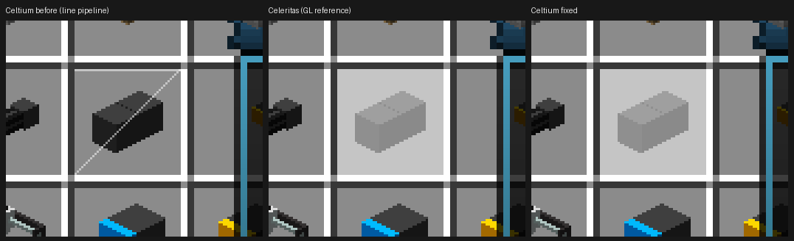

# the creative inventory's hovered-slot highlight was drawn as three lines (2026-11-02)

The last differing cell of the creative inventory is fixed. It was not a missing draw, a scissor, a viewport, a target
or an alpha problem: the quad was drawn with **`VK_PRIMITIVE_TOPOLOGY_LINE_LIST`**, so it reached the image as three
one-pixel lines - its top edge, its bottom edge and its diagonal - and the slot looked unhighlighted.

AMD Radeon RX 6400 (RADV NAVI24)・`plain`・Supersymmetry・1280x720・`guiScale3.txt`・validation 既定ON.
Scene on every leg below: `-Dceltium.validation.screen=creative -Dceltium.validation.creativeTab=12
-Dceltium.validation.screenshotAtTick=60`. The cursor sits at the window centre, so the hovered slot is the same
(594..642, 321..369, guiScale 3) on every run.

## The cause

`VulkanTerrainGpuBackend.celtium$stateKey` is a 64-bit polynomial hash over the captured state array:

```java
long key = formatId;
for (int value : state) key = (key * 31) + value;
```

The accept path marks a line draw by setting bit 61 of that result (`stateKey |= 1L << 61`,
`VulkanTerrainGpuBackend:7490`), and the prepare path reads the bit back to choose between the triangle and the line
pipeline (`prepareImmediateUncached`, `:10703`). **The hash sets that bit half the time**, so roughly half of the
untethered (no-texture) drawing states were drawn as line lists. The textured families never consult the bit, which is
why the GUI's textured rectangles were unaffected and only a few untextured overlays were wrong.

The hovered slot's state is one of them. Its captured array is
`[blend=1 src=6 dst=7 depthTest=0 depthWrite=1 cull=1 alphaRef=0 depthFunc=515 lighting=0 srcA=1 dstA=0 mask=0x7
eq=0/0 alphaFunc=0 combine=0]` and its hash is `0x364d31f191fb43aa` - bit 61 set.

## How it was identified

| leg | renderer | what it did |
|---|---|---|
| `r23a`–`r23c` (round 3) | round-2 JAR | the group is accepted, closed, drawn and correct in target/colour/bounds; mask and depth-test are its only differences |
| `r24a` | `33cc1faf…` | `CELTIUM_GROUP_BOUNDS` gained `pipeline=`/`renderPass=`/`vp=`/`clip=`; a draw-state census printed the applied viewport, scissor and blend. Result: `clip=none`, `scissorApplied=0,0 1280x720`, `blend[rgb=6,7 a=1,0 mask=0x7]`, same `passImage` and same `onMain` as the visible neighbours - the clip/viewport/target hypotheses are dead |
| `r24b` | `dc2551de…` | the probe rewrote the highlight's own vertices to opaque magenta **at close** and read them back at the draw: `colourNow=0xffff00ff`, `strideNow=16`, `indicesNow=6`, `firstIndices=0,1,2,0,2,3` - the mesh the command reads holds the poison. No magenta in the tick-60 picture: the probe had only poisoned frames 8-10 |
| `r24d` | `0ea66515…` | same probe, unbounded (every frame): `handle=0x12630000001263`, `passOpen=true`, `postClears=0` - and **143 magenta pixels at x 591..638, y 318..366, i.e. the hovered slot**. A vertical strip at x=610 shows magenta at exactly y=318, 346 and 366: the quad's top edge, its diagonal and its bottom edge. That is the line list of the index buffer `0,1,2,0,2,3`. |

The arithmetic that ties the picture to the key is in
[LineBatchStateKeyTest](../../celtium-vulkan/src/test/java/org/soutalab/celtium/vulkan/LineBatchStateKeyTest.java):
the measured highlight state's raw hash has bit 61 set, and the masked key does not.

## The change

1. `celtium$stateKey` returns `hash & ~LINE_KEY_BIT`; the flag is added by the accept path only
   (`stateKey |= LINE_KEY_BIT`), and both sites now use the named constant. One extra collision between two states
   that differ only in bit 61 is the cost, against a silently misdrawn batch every time the hash sets it.
2. `LineBatchStateKeyTest` pins the measured hash, sweeps the varying state slots (`blend`, `depthTest`, `depthWrite`,
   `cull`, the colour mask, `depthFunc`) and checks that a line batch and a triangle batch with the same state still get
   different keys.

## Confirmation

Leg `r24e-linefix` (fixed JAR `d8000677…`, fixture `164c78de…`, same scene, probe off, validation default on):

```
celtium slot (594..642, 321..369) mean   190.27 / 190.27 / 190.27
Celeritas reference, same rect           190.27 / 190.27 / 190.27
mean |difference| in the rect            0.0      (100 % of pixels within 2)
spot pixels (600,330) 197 → 197, (620,340) 138 → 138, (610,350) 138 → 138
```



Left: the round-2 build - the hovered cell is not lightened and a thin white diagonal crosses it (the line list's
top edge, diagonal and bottom edge). Middle: the Celeritas reference. Right: the fixed build, pixel-identical to
the reference in the slot.

The slot now matches the GL reference exactly, where every leg since round 2 read 127.01 / 127.01 / 127.01 there. The
run reports `celtium/vulkan-check passes=1857 skipped=0 errors=0`, no VUID line and no Celtium exception.
`fixtureStatus=UNCALIBRATED_PRESENTED_IMAGE` / `sceneCalibrationKeyMatches=false` is the creative scene's own state (its
calibration key carries `screen=named:creative` while the terrain reference carries `screen=none`), not a regression:
the gate for this scene is the picture comparison above.

## Scope

Every untextured immediate batch whose state hash set bit 61 was drawn as lines: `POSITION_COLOR` overlays (the slot
highlight, the `0xee555555` GUI quad, the hurt/vignette-style overlays), and the `POSITION`/`POSITION_NORMAL` families
(the sky, the horizon plane, the missing-renderer box). The fix is one mask, so it applies to all of them at once.

## Evidence files

- `r24d` (before): `.gv-verify/run-r24d-borrow/screenshots/*tick60*.png` - deleted after the round; the numbers above
  are the record.
- `r24e` (after): `.gv-verify/run-r24e-linefix/` - the tick-60 picture with the fix, and `logs/latest.log` for the
  verification line.
