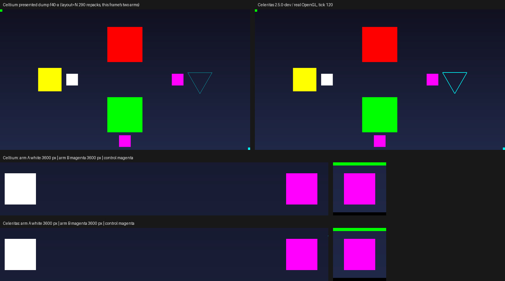

# a compiled `glBegin` run takes its vertex layout from the texturing state at `glCallList`, and Celeritas draws it that way too (2026-11-02)

Round 7 fixed which *values* a display list replay uses. This round fixes which *layout* it uses, which was the other
half of the same rule and the one it explicitly left open.

GL chooses the vertex layout from the **enabled** state when the vertex is executed, not from the state at
`glNewList`. A list compiled with `GL_TEXTURE_2D` on and called under `glDisable(GL_TEXTURE_2D)` draws untextured
geometry carrying the colour it stored; the reverse draws textured geometry sampling the caller's texture at the
caller's current coordinate. Round 6-7's replay submitted the compile-time layout every time, so the first case sampled
whatever texture the caller had bound (or a transparent texel - the reason this scene's own geometry had to disable
texturing to be measurable at all) and the second left the caller's texture unsampled.



## The scene

`-Dceltium.validation.screen=displaylist` (`DisplayListLegacyScreen`, fixture only) gained two small lists and a
control, drawn in every frame next to the three lists round 7 added:

| element | compiled under | called under | GL's answer | the compile-time layout's answer |
|---|---|---|---|---|
| **arm A** (white) | `GL_TEXTURE_2D` **on**, with a recorded coordinate | **off** | the stored colour, **white** | samples the bound texture - **magenta** |
| **arm B** (magenta) | `GL_TEXTURE_2D` **off** | **on** | the caller's texture at the caller's coordinate - **magenta** | untextured, **white** |
| **control** (magenta) | - (drawn directly) | on | **magenta** | - |

Both arms are called with the same 16x16 solid magenta texture bound, deliberately: it makes the wrong answer a counted
colour rather than "whatever the GUI bound last", and each arm's colour is the other's failure mode, so a renderer that
keeps the compile-time layout paints them **swapped**. The direct textured quad is the frame's proof that the texture
reached the sampler at all, so "arm B has no magenta" can be told from "the upload failed". The arms are 20x20 GUI units
(half extent 10) and sit in the gaps the four existing elements leave unused; the layout report names their centres
(`armA=123,120,10 armB=303,120,10 texControl=213,225,10`).

## The change

* `CompiledLegacyRun.prepareCall(substituteCallState, texturedAtCall, …)` decides the layout at replay. When the
  call-time texturing state matches the compile's it returns the copy unchanged (the common case, no cost); when it
  differs it repacks the run into the other immediate layout - position 12 bytes first in both, so only the colour and
  the coordinate move - and returns that address, width and format in a per-run `Submission` holder, so a replay on the
  drawing path allocates nothing.
* The conversion pays for itself once per run: the other layout's buffer is allocated on the first differing replay and
  freed with the run (`free()`), and a failed allocation falls back to the compiled layout rather than refusing the
  draw.
* In the untextured-to-textured direction the coordinate is the caller's, always: an untextured layout cannot hold one,
  and under GL the texcoord of a list's vertex is whatever is current when the list runs. A list that *does* carry a
  `glTexCoord` command executes it in order before the run is submitted, so the mirror already holds the list's value
  at that point.
* `CeltiumGlStub.replayLegacyRun` asks the backend for `celtium$texture2dEnabled()` at `glCallList` and submits the
  returned layout. `-Dceltium.glstub.legacyCallLayout=false` keeps the compile-time layout on the same JAR (A/B
  switch, default on, separate from `-Dceltium.glstub.legacyCallState`).
* Instruments: the verification line's `celtium/legacyListRuns[...]` now carries `layout=<replays repacked>` and
  `callLayoutSwitch=<bool>`; `CompiledLegacyRun.describe()` (the refusal line) carries `repacks=<n>`.
* CPU tests: `CompiledLegacyRunTest` pins both directions' byte layout (colour at 20 / at 12, coordinate at 12), that
  the owned copy is not modified, that a matching layout does not repack, and that the call-state switch off keeps the
  compiled colour while still converting the layout.

## The two arms

Same fixture in both arms: `a84422461b21eecf80b170bb88ce7d669d7d648965cbd0cb9dd2c3cd1dc6e427`. Same scene, flags,
1280x720, `guiScale3.txt` (GUI 427x240), AMD Radeon RX 6400.

| arm | leg | renderer | device | result |
|---|---|---|---|---|
| Celtium | `r28a-displaylist` | `c0f79c0ed25134305f2c7a78b03d83103a3d8b956e0397bc349bb90b910221b2` | RADV NAVI24 | `INCONCLUSIVE`/exit 2, `problems=[]`, `UNCALIBRATED_PRESENTED_IMAGE` (a named screen moves the calibration key off the terrain pose, by construction) |
| Celeritas | `r28b-displaylist-ref` | `567dcf8aadd6f4f4d5d594b02549c7997385b7dc8ade5e9722d1e9756056092c` | radeonsi navi24 | `INCONCLUSIVE`/exit 2, `problems=[]`, `UNCALIBRATED_PRESENTED_IMAGE` |

Celtium's picture is its own presented dump (`displayListDumpCount=2`, `completed=true` at presented frames 42 and 43);
the reference arm has no presented dump (a GL arm presents through the game), so it is judged by
`-Dceltium.validation.screenshotAtTick=120`, the same scene at tick 120.

### Ink per element (`scripts/cpu-contract/display-list-legacy-check.py`)

| picture | arm A white | arm A magenta | arm B white | arm B magenta | control magenta | red/green bands, cyan loop, yellow control |
|---|---|---|---|---|---|---|
| `displaylist-f40-a` | **3600** | 0 | 0 | **3600** | **3600** | unchanged from round 7 (`red 32400` / `green 32400`, cyan 340, yellow 14400) |
| `displaylist-f41-b` | **3600** | 0 | 0 | **3600** | **3600** | unchanged (`green 32400` / `red 32400`, cyan 340, yellow 14400) |
| Celeritas, tick 120 | **3600** | 0 | 0 | **3600** | **3600** | `red 32400` / `green 32400`, cyan 1014, yellow 14400 |

3600 = (2·10·3)² is the arm's own area at the picture's scale, so each arm is one colour and no pixel of the other
colour is inside it. The reference arm - real OpenGL, same fixture, same scene - produces the identical arrangement,
which is what settles the rule without an argument about the specification. Round 7's assertions still hold in both
arms (the outer list in the call-time red, the inner in its own green, the quad and the loop present), so the layout
change did not disturb the value change.

The positive control is again built from the run's own pixels: the two arms' squares are exchanged - the exact picture
a replay that keeps the compile-time layout leaves, white where the sample should be and magenta where the stored colour
should be - and the same analysis has to reject it. Both the two-frame and the single-picture modes run it
(`control (layout arms exchanged) armA_white=0 armA_magenta=3600 armB_white=3600 armB_magenta=0 rejected=True`), and
`scripts/tests/test_display_list_legacy_check.py` pins both modes on synthetic frames (the swapped picture fails,
the expected one passes, a missing arm fails, a pre-arm layout report is refused).

### Replay census and errors (Celtium arm)

`celtium/legacyListRuns[enabled=true recorded=5/19 replayed=725/2755 lists=5 bytes=336 droppedBytes=0
replayRefusals=0 callState=435 layout=290 provenance[colour=2 tex=4 midRun=0]]` - five lists, 145 frames of replays,
and `layout=290` is exactly the two arms repacked on every frame (2 x 145). That is the scene measuring itself: the
pack's own display lists are compiled during startup but not called while this screen is open, so **this leg does not
say how often a pack list's call-time texturing state differs from its compile's**. The counter is the instrument for
that question on a world scene; it does not answer it here.

`celtium/vulkan-check passes=3517 skipped=0 errors=0`, zero `VUID` lines, zero device-lost events,
`validationMessageCount=0` / `validationClean=true` (`validation-process.json`), with the validation layer loaded
(`CELTIUM_VALIDATION messenger=… layer=VK_LAYER_KHRONOS_validation`).

## What this does not claim

* **Pack-level occurrence is unmeasured**, as above: the census shows the fixture's own arms and nothing else, so this
  round proves the semantics and the drawing, not that a Supersymmetry list hits the mismatch.
* **A mid-run attribute change is still baked** (unchanged from round 7, counted as `midRun`; zero measured).
* **The colour mirror of a compile is still not rolled back.** Under `GL_COMPILE` the commands are stored, not
  executed - the stub's dispatch already returns before executing them during a compile - but the legacy capture's
  *hook* (`celtium$legacyColor`) writes its mirror directly, so the current colour after `glEndList` is the last one
  the list carried rather than the caller's. Runs after the compile are marked "set outside" and take the call-time
  value, but a *direct* `glBegin` after a compile that sets no colour of its own would see the list's colour. Next
  round's candidate; not measured here.
* Intel was not run; one pack (Supersymmetry); one scene.

## Re-running

```sh
JAVA_HOME=/usr/lib/jvm/java-25-openjdk-amd64 scripts/build.sh :celtium-vulkan:test :forge122:packageJar :forge122:validationRemapJar
# stage = the packaged renderer + the remapped fixture
CELTIUM_INSTANCE_COHORT=$HOME/.local/share/PrismLauncher/instances/Supersymmetry \
CELTIUM_LEG_SEED_OPTIONS=$PWD/.celtium-work/options/guiScale3.txt \
  scripts/gv-leg.sh <fresh> .gv-verify/jars/<stage> plain amd 200 \
    -Dceltium.validation.screen=displaylist -Dceltium.validation.screenshotAtTick=120
python3 scripts/cpu-contract/display-list-legacy-check.py --run .gv-verify/run-<fresh>
# the same scene under real GL (no presented dump in that arm: judge the game's own screenshot)
CELTIUM_LEG_REFERENCE_RENDERER=$HOME/ダウンロード/01-celeritas-forge-mc12.2-2.5.0-dev.jar \
CELTIUM_INSTANCE_COHORT=$HOME/.local/share/PrismLauncher/instances/Supersymmetry \
CELTIUM_LEG_SEED_OPTIONS=$PWD/.celtium-work/options/guiScale3.txt \
  scripts/gv-leg.sh <fresh-ref> .gv-verify/jars/<stage> plain amd 200 \
    -Dceltium.validation.screen=displaylist -Dceltium.validation.screenshotAtTick=120
python3 scripts/cpu-contract/display-list-legacy-check.py \
  --report .gv-verify/run-<fresh-ref>/logs/celtium-validation.json \
  --picture .gv-verify/run-<fresh-ref>/screenshots/celtium-at-tick-120.png
```
