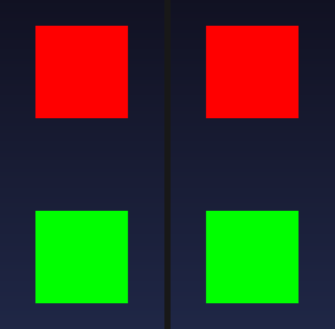

# a compiled `glBegin` run takes the colour current at `glCallList`, and Celeritas draws it that way too (2026-11-02)

Round 6 made a display list compiled out of `glBegin` geometry replayable. This round fixes what that replay drew with:
the colour.

A display list compiles the **commands**, not the values. A `glVertex` written inside `glNewList(GL_COMPILE)` takes the
colour and the texture coordinate current at `glCallList` unless the list itself carries a `glColor`/`glTexCoord`
command. Round 6's replay baked the values the capture had seen at compile time into the copied vertices, so a mod that
compiles a mesh once and draws it in a different colour per instance got the compile-time colour - and the fixture that
was written to prove the replay ended up asserting that answer as if it were GL's ("the call sets red immediately
before `glCallList` and the compiled green wins").

This round is that correction, measured on one JAR against the reference renderer that is real GL.



## The scene

`-Dceltium.validation.screen=displaylist` (`DisplayListLegacyScreen`, fixture only) now compiles and draws three lists
in every frame, all under `glColor4f(red)` and under a `glPushMatrix`/`glTranslatef` that swaps the two squares'
slots between frames:

| list | colour command | GL's answer |
|---|---|---|
| **outer** | none - green was set *outside* the compile | **red** (the colour current at `glCallList`) |
| **inner** | `glColor4f(green)` *inside* the compile | **green** (the list's own command wins over the caller's) |
| **line loop** | `glColor4f(cyan)` inside the compile | cyan - the primitive GregTech's rotation marker uses |

A fourth quad, yellow and drawn directly with `glBegin`/`glEnd` in the same frame, separates "the list replay drew
nothing" from "the immediate path drew nothing". The scene asks for two consecutive presented dumps (`-a` even, `-b`
odd), so the slots must also swap between them.

## The change

* `LegacyImmediateCapture` now knows whether a compile is open when a `glColor*`/`glTexCoord*` arrives, and carries
  the provenance of the values the open run's first vertex saw, plus whether the list changed either attribute *between*
  its vertices. `end(...)` hands the result to the record sink as `CompiledLegacyRun.ATTRIBUTE_*` flags.
* `CompiledLegacyRun` keeps the flags and, at replay, `applyCallState` writes the colour/coordinate current at
  `glCallList` into the copy for every attribute the list never set. Attributes the list did set keep their baked bytes
  - that is the only place a mid-run `glColor` (a colour change between two vertices of one run) can live, and such a
  run is left baked and counted (`compiledMidRunChanges`).
* `CeltiumGlStub` calls `legacyCapture.setCompileOpen(...)` at all four places a list opens or closes (the transformer's
  `celtium$noteListOpened`/`celtium$noteListClosed` and the stub's own `SEM_NEW_LIST`/`SEM_END_LIST`), and the replay
  applies the call-time state before submitting.
* `-Dceltium.glstub.legacyCallState=false` restores the baked behaviour on the same JAR (A/B switch). Default on,
  because baking is a wrong picture and not a smaller one: OpenComputers' screen text, AE-Net-Vis' link renderers and
  GregTech's marker all set the colour immediately before `glCallList`.
* Instruments: the verification line's `celtium/legacyListRuns[...]` now carries `callState=<replays>` and
  `provenance[colour=<runs> tex=<runs> midRun=<runs>]`; `CELTIUM_LEGACY_LIST_RUN` lines carry `attributes=`.
* CPU tests: `LegacyImmediateCaptureTest` pins the three provenance cases (outside the compile, inside it, changed
  mid-run) and the compile-close reset; `CompiledLegacyRunTest` pins the byte offsets for both layouts, the "list set
  it, do not rewrite" case and the idempotent multi-replay write.

## The two arms

Same fixture in both arms: `803b03c2cb74f8bc7d8279a15ad1ae33da46a9c26344080ba0058017b85ebbfb`. Same scene, flags,
1280x720, `guiScale3.txt` (GUI 427x240), AMD Radeon RX 6400.

| arm | leg | renderer | device | result |
|---|---|---|---|---|
| Celtium | `r27a-displaylist` | `82dc16922f8b6f4c08e5bceecb8836a8008a0faeec0b5532e40b12a9c81a23e8` | RADV NAVI24 | `INCONCLUSIVE`/exit 2, `problems=[]`, `UNCALIBRATED_PRESENTED_IMAGE` (a named screen moves the calibration key off the terrain pose, by construction) |
| Celeritas | `r27b-displaylist-ref` | `567dcf8aadd6f4f4d5d594b02549c7997385b7dc8ade5e9722d1e9756056092c` | radeonsi navi24 | `INCONCLUSIVE`/exit 2, `problems=[]`, `UNCALIBRATED_PRESENTED_IMAGE` |

Celtium's pictures are its own presented dumps (`displayListDumpCount=2`, `completed=true` at presented frames 44 and
45); the reference arm has no presented dump (a GL arm presents through the game), so it is judged by
`-Dceltium.validation.screenshotAtTick=120`, which is the same scene at tick 120.

### Ink per band (`scripts/cpu-contract/display-list-legacy-check.py`)

| frame | outer band | inner band | cyan loop | yellow control |
|---|---|---|---|---|
| `displaylist-f40-a` (even) | band0 **red 32400**, green 0 | band1 **green 32400**, red 0 | 340 | 14400 |
| `displaylist-f41-b` (odd) | band1 **red 32400**, green 0 | band0 **green 32400**, red 0 | 340 | 14400 |
| Celeritas, tick 120 | band0 **red 32400**, green 0 | band1 **green 32400**, red 0 | 1014 | 14400 |

32400 = (2·30·3)² is the square's own area at the picture's scale, i.e. the whole quad is one colour and no pixel of the
other colour is in the band. The reference arm - real OpenGL, same fixture, same scene - produces the same arrangement,
which is what settles the rule without an argument about the specification.

The positive control is built from the run's own pixels: the inner (green) square is pasted onto the outer one - the
picture a baked-colour replay leaves, green in both bands - and the same analysis has to report both bands green
(`band0_green=32400 band1_green=32220`, so the outer-band assertion fails). On the reference picture the same control
leaves `band0_red=180 band0_green=32220`, which the single-picture rule rejects. `scripts/tests/test_display_list_legacy_check.py`
runs both the multi-frame and the single-picture judgement on synthetic frames, so the checker's two directions are in
the CPU suite.

### Replay census and errors (Celtium arm)

`celtium/legacyListRuns[enabled=true recorded=3/11 replayed=156/572 lists=3 bytes=176 droppedBytes=0
replayRefusals=0 callState=52 provenance[colour=1 tex=3 midRun=0]]` - three lists, 52 frames' worth of replays, and
exactly the outer list's 52 replays took the call-time colour; the other two carry their own `glColor`, so their bytes
are not rewritten. The texcoord flag is set for all three (no list sets a coordinate) and costs nothing while the runs
are untextured.

`celtium/vulkan-check passes=1469 skipped=0 errors=0`, zero `VUID` lines, zero device-lost events,
`validations=0` (the validation layer was loaded: `CELTIUM_VALIDATION messenger=… layer=VK_LAYER_KHRONOS_validation`).

## What this does not claim

* **A mid-run attribute change is still baked**, by design (one submitted block cannot change colour halfway through),
  and it is counted. No pack path measured this round exercises it (`midRun=0`).
* **The layout at `glCallList` is still the layout at compile time.** A list compiled with `GL_TEXTURE_2D` enabled is
  replayed as `POSITION_TEX_COLOR` even if the caller disabled texturing, and the other way round. That is a separate
  question (it needs a vertex-format conversion) and is not addressed here.
* **The colour mirror of a compile is not rolled back.** Under `GL_COMPILE` a `glColor` inside the list is stored, not
  executed, so it should not become the caller's current colour; the capture's mirror and the backend's colour mirror
  still hold it after `glEndList`. Runs after the compile are marked "set outside" and their replay takes the call-time
  value, so this round's path does not depend on the stale mirror - but a *direct* `glBegin` run after a compile could
  still see the compile-time colour. Not measured in this round.
* Intel was not run; one pack (Supersymmetry); one scene.

## Re-running

```sh
JAVA_HOME=/usr/lib/jvm/java-25-openjdk-amd64 scripts/build.sh :celtium-vulkan:test :forge122:packageJar :forge122:validationRemapJar
# stage = the packaged renderer + the remapped fixture
CELTIUM_INSTANCE_COHORT=$HOME/.local/share/PrismLauncher/instances/Supersymmetry \
CELTIUM_LEG_SEED_OPTIONS=$PWD/.celtium-work/options/guiScale3.txt \
  scripts/gv-leg.sh <fresh> .gv-verify/jars/<stage> plain amd 200 \
    -Dceltium.validation.screen=displaylist -Dceltium.validation.screenshotAtTick=120
python3 scripts/cpu-contract/display-list-legacy-check.py --run .gv-verify/run-<fresh>
# the same scene under real GL (no presented dump in that arm: judge the game's own screenshot)
CELTIUM_LEG_REFERENCE_RENDERER=$HOME/ダウンロード/01-celeritas-forge-mc12.2-2.5.0-dev.jar \
CELTIUM_INSTANCE_COHORT=$HOME/.local/share/PrismLauncher/instances/Supersymmetry \
CELTIUM_LEG_SEED_OPTIONS=$PWD/.celtium-work/options/guiScale3.txt \
  scripts/gv-leg.sh <fresh-ref> .gv-verify/jars/<stage> plain amd 200 \
    -Dceltium.validation.screen=displaylist -Dceltium.validation.screenshotAtTick=120
python3 scripts/cpu-contract/display-list-legacy-check.py \
  --report .gv-verify/run-<fresh-ref>/logs/celtium-validation.json \
  --picture .gv-verify/run-<fresh-ref>/screenshots/celtium-at-tick-120.png
```
