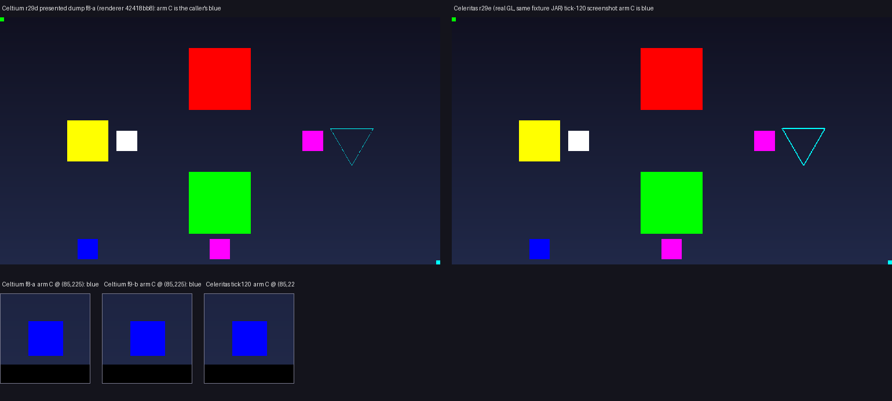

# a `GL_COMPILE` list does not change the caller's colour, and Celeritas says so too (2026-11-02)

Rounds 6-8 made a replayed `glBegin` run take its mysterious state from the caller: the colour and coordinate a list
never set (round 7), and the vertex layout the call-time texturing state selects (round 8). Both were rules read *from
the list inwards*. This round reads the same rule *from the caller outwards*: what does the compile leave behind?

GL stores the commands between `glNewList` and `glEndList` and runs them at `glCallList`, so a `glColor` recorded inside
a `GL_COMPILE` list does not become the caller's current colour. `GL_COMPILE_AND_EXECUTE` is the exception the spec
names: it records *and* runs, so there the colour really does become current.

Celtium's legacy immediate capture is fed by the transformer's direct colour route (`celtium$legacyColor`), which does
not pass the stub's "a list being compiled does not execute" guard: it wrote the capture's mirror straight through. So
after a mod's `glEndList` the list's last colour stayed current, and every following `glBegin` that does not set a
colour of its own - the shape Forge's splash bar and GregTech's overlays use - was drawn in it. A wrong picture, not a
missing one.



## The change

* `LegacyImmediateCapture.openCompile(int glMode)` snapshots the current colour (four floats) and texture coordinate
  (two) when a `glNewList` opens; `closeCompile()` puts both back and returns whether it did. It is deliberately
  *idempotent*: the stub's own `glNewList` dispatch and the transformer hint the game's calls reach both report the
  same compile, and the first arrival is the one that holds the caller's value - re-snapshotting at the second would
  capture the list's own colour as if it were the caller's.
* `GL_COMPILE_AND_EXECUTE` (0x1301) is not rolled back: the command ran, so the mirror it left is the correct one.
  The provenance flags (`colourSetInList`/`texSetInList`) are still cleared on every close, as before.
* `CeltiumGlStub` keeps its *own* snapshot of `GL_CURRENT_COLOR` for the same compile (`openCompileState`), because
  the two mirrors are fed by different writers: the capture's only by the raw colour route that feeds vertices, the
  stub's by every path that sets the colour (the game's `GlStateManager.color` included) and by the backend's colour
  mirror, which formats 6, 7 and 9 and the model replay read for the group tint. Each is restored to what it held, and
  the backend is pushed the restored value once per compile (`setColor`) so the list cannot tint the next group.
* The colour a compile records is still baked into the run's vertex bytes when the list sets it before/within the run
  (round 7's `runColourInList`/mid-run flags are unchanged): the rollback restores the *caller's* state, it does not
  discard the list's own commands.
* Instrument: `celtium/legacyListRuns[...]` gains `provenance[... rollbacks=<n>]`; the capture's one-line summary
  gains `compileRollbacks=`.

## The scene

`-Dceltium.validation.screen=displaylist` (`DisplayListLegacyScreen`, fixture only) gained **arm C** next to the two
layout arms, in the free bottom-left slot the direct control's column leaves empty (`armC=85,225,10`, a 20x20 GUI-unit
quad at the panel's bottom row, clear of the direct textured control at the centre of that row):

1. set the caller's colour - **blue**;
2. `glNewList(GL_COMPILE)` and record **red** plus a quad, then `glEndList` - GL stores that red;
3. query `glGetFloatv(GL_CURRENT_COLOR)` right there - the state answer, `colourAfterCompile=`;
4. draw the arm's quad with **no colour call of its own** - the picture answer.

The failure colour is therefore exactly the colour the compile recorded, and the arm's positive control paints the
outer square's red (the list's colour after the call) over arm C, which the check has to reject. The list is recompiled
every frame on purpose: the state it must leave behind is only observable *immediately* after its own `glEndList`, and
the rest of the scene sets colours of its own before the frame is dumped - a single compile on the first frame would
have its evidence overwritten.

## The two arms

Same fixture JAR in both: `7c3305609d396f910b0e006c41c67e6b3c820215e5dde2396ad29ac0194bef43`. Same scene, flags, 1280x720,
`guiScale3.txt` (GUI reported as 427x240), AMD Radeon RX 6400, same seed options hash.

| arm | leg | renderer | device | picture source |
|---|---|---|---|---|
| Celtium | `r29d-compilecolour` | `42418bb82d426cf960c4d4423615b0a2c4f26917520346e8f5805739e0c67a26` | AMD Radeon RX 6400 (RADV NAVI24) | presented dumps, presented frames 13 and 14 |
| Celeritas 2.5.0-dev | `r29e-compilecolour-ref` | `567dcf8aadd6f4f4d5d594b02549c7997385b7dc8ade5e9722d1e9756056092c` | AMD Radeon RX 6400 (radeonsi, navi24, ACO) | game screenshot at tick 120 |

Both legs are `exitCode=2 INCONCLUSIVE problems=[]` **by construction**: a named screen moves the calibration key off
the terrain pose, which is what `UNCALIBRATED_PRESENTED_IMAGE` says. The picture and the counters are the measurement;
the acceptance gate is not.

## The readings

Celtium (`display-list-legacy-check.py --run`), both frames:

```
displaylist-f8-a band0_red=32400 band0_green=0 band1_red=0 band1_green=32400 triangle_cyan=340 direct_yellow=14400
                 armA_white=3600 armA_magenta=0 armB_white=0 armB_magenta=3600 texControl_magenta=3600
                 armC_outside=3600 armC_inside=0
displaylist-f41-b (the same, bands swapped: band0_green=32400 band1_red=32400) armC_outside=3600 armC_inside=0
control (displaylist-f40-a's inner square pasted into displaylist-f41-b's outer band) both=True
control (displaylist-f40-a's layout arms exchanged) rejected=True
control (displaylist-f40-a's list colour painted over arm C) armC_outside=0 armC_inside=3600 rejected=True
PASSED
```

Celeritas (`--picture` on the tick-120 screenshot) reads the identical arrangement:
`armA_white=3600 armA_magenta=0 armB_white=0 armB_magenta=3600 texControl_magenta=3600
armC_outside=3600 armC_inside=0`, `triangle_cyan=1014`, `direct_yellow=14400`, all three controls rejected. **Real GL
leaves the caller's blue current after `GL_COMPILE`**, which is the rule the fix implements.

The state instrument agrees with the picture in both arms: `colourAfterCompile=0,0,255` and
`compileColourLeaks=0` over `compileColourFrames=51` (Celtium) and `172` (Celeritas). Before the fix the same query
returned the recorded red - and the arm's quad would have been painted in it, which the third control above shows the
check would have rejected.

## Renderer health for the Celtium arm

* `celtium/vulkan-check passes=1440 errors=0`; 0 `VUID` lines in the log.
* `run-r29d-compilecolour/validation-process.json`: `validationMessageCount=0`, `validationClean=true`
  (VK_LAYER_KHRONOS_validation loaded).
* `lostDevices=0` in the backend's `waitOutcomes`; no device-lost line.
* `celtium/legacyListRuns[enabled=true recorded=56/223 replayed=255/969 lists=6 bytes=400 droppedBytes=0
  replayRefusals=0 callState=153 layout=102 provenance[colour=2 tex=55 midRun=0 rollbacks=66]]` - the 66 rollbacks
  are the fixture's 51 frames plus the startup compiles this leg's lists and models made; `recorded=56` is the five
  fixture runs plus the 51 arm-C runs (the arm is compiled and deliberately never called).

## What this does not claim

* A *pack* list's compile being rolled back is not separately counted: the counter shows the mechanism ran 57 times, and
  GregTech's marker compile is the shape the scene reproduces, but no leg here sat in a world with a wrench held.
* The font colour capture (`CeltiumFontGlyphCapture.currentColor`) is a third mirror of the same GL state and is *not*
  rolled back; vanilla sets a colour before every glyph run, so the stale value is unlikely to be read, but that is an
  assumption and not a measurement.
* The dump requests used to be at draw frames 40/41, which land on presented frames 42/43 - exactly where this scene's
  legs were ending (leg `r29a`: the second stage's report line was serialized before its completion, `completed=false`
  while its image, identity file and `presentedFrame=43` all existed). They are now at 8/9, so the pair is on presented
  frames 13/14 and the report says `completed=true` for both; the checker still falls back to the harness's `-kept` copy
  for a report line written before its completion, with a test.
* The run length is not stable and it is *tick*-bound, not frame-bound: the scene's world capture waits for a pinned,
  stable section set and happened at tick 358 on the passing leg, so a 200 s budget can end before it (leg `r29c` was
  killed at tick 300 with no report at all). This leg's budget was 300 s. The 51 drawn frames here against round 8's
  145 are that same spread and are not a performance measurement.
