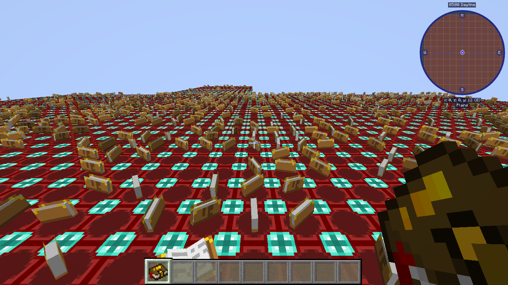

# Enigmatica 2: Expert 1.93a on Cleanroom 0.7.11 + Celtium (2026-10-26)

All legs ran on the AMD RX 6400 with the leg's `e2e` mode and a private instance
(`.celtium-work/modpack-p0/prism-e2e-private/instances/e2e-1.93a`, 270 manifest jars).
Local substitutions are listed in `.celtium-work/modpack-p0/e2e-staged/SUBSTITUTIONS.md`:
- Nothirium and Naughthirium excluded (Celtium replaces the terrain renderer).
- CodeChickenLib CRE 3.3.8 → 3.3.10.
- Fugue's "Reflection Patch Target List" emptied.
- StellarCore `ParallelModelLoader=false`.

The first two changes are needed because Cleanroom 0.7 no longer ships `com.cleanroommc.hackery.ReflectionHackery`, which the pack's 0.6-era CodeChickenLib and Fugue's reflection patch both call.

## Fixed in Celtium

| Commit | Defect | Evidence |
|---|---|---|
| `22bb9211f` | The loading screen queued hundreds of uploads into one batch, and building them all on the 64 KiB MemoryStack threw "Out of stack space". Batches now go to the queue in chunks of 128. | Leg e2e-amd3 loads and exits 0 |
| `a72f32533` | Every GL sub-image patch was its own command buffer and submission (70,875 allocations over 42 world frames). Patches are now batched per backlog drain, and one-shot command buffers are recycled. | World frames 42 → 345, p50 869 → 41 ms |
| `d419df88f` | `celtium$queueMeshUpdates` never queued into an empty rebuild queue. | World legs pass |

## Open: black band at the horizon

The floor near spawn is drawn; beyond it the image is black where Celeritas shows the floor to the horizon. Ruled out by measurement:
- **Fog:** the backend and `TerrainRenderer` both use the sky colour, linear fog 96–128.
- **Chunk availability:** the client holds 169 chunks under both renderers.
- **Visible count:** the F3 `C:` count is the same (10 vs 8 of 1936).
- **Occlusion culling:** `-Dceltium.debug.noOcclusion=true` changes nothing.
- **Build throughput:** with adaptive scheduling on, builds flow at 20–40 results a frame, but about 240 sections stay pending all run.

The remaining hypothesis is that Alfheim's light updates keep re-marking the same sections for rebuild, so they stay pending and are drawn with unsettled light. The next measurement is a per-tick count of `markBlocksForUpdate` calls and their positions. The E2E test world is not reproducible across mod sets (without Alfheim there is no floor at all), so a Celeritas reference must run with the same jars.

## Rebuild storm and the lighting-engine policy

`-Dceltium.debug.markTrace=true` showed `markBlocksForUpdate` running 316,882–415,911 times per 5 s over only about
440 distinct sections. The callers:
- tile-entity ticks (`World.updateEntities` → `notifyBlockUpdate`);
- Alfheim's client `processLightUpdates` on every tick;
- a LittleTiles ↔ Alfheim loop: LittleTiles' `LightChangeEventListener` reloads its tile entity on each Alfheim light
  change, which issues another block update.

**Policy (user, 2026-10-26):** Alfheim is unsupported with Celtium and Pulsar Lighting Engine is the supported lighting
engine. E2E runs with `pulsar-0.5.2.jar` (Modrinth gs7RbryI; Alfheim moved to `replaced/`).

## 2026-10-29: the black band is fixed (AMD); Intel crashes while loading

**Cause of the black band.** The pack runs with mipmaps off (`mipmapLevels:0`), so the game writes only level 0 of its
8192x8192 block atlas. The terrain sampler still read up to level 4, whose content was zeros, so everything a few blocks
out sampled black. Pixel probes put every black pixel on a lit block 12-21 blocks away (sky light 15); skipping the sky
pass left the band in place; the clear colour (`f97f01558`) and fog occlusion were ruled out on their own legs.
`af1e97fe0` caps the sampler at the highest level the game gave the atlas. Leg `e2e-lod3` (AMD): PASSED, presented
black fraction 0.131 -> 0.004, floor drawn to the horizon as in the Celeritas reference.

**Intel UHD 630.** Every run dies with SIGSEGV inside `libvulkan_intel.so` (+0xbe54a, address 0) in
`vkCmdCopyBufferToImage`, called from `VulkanGlTexture.uploadPatchedLevels` <- `announceFullPixels` <-
`TextureUtil.uploadTextureMipmap` <- `TextureMap.finishLoading`, at about 40% atlas coverage. Deterministic over four
runs. Unchanged with `-Dceltium.vulkan.batchTexturePatches=false`, with the atlas mirror at one level, and with
`INTEL_DEBUG=noccs`; no allocation failure or exception is logged, and the same copies are validation-clean on AMD.
Next: locate the faulting function with Mesa debug symbols.

**2026-10-29 follow-up.** Mesa 26.2.5 debug symbols place the fault at a binding-table write in
`blorp_alloc_binding_table`. Texture loading can retain thousands of completed one-shot command buffers until a
frame polls them; the new pressure limit reclaims completed submissions and waits for the oldest if necessary.
`pressure-intel`, E2E 1.93a, Intel UHD 630, renderer SHA-256
`6cae0dc44ce3b7898539e79aad7d7a0bc9a52ec6f61506e5d15d98f08589800a`, fixture
`87ce2ad793d34526a95309085e986cc35e96f9c574370614437b6695d181772b`: startup and world reached, fixture PASSED,
GPU requirement met, validation ON with 0 messages. During loading 128 command buffers were allocated and 37,499
reused (peak outstanding 128). Scene terrain, camera (0.5,12,0.5), yaw 180, pitch 20, 1280x720, view distance 8;
[presented image](2026-10-29-e2e-intel-pressure.png). The image is **not comparable**: capture hit its deadline with
39 P1 builds pending. The log also shows format-4 atlas draws refused; the gate alone does not establish complete mod
rendering. This is one successful Intel run, not proof against all driver crashes. AMD and Intel qmagnet world legs on
the same jar both passed with validation 0 and comparable captures; performance and the other four screens were not
remeasured.

**Sparse atlas follow-up.** On Intel E2E, the 8192² atlas had unwritten gaps, so the whole-tile coverage test never
marked it sampleable and rejected atlas-dependent immediate draws. An intermediate renderer
`a0ce17e4c1ede301b0eed2a9798485d291e216e92e9910c28d4ad23986eb8b11` with fixture
`0ee6f5f0e491027aee962003ef9871c12232df0679070eb9f770ff37c2dccb38` displayed the
[held apple and hotbar icon](2026-10-29-e2e-intel-item.png), reached the world and had validation 0; the image was
not comparable because 15 P1 builds remained. The final renderer was **not** rerun on E2E.

The final implementation clears a new native image before its first partial write, leaving earlier GPU blits and
other mip writes untouched. Renderer `59c26f684441dcfb9ee6433eb80b832fb397e1d04d708051c8c351c24b3c8b5a`, fixture
`566b9ad20b4ad83a4412eb7c51a7b752c9632ceadd4febd3b34c75dbbe243942`: `owned-sparse-amd` and
`owned-sparse-intel` show both 64² patches in a 4097² texture; the [crop](2026-10-29-sparse-texture.png) shows
the AMD control, fixed result and Celeritas reference. Control renderer
`6cae0dc44ce3b7898539e79aad7d7a0bc9a52ec6f61506e5d15d98f08589800a`, reference
`567dcf8aadd6f4f4d5d594b02549c7997385b7dc8ade5e9722d1e9756056092c`; same fixture, QMAGNET, camera
(217.5,48,217.5), yaw 180, pitch 10, 1280×720, fixed time 1500; native captures at world ticks 205/207 after the
tick-200 request and pinned-section gate. Both native legs
met the GPU requirement and had validation ON with 0 messages. `owned-world-{amd,intel}` and
`owned-video-{amd,intel}` also passed their gates with validation 0; menu/loading and settings images were inspected.
The fixture's two sample pixels match the reference (red `255,0,0`, green `0,255,0`); no speed claim is made.

## 2026-10-29: All the Mods 3 (6.1.1) on Cleanroom 0.7.11

Instance `atm3-6.1.1` (the gist's migration: 17 mods removed, Fugue, Scalar Legacy, LibrarianLib-Continuous,
Forgelin-Continuous, RoughlyEnoughIDs and HEI added; 248 jars). Platform fixes needed before Celtium is involved:
Scalar Legacy (BdLib is Scala 2.11), Fugue 0.25.5 (Quark calls Cleanroom 0.6's `ReflectionHackery`), `-Xmx7g`
(CraftTweaker ran out of 5 GB), and ConfigChecker's RAM checks off (its modal dialog waits forever headless).

- Celtium bug fixed: the GL-less transformer emitted `glCopyTexImage2D(IIIIIIII)V`, the hint had only the
  seven-argument form - The Betweenlands died with NoSuchMethodError (`3764c9887`, new CI contract).
- Open: with The Betweenlands its per-frame depth-buffer `glCopyTexImage2D` path makes a frame ~700 ms (Celeritas
  51 ms); without it 63 ms.
- Celtium bug fixed: terrain drawn black (black 0.64). Mods build secondary RenderGlobals (Chisels & Bits'
  `ChisledBlockRenderChunkTESR.nextFrame` -> `loadRenderers`, another `setWorldAndLoadRenderers`); each built a new
  terrain backend that replaced the installed one and lost the atlas mirror. Only `Minecraft.renderGlobal` drives the
  renderer now (`07d381a24`): AMD, Betweenlands excluded, black 0.003, p50 33.5 ms (Celeritas 51 ms); world-0.7.11,
  world-xaero and E2E 1.93a legs PASSED on the same jar.

## E2E-E 1.87.3 status detail (moved from plan.md, 2026-10-31)

- AMD: fixture PASSED, validation 0 (`e2ee-amd-c4`), 0.25% difference across 16 levels against Celeritas. Intel not run.
- Cleanroom 0.7 environment differences are handled by local substitution
  (`.celtium-work/modpack-e2ee/SUBSTITUTIONS.md`) and upstream PRs (Fugue #136, Cleanroom #720).
- Fixed in Celtium: fail-fast for conflicting mods (CLS, SmoothFont); chain-pair retire/resize destroyed an image,
  framebuffer and sampler while they were still recorded (use-after-free, `8f121acfb`).
- Resolved: Xaero World Map minimap (4-unit COMBINE, `e57b51421`), player arrow (`ff74fd73f`), atlas missing/parse
  errors (`5f8badef9`; re-confirmation on E2E-E still wanted).
- Remaining: (1) Xaero radar entity icons missing; (2) HUD missing from Gnetum's FBO management - refused as a
  conflicting mod (`889cc89e3`); (3) ten `VUID-vkCmdDraw-None-09600` on the atlas (writer to be identified with
  `-Dceltium.vulkan.descWriteCensus=true`); (4) EnderIO `block_buffer` NPE during FTB Quests sync (1 of 3 runs,
  timing dependent); (5) fixture's validation count reads 0 while the console still carries errors.

## 2026-11-06: E2E-E 1.87.3 on the reinstalled instance (Cleanroom 0.7.14 via relauncher 1.3.0)

The reinstalled instance (manifest jars, `celtium-e2ee-1.87.3`) never reached the world before today: every leg
halted in mod loading, with Celtium and with Celeritas as the renderer alike (`m3-e2ee-ref`), so none of these are
Celtium defects. The `e2ee-amd-c4` pass above ran on the old private instance (Cleanroom 0.7.11 directly). Three
local substitutions, recorded in `.celtium-work/modpack-e2ee/SUBSTITUTIONS.md`:

| Halt | Cause | Substitution |
|---|---|---|
| `IllegalAccessException` in `ConfigManager.sync` (ThaumcraftFix 1.1.11) | its `@Config` class is package-private; Fugue 0.25.5 ships `ThaumcraftFixConfigImplTransformer`, 0.24.4 does not | Fugue 0.24.4 -> 0.25.5 |
| `NoClassDefFoundError` `icbm/.../BlastAntimatter` (Trinity `ICBMEvents`) | no ICBM in the pack; Forge's `EventBus.register` reflects `getMethods()`, Cleanroom 0.7.14's `getDeclaredMethods()` resolves the private lambdas' ICBM parameter types | Trinity without `ICBMEvents.class` (registered by its proxy only when ICBM is loaded) |
| `NoClassDefFoundError` `com/cleanroommc/hackery/ReflectionHackery` (CodeChickenLib) | 3.3.8 calls a Cleanroom 0.6 class | CodeChickenLib 3.3.8 -> 3.3.10 (as E2E 1.93a) |

With them, stage `r112-split` (HEAD `87512bd0c`), 2400 s e2e legs:

| Leg | GPU | fixture | validation | notes |
|---|---|---|---|---|
| `n1-e2ee-amd` | AMD RX 6400 | PASSED | 5 x `VUID-vkCmdDraw-None-09600` | first world frame (frame 2): a 5-level image, every level in `TRANSFER_DST` at the submit |
| `n1-e2ee-intel` | Intel (`gpuRequirementMet=true`) | PASSED | the same 5 x 09600 | first E2E-E Intel leg to reach the world |

So the atlas fix (`732ac81ba`) did not remove every 09600: one image with five levels still reaches a draw in
`TRANSFER_DST`, and the upload paths read so far (whole-image, per-level, patch, deferred batch) each return their
levels to `SHADER_READ_ONLY` in the same command buffer. Next discriminator: `5485ebaf6` names every GL texture
image under validation (`gl<id> WxH mips=N`), so the next leg's message names the texture and its producer.
Also seen, pack-side: Thaumic Additions' JEI subtype interpreter NPE (`getAspects` null), caught by JEI.

## 2026-11-05: E2E 1.93a passes on both GPUs with the current renderer

The pack's staged mods (`.celtium-work/modpack-p0/e2e-staged/mods`) had been deleted; they were re-fetched from
`e2e-urls.txt` (270 jars, edge.forgecdn.net) with the substitutions above re-applied (Nothirium/Naughthirium out,
CodeChickenLib CRE 3.3.8 -> 3.3.10 from Modrinth `KphJPRlN`; the Fugue and StellarCore configs were still in place),
recorded in `e2e-staged/SUBSTITUTIONS.md`. Two harness/setup problems were found on the way:

- `scripts/prism_validation.py` keyed a profile's natives entry and class-jar entry of one coordinate alike, so the
  natives replaced LWJGL's class jars (`NoClassDefFoundError: org/lwjgl/BufferUtils`, leg `e2e-amd-r1`). Fixed in
  `43880abc8`.
- The instance runs LWJGL 3.4.3; the leg's default `lwjgl-vulkan-3.4.1` has no `VkDebugUtilsMessengerCallbackEXTI`, so
  Vulkan device creation failed and the client sat on `GuiScreenWorking` for the whole leg (`e2e-amd-r2`). Run with
  `CELTIUM_LEG_LWJGL_VULKAN=<instance>/libs/lwjgl-vulkan-3.4.3.jar`.

| leg | GPU | renderer | result |
|---|---|---|---|
| `e2e-amd-r3` | AMD RX 6400 | `f4f1993d…` | **PASSED**, validationMessageCount=0, gpuRequirementMet=true, sceneGateCalibrated/KeyMatches=true, world 4273 colours, black 0.003775 |
| `e2e-intel-r1` | Intel UHD 630 | same | **PASSED**, validationMessageCount=0, gpuRequirementMet=true, KeyMatches=true, world 4656 colours, black 0.00377 |

The horizon black band of 2026-10-26 is not present: the floor reaches the horizon. Open: a Celtium that cannot create
its Vulkan device leaves the client on `GuiScreenWorking` instead of failing (`e2e-amd-r2`: 25 minutes, "Celtium
requires a Vulkan terrain backend" logged as a scheduled-task exception) — goal condition 6 asks for no silent failure.

## 2026-11-05/06: static fixes against the remaining E2E-E items (not yet run on E2E-E)

- (1) Xaero radar icons: one image per raw framebuffer meets Xaero's attachment swap; fix behind
  `-Dceltium.vulkan.rawFboTextureIdentity=true` (b35f73b6e, [reading](xaero-radar-icons-2026-11-05.md)). world-xaero
  off/on legs both PASSED with 180 changed minimap pixels; the GL reference leg decides which is right.
- (3) the ten `VUID-vkCmdDraw-None-09600` on the atlas: a captured mip level above 0 was left in TRANSFER_DST
  (732ac81ba, loop bound 79392badc).
- (4) EnderIO `block_buffer` NPE: no stack trace in any kept log; needs the next occurrence.
- (5) validation count 0 with console errors: console-only messages now count (ee8623e0d).
- Run with `CELTIUM_E2E_PACK=e2ee` when heavy legs are allowed.
