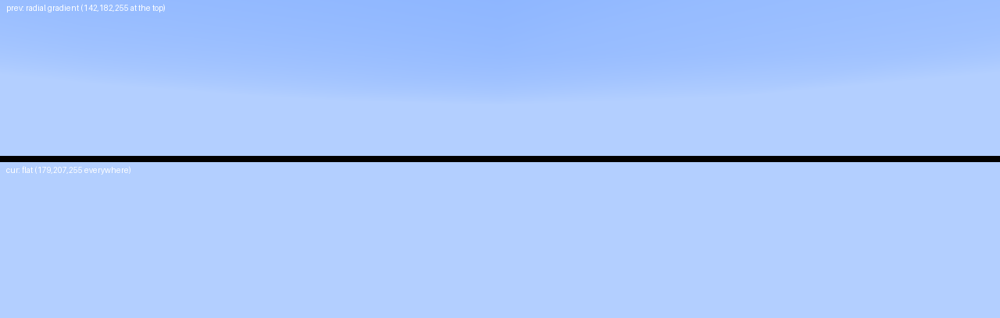

# two consecutive frames of a still scene: 16.6% of the frame differs, and the accept path's cost is named (2026-11-03)

The user's report has one symptom this project had never measured: "the blocks flicker / structures appear in the
air". Every other symptom in the report has a leg behind it (menu background, tooltip afterimage, creative tab,
custom rendering, invisible models, sign text). This round builds the measurement, takes it, and - because the same
leg carries the accept path's new sub-brackets - names the two calls that own the renderer's per-offer cost.

## The scene, and why each control is there

A still camera over a stack of solid blocks, with nothing in the frame that can change by itself:

| control | why |
|---|---|
| `worldLayers=3;minecraft:bedrock,2*minecraft:dirt,minecraft:grass;1;` | the default flat stack carries water, lava and fire, whose textures animate every tick; a whole-frame comparison of two frames is then dominated by them (measured in round 28: a 98,295 px mask) |
| the fixture's pinned pose | the camera is re-applied every tick, so the view cannot drift |
| `hideGUI` (the world stage sets it at tick 190) | the HUD's text and the hotbar are drawn by the same immediate path and change every frame |
| `effectRenderer.clearEffects` at the arm tick | the world's particles move |
| `renderClouds=0` | clouds move |
| the pinned world time (6000) and the pinned lightmap flicker | the sun angle and the lightmap are otherwise per-frame noise |
| first person (the view is not changed) | third person would remove the first-person hand, but it also moves the camera off the pose and the fixture's picture assertion refuses that (measured on leg `r29g`: "the renderer drew this picture from x=0.50 y=14.99 z=4.26, not from the pose's eye x=0.50 y=13.62 z=0.50"). The hand is therefore part of what this scene measures |

The pair is taken by the swapchain: `-Dceltium.debug.flickerSample` reads back two consecutive presented frames and
compares them, `-Dceltium.debug.flickerDump` writes them, and `-Dceltium.validation.flickerArmTick=T` says *when*.

## The instrument change: a present count is not a scene

The sampler used to fire after a fixed number of presents (`-Dceltium.debug.flickerFrom`, default 150). That is not a
scene: the loading screen presents hundreds of frames before the world exists, and how many depends on the pack. The
first attempt this round measured the splash (`present=152`, `changed=3270`), and the second measured the world only
because the count happened to land there.

`-Dceltium.debug.flickerArm` is now set by the fixture at a world tick it chooses, and the next two presents are the
pair. Defining the property at all (`-Dceltium.debug.flickerArm=false` on the command line) switches the present-count
rule off, so the two readbacks are not spent on the loading screen and the worst-pair count that gates the dump is
reset at the arm - without that reset the armed pair's dump was suppressed whenever the world was quieter than the
splash, which is the case the instrument exists for.

## The measurement

Leg `r29h-flicker` (plain/terrain, Supersymmetry, AMD RX 6400 RADV NAVI24, 1280x720, guiScale3, validation ON,
`worldLayers=3;minecraft:bedrock,2*minecraft:dirt,minecraft:grass;1;`, `flickerArmTick=198`, renderer
`006b4714…`, fixture `0e90c988…`):

```
CELTIUM_FLICKER_ARMED present=1189
CELTIUM_FLICKER present=0 changed=135325/921600 fraction=0.14684 maxDelta=37
```

`scripts/cpu-contract/flicker-frame-check.py` reads the two dumped frames independently and agrees:
`135325 of 921600 pixels differ (fraction=0.14684, maxDelta=37)`.

**Where the difference is** (160x80 cells, changed pixels):

| rows | columns | changed | what is there |
|---|---|---|---|
| 0-79 | all | 12772-12800 | the sky's upper band |
| 80-159 | all | 978-6673 | the sky's lower band |
| 160-719 | all | **0** | the terrain, the horizon, the hand, the shadow |

The difference is the sky and nothing else. The terrain, the first-person hand and the shadow are pixel-identical
between the two frames, which is what makes this a measurement of the renderer rather than of the scene.

**What the sky does.** One frame carries a radial gradient about the view axis - (142,182,255) at the top of the frame,
(152,189,255) at y=80, (168,200,255) at y=120, (179,207,255) from y=160 down - and the other is flat (179,207,255)
everywhere. The flat value is the steady state: the run's own acceptance pictures (`celtium-presented-tick200-*.png`,
`celtium-presented-world-*.png`) are flat at the same pixels. So the gradient frame is the anomaly, and it is a
one-frame difference in the sky's shading - the class of thing a player reports as "something appears in the sky".

The gradient is radial about the view axis and centred on the zenith, which is the shape of the sunset glow fan
`RenderGlobal.renderSky` draws with `POSITION_COLOR` and a per-vertex alpha (`RenderGlobal:1383`, gated on
`world.provider.calcSunriseSunsetColors(...) != null`). At the pinned world time (6000, noon) that call returns a
colour array - `cos(celestialAngle * 2pi)` is 0, inside the `[-0.4, 0.4]` window - so the fan is drawn every frame and
should be identical every frame. That it is present in one of two consecutive frames and absent in the next is the
finding. It is a hypothesis about *which* draw it is, not a measurement: the next unit is to dump the two frames'
sky batches (format, colour, blend, alpha test, and whether the batch was accepted) rather than to infer it from the
picture.

The `r29e`/`r29f` legs entered third person, which draws the player's model; its arms move between frames and added a
second, larger difference (16.6%, maxDelta 168). That is the fixture's own content, not the renderer's, and it is why
the final leg leaves the view in first person.



## The accept path's cost, named

The same leg carries `-Dceltium.vulkan.batchTimings` and the new sub-brackets, which split the two intervals the offer
stages left unnamed:

```
offerStages[nanosPerReached s8=3580 s9=131 s10=6846 s11=2260 s13=2075]
accept[decideMs=18 preflightMs=870 tailMs=0] parts[expand=88 matrix=105 extent=99 registry=2593 supply=4980 prepare=2015]
```

| part | ns/offer | what it is |
|---|---|---|
| **registry** | **2593-2676** | `VulkanTextureRegistry.get(name)` in the merge predicate |
| **supply** | **4980-5278** | `celtium$supplyMirror` / `celtium$refreshRawWrites` in the preflight |
| prepare | 2015-2127 | `prepareImmediate` (pipeline + descriptor, 99.87% cache hit) |
| expand / matrix / extent | 88-105 | the topology cache, the matrix capture, the texture-extent lookup |

The registry lookup is 2.6 us for a call the registry documents as "a field compare rather than a second hash": its
one-entry memo is bypassed whenever `announcedImages` is non-empty (VulkanTextureRegistry:483), which in a world scene
it always is. At ~225 offers a frame that is **0.6 ms a frame**; the supply is another **0.6 ms** at ~116 slow-path
offers. Together they are ~1.2 ms of a 3.2 ms frame - the size of the whole gap to Celeritas - and they are the next
performance unit, ahead of the plan's §12 Stage 1.

## The code

- `VulkanSwapchain`: the arm (`-Dceltium.debug.flickerArm`), the arm-only mode, the worst-pair reset, and a present
  counter for the arm line.
- `ValidationClient`: `-Dceltium.validation.flickerArmTick=T` hides the HUD, clears the particles, enters third person
  and sets the arm property, recording the tick and the pose.
- `VulkanTerrainGpuBackend`: six sub-brackets (`expand`, `matrix`, `extent`, `registry`, `supply`, `prepare`) printed
  as `accept[...] parts[...]` with `-Dceltium.vulkan.frameStats` + `-Dceltium.vulkan.batchTimings`.
- `scripts/cpu-contract/flicker-frame-check.py` + `scripts/tests/test_flicker_frame_check.py` (8 tests): identical
  frames pass, a patch above the floor fails, a change below it passes with its number, a difference exactly at the
  threshold is not counted, different sizes and missing frames are inconclusive, and a run with no dumped frames is
  inconclusive rather than read as "no flicker".

## Scope

One pack (Supersymmetry), AMD RX 6400, GUI scale 3, one pose, one pair of frames, a scene that is uncalibrated by
construction (`worldLayers` is part of the calibration key), so the leg's verdict is `UNCALIBRATED_PRESENTED_IMAGE`
(exit 2) and this document does not claim it is PASSED. Validation was clean on the leg (`vulkan-check passes=14456 errors=0`,
zero `VUID` lines, `CELTIUM_REFUSALS_BY_FORMAT {}`). No performance claim is made from this leg - the sub-bracket
numbers are per-offer averages from a diagnostic run, and the 1.2 ms they name is a target for the next round, not a
measured improvement.
