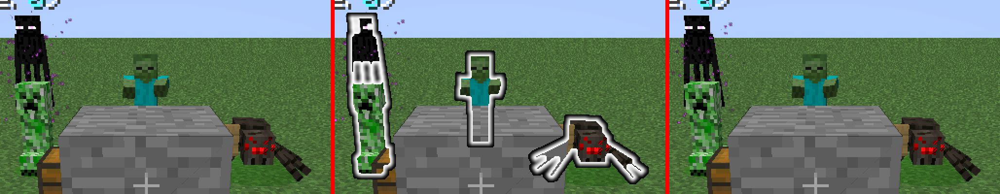

# the glow outline is in the picture, and the entity scene had the mobs in the air (2026-11-03)

The entity-outline glow is the last rendering feature whose evidence was a sentence read off a picture ("outlines
still drawn when entities glow") rather than a measurement, and the renderer contradicted it: a comment in
`supportedImmediateTarget()` said "the glow defect is real and is not fixed here". Both cannot be the current state.

This round settles it with the chain's own counters, a within-run off/on/off triple whose only difference is the
glowing tag, and a checker that can fail. It also found two fixture defects on the way, both of which had been
quietly shaping every entity-scene leg.



*Left: tick 190, no entity tagged. Middle: tick 191, every non-player entity tagged. Right: tick 192, untagged again.
Same run, same camera, same stack; the only input that changed is the tag.*

## The legs

| | glow arm | A/B arm |
|---|---|---|
| Leg | `r44a-glow` | `r44b-glowab` |
| Renderer | `479c783b87274f674ed81b734a7e8d43f0625486c124d492c30d65b6c2d4d600` | same |
| Fixture | `79899e494374f89f5c813029d937985d5231265bf91abf027b1ed683860303ca` | same |
| GPU | AMD Radeon RX 6400 (RADV NAVI24), `gpuRequirementMet=true` | same |
| Scene | `plain`, stack `3;minecraft:bedrock,2*minecraft:dirt,minecraft:grass;1;`, `keepEntities+captureEntities`, `-Dceltium.validation.glowEntities=true`, dump at tick 170 | `plain`, stack `3;minecraft:bedrock,2*minecraft:dirt,minecraft:grass,6*minecraft:dirt,minecraft:grass;1;`, `keepEntities+captureEntities`, `-Dceltium.validation.glowAbTick=190` |
| Camera | pinned `0.5/12.0/0.5 yaw 180 pitch 20`, `rendererCameraAtPose=true` | same |
| Flags | validation ON, 1280x720, `guiScale=3` | same |
| Verdict | `UNCALIBRATED_PRESENTED_IMAGE` (exit 2) | `UNCALIBRATED_PRESENTED_IMAGE` (exit 2) |

Both verdicts are uncalibrated **by construction**: the entity variant has no scene floors (the calibrated gate is a
terrain-only scene), so neither leg claims a picture verdict. Neither leg is a regression arm either - the calibrated
plain scene was gated in round 23 on the immediately preceding JAR.

## 1. The chain runs, the silhouette reaches it, and the composite draws

`r44a-glow`, with the tag on for 55 ticks:

| instrument | reading |
|---|---|
| `postChains` / `postPasses` / `postAdopted` | **149 / 596 / 1** (`postTargets=1`, `postPipelines=3`) |
| `CELTIUM_OUTLINE_INPUT` | `identity=106235273 texture=503 size=1280x720 clearedThisFrame=true chainPairClears=3606 publishedTexture=503` |
| `CELTIUM_CHAIN_INPUT_FLUSH` | `target=106235273 groups=49` a frame, `pendingForInput=0` |
| `CELTIUM_MODEL_OFFTARGET_BATCHES` | `calls=480 drawn=479 missingMeshes=0 refusals=0` |
| `nativeFramebufferComposites` | 168 |
| health | 0 `VUID` lines, `CELTIUM_REFUSALS_BY_FORMAT {}`, `celtium/vulkan-check passes=11602 skipped=0 errors=0`, no `DEVICE_LOST` |

So the silhouette is drawn into the game's own outline framebuffer, 49 groups a frame are flushed into that
identity before the chain reads it, the chain adopts and publishes the image the composite binds, and the composite
that blends it over the frame is drawn natively.

## 2. The within-run triple, and what it measures

`r44b-glowab` tags every non-player entity at tick `T+1` and clears the tag at `T` and `T+2`, dumping the frame each
tick draws (`glow-a`, `glow-b`, `glow-c`). The fixture reports `glowAba=190 on=false entities=5`,
`glowAbb=191 on=true entities=5`, `glowAbc=192 on=false entities=5`.

The chain counter moves with it: **`postChains=1 postPasses=4 postAdopted=1`** for the whole run, against 149 in the
55-tick arm - the chain ran for exactly the one frame the mobs carried the tag.

`python3 scripts/cpu-contract/glow-outline-check.py --run .gv-verify/run-r44b-glowab`:

| reading | value |
|---|---|
| outline (bright neutral in `b`, not in `a` and not in `c`) | **2669 px (0.290 %)** |
| bounding box | `(506, 187, 807, 354)` = 302x168, fill **5.3 %** |
| control: same criterion with `a` as the middle frame | **0** |
| control: same criterion with `c` as the middle frame | **0** |
| same-arm noise floor (`a` vs `c`) | 33 999 px (3.69 %) |
| verdict | **PASS** |

The controls are the point. Bright neutral pixels are not scarce in this frame - the clouds, the hotbar and the F3
text are white in every frame - and the criterion still finds exactly zero of them in either outer frame, because it
only counts pixels that are white in the glowing frame and *not* white in both outer ones. The 2 669 are therefore
what the tag added, and their shape (a sparse 302x168 ring structure, 5.3 % fill) is an outline's shape, not a panel's.

The checker is not decorative: `scripts/tests/test_glow_outline_check.py` makes a ring present in every frame, a
filled white box, a scene that moves between the outer frames, a ring only the outer frame has and a too-small patch
each fail - six cases, all passing.

## 3. The renderer comment was stale, and is now the current routing

`supportedImmediateTarget()`'s `fbo == 0` branch carried: "The glow defect is real and is not fixed here; the shared
off-target pair needs a fix that does not cut this path." The defect it named was the one shared off-target pair being
both the finished-frame composite's target and the outline chain's input, and `de8233fdb` fixed it by splitting the
pairs by identity (`GllessFrameTarget.defaultPair` for identity 0, `chainPairs` for the game's own framebuffers). The
comment now says that, and cites this leg's numbers instead of a defect.

## 4. Two fixture defects the leg exposed

**The entity scene spawned its mobs at the player's Y.** `celtium$spawnEntity` used `mc.player.posY`, which is only
"ground level" for the default stack: the pose is a teleport to y=12 and the default stack's top block is at y=10, so
the mobs stood one block up. Any leg that names its own `worldLayers` - the four-block static stack the fog and glow
arms use - put them **eight blocks in the air**: `r44a-glow` drew the creeper, the zombie and the spider floating
above a flat plane with the camera at y=12 and the grass at y=3. The scene is documented as ground-standing and the
report never recorded the spawn position, so nothing could see it.

The spawn now asks the world's surface height for each entity's own column, and the report carries
`entitySpawnSurfaceY`, `entitySpawnPoseY` and `entitySpawnOnGround`. `r44b-glowab` reports `11 / 12.0 / true`.

**The fixture JAR was not reproducible.** Two consecutive `:forge122:validationRemapJar` runs of one tree produced
different sha256 values, so every evidence record's fixture hash changed with the build and "this run used the jar
that was tested" could not be checked from the hash. `ReobfuscateCodeAndMixinsTask` extends `Jar` but overrides
`copy()`, writing the archive through tinyremapper's `OutputConsumerPath`, so the reproducible-archive settings the
build applies to every `AbstractArchiveTask` (`isPreserveFileTimestamps=false`, `isReproducibleFileOrder=true`) never
reached the file. The task now rewrites the archive after remapping: entries in name order, the manifest first, a fixed
local timestamp (`1980-01-01 00:00`, set through `setTimeLocal` so the default time zone cannot move the bytes), no
extra fields.

Verified by two independent executions of `:forge122:validationRemapJar --rerun-tasks --no-build-cache` on this tree:
**`79899e49…` both times**. The renderer jar reproduces as well: **`479c783b…`** from two independent executions of
`:forge122:packageJar --rerun-tasks --no-build-cache`.

## What this does not claim

* The outline's **colour and width** against a reference. There is no GL-less reference arm for the entity scene, so
  the triple proves "the tag put a sparse bright ring around the mobs and nothing else did", not "the ring is the same
  ring vanilla draws". The glow colour is the team colour (white for a teamless mob) by construction of
  `Render.enableOutlineMode`, and the composite's blend is vanilla's `SRC_ALPHA/ONE_MINUS_SRC_ALPHA`, but neither is
  measured here.
* **Intel** is not run this round.
* The **spectator shader effects** (creeper/spider/enderman post chains) are a different producer and are not in this
  set.
* The **tooltip under a mod framebuffer** and the **sign-text afterimage** remain unmeasured (they are the other two
  arms of the same user report).
* `sceneCalibrationKeyMatches=false` on both legs: the variant key carries the entity flags and the custom stack, so
  neither leg is a calibrated scene and neither is a picture verdict.

## Re-running

```sh
CELTIUM_INSTANCE_COHORT=$HOME/.local/share/PrismLauncher/instances/Supersymmetry \
CELTIUM_LEG_SEED_OPTIONS=$PWD/.celtium-work/options/guiScale3.txt \
scripts/gv-leg.sh <fresh> .gv-verify/jars/<stage> plain amd 200 \
  '-Dceltium.validation.worldLayers=3;minecraft:bedrock,2*minecraft:dirt,minecraft:grass,6*minecraft:dirt,minecraft:grass;1;' \
  -Dceltium.validation.keepEntities=true -Dceltium.validation.captureEntities=true \
  -Dceltium.validation.glowAbTick=190
python3 scripts/cpu-contract/glow-outline-check.py --run .gv-verify/run-<fresh>
```
