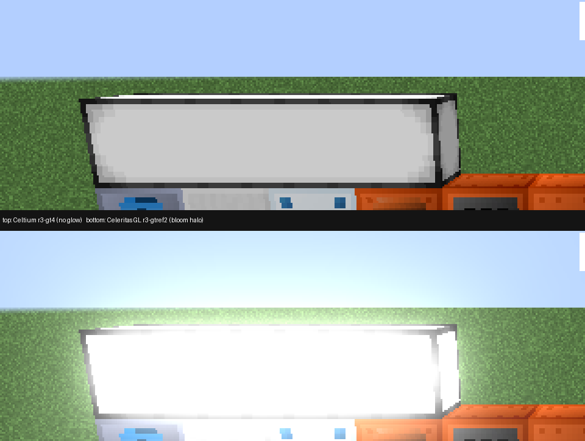
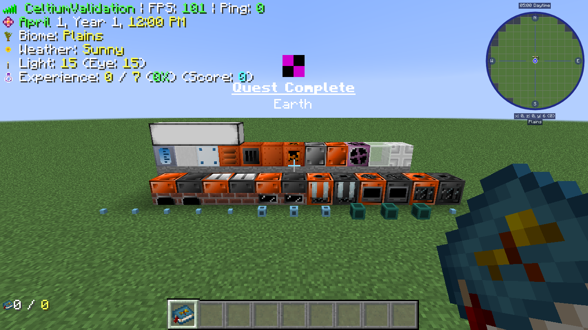

# GTCEu's lamp bloom is missing, and the pipe rows were a different material every run (2026-11-04)

Round 3 of phase 3 put two things into the `gregtech` scene that the previous rounds had not: a row of GTCEu lamps
with their `BLOOM` property set, and a report of the material each pipe row was placed with. The first found a real
rendering gap; the second found that the scene had never been reproducible.



*Same fixture (`efc48aed…` / `30feaa40…`), same pose (`x=0.5 y=6.0 z=0.5 yaw=180 pitch=15`), 1280x720, guiScale=3.
Top: Celtium `r3-gt4` (`be5629a2…`). Bottom: Celeritas 2.5.0-dev GL bridge `r3-gtref2`. The four lamps on the casing
row are a plain white box in Celtium and a blown-out white glow with a halo in the reference. The final leg of the
round, `r3-gt7` (`be5629a2…` + fixture `efc48aed…`), is the same picture and PASSED with `validationMessageCount=0`,
`sceneGateCalibrated=true`, `sceneGateFloorsEnforced=true`, `sceneCalibrationKeyMatches=true`.*

## What was measured

| | Celtium `r3-gt4` | GL reference `r3-gtref2` |
|---|---|---|
| Lamp box mean RGB (x 320..540, y 265..315) | 170.8 / 173.4 / 168.3 | 243.0 / 245.5 / 240.6 |
| Halo band mean RGB (x 300..560, y 230..265) | 155.9 / 185.1 / 210.9 | 209.4 / 236.3 / 233.2 |
| Near-white fraction in the halo band | 0.0283 | 0.1279 |
| World frame (distinct / nonBackground / bands / black) | 7019 / 0.885949 / 714 / 0.011492 | 19349 / 0.902789 / 720 / 0.009129 |
| `gregtechStageLampState` | `BLOOM=true LIGHT=true INVERTED=false POWERED=false` | same |
| `gregtechStageShadersSupported` | `true` | `true` |
| `gregtechStageBloomFbo` | `1280x720 texture=23802` | `1280x720 texture=172` |

The lamp state is the same in both arms, so the difference is not the fixture's placement. `shadersSupported` is true
and GTCEu's bloom framebuffer exists at the window size in both arms, so the mod's bloom path ran in both.

## What the renderer did with the layer

GTCEu adds a `BLOOM` constant to `BlockRenderLayer` (`BloomEffectUtil.init` → `EnumHelper.addEnum`) and renders it by
replacing the fourth `RenderGlobal.renderBlockLayer` call in `EntityRenderer.renderWorldPass` with
`BloomEffectUtil.renderBloomBlockLayer`. The layer therefore arrives at the same entry point as the vanilla four:

```
[Celtium] CELTIUM_BLOCKLAYER layer=Solid name=SOLID pass=2 calls=1 layers=1
[Celtium] CELTIUM_BLOCKLAYER layer=Mipped Cutout name=CUTOUT_MIPPED pass=2 calls=2 layers=2
[Celtium] CELTIUM_BLOCKLAYER layer=Cutout name=CUTOUT pass=2 calls=3 layers=3
[Celtium] CELTIUM_BLOCKLAYER layer=Bloom name=BLOOM pass=2 calls=4 layers=4
[Celtium] CELTIUM_BLOCKLAYER layer=Translucent name=TRANSLUCENT pass=2 calls=5 layers=5
```

and the pass has geometry, not just a draw call:

```
[Celtium] CELTIUM_LAYER_GEOMETRY layer=Bloom regions=6 passes=[TerrainRenderPass[name=bloom]=true]
```

So the custom layer is built, the pass is drawn, and the mod's framebuffer is created. What is missing is the
composite: GTCEu's `emissiveTexturesBloom=true` path renders the bloom layer into its own `Framebuffer`, then runs
`Shaders.renderFullImageInFBO` and `BloomEffect.renderUnreal` - full-screen quads drawn with CCL `ShaderProgram`s -
and composites the result additively. Under GL-less those programs are stubs (`glShaderSource`, `glCompileShader`,
`glLinkProgram` and the `glUniform*` family are recorded no-ops in `CeltiumGlStub`), so the composite cannot produce
the blurred halo.

One hypothesis was tested and rejected: the composite's self-sampling passes are dropped by
`-Dceltium.vulkan.skipSelfComposite` (default on), so the same jar was run with the drop off (`r3-gt5`). The lamp
region is pixel-identical (mean 145.96/155.86/145.25 in both), so the drop is not what removes the glow.

The mod's own gate is open, measured from the fixture (`r3-gt9`): `Shaders.allowedShader()` is `true`,
`Shaders.IMAGE_F` is a `ShaderObject`, and the bloom framebuffer is `1280x720`. So `renderFullImageInFBO` does not
return early - it binds the framebuffer, calls `ShaderProgram.useShader` (which calls `GL20.glUseProgram`) and draws
the quad through `Tessellator`. A census of the GL stub's draw entry (`CELTIUM_PROGRAM_DRAW`, one line per program a
draw is decoded under) reports **zero** draws with a non-zero program, and the backend's
`CELTIUM_SHADER_PROGRAM_REFUSED` (which fires when a batch is offered while a custom program is bound) does not fire
either. So the composite's full-screen quad does not reach either draw path with the program bound: the next
question is where it goes instead (the `VertexBuffer` path is cancelled into `CeltiumNativeDraw.vertexBuffer`, and
the `WorldVertexBufferUploader` hook offers every `Tessellator` batch, so the two candidates are a program that is
already 0 by the time the batch is offered and a batch that never reaches the uploader).

## The pipe rows were not reproducible

The item pipe row measured lavender in `r2-gt6` and cream in `r2-gtref` with the same fixture and pose. The cause is
the fixture, not the renderer: `BlockMaterialPipe.getSubBlocks` iterates a `HashMap<Material, …>`, `Material` declares
no `hashCode`, and the identity hash order differs between JVMs - so "the first sub-block" was a different material,
and a GTCEu pipe's colour is its material's RGB (`PipeRenderer`'s `ColourMultiplier`). The fixture now picks the
sub-block with the lowest (item id, metadata) and reports the material:

```
gregtechStageCableMaterial = aluminium=0x80C8F0
gregtechStageFluidPipeMaterial = aluminium=0x80C8F0
gregtechStageItemPipeMaterial = americium=0x287869
```

Both arms of this round report the same three materials, and the item pipe row is the same dark teal in both pictures
(`docs/evidence/gregtech-item-pipe-material-2026-11-04.png` is the earlier lavender/cream pair that named the defect).

## Next

The composite is the remaining question, and it is now a narrow one: count the full-screen quads offered while a
custom program is bound and their refusal reason. `CELTIUM_SHADER_PROGRAM_REFUSED` did not fire in this run, so the
composite's draw is either never offered (the program is 0 at draw time, or the draw is refused earlier for its
format) or offered and dropped by a rule that does not name itself. The instrument to add is a per-program census of
the full-screen POSITION_TEX draws, with the refusal reason, at the point the immediate path decides.

## Round 4: the program bind had no route (fixed)

The census was empty because `glUseProgram` never reached the stub. The transformer rewrites every GL native and
answers the ones no route claims with a bare return; `glUseProgram` had no route, so the stub's tracked program stayed
0 for the whole session. With it at 0 the backend's "a custom shader program is bound" refusal could never fire, and
the composite's full-screen quad was accepted by the immediate path and drawn with the world projection.

The fix routes `glUseProgram` / `nglUseProgram` / `glUseProgramObjectARB` to `CeltiumGlStub.celtium$useProgram`, and
`CELTIUM_PROGRAM_BOUND` names the first bind of each program with its call site. Legs `r5-gt1` (census) and `r5-gt2` (acceptance: PASSED, validationMessageCount=0, gpuRequirementMet=true, sceneCalibrationKeyMatches=true; renderer
`ea32d975…`, fixture `22fcf3e0…`, AMD RX 6400, scene=gregtech):

```
CELTIUM_PROGRAM_BOUND program=23887 site=[... codechicken.lib.render.shader.ShaderProgram.useShader:122 <- gregtech.client.shader.Shaders.renderFullImageInFBO:130]
CELTIUM_SHADER_PROGRAM_REFUSED program=23887 format=6 (first batch refused with this program bound)
```

(Intel UHD 630, leg `r7-gt-intel`, same jar: PASSED, validationMessageCount=0, gpuRequirementMet=true, the same four refusals.)

and the same three lines for programs 23916, 23917 and 23918: four GTCEu bloom programs, all bound from
`Shaders.renderFullImageInFBO`, all refused and counted. No other program was bound in the run (no vanilla program:
the vanilla post chain is cancelled at `ShaderGroup.render` HEAD and never calls `useShader`). The lamps are still a
plain white box - the bloom stays missing until mod GLSL is compiled and run natively (goal.md, 2026-11-04) - but the
gap is now counted per program instead of being drawn as a different picture.

## Round 5: the programs can be lowered to Vulkan GLSL (not yet executed)

`ModGlslTranslator` lowers a mod's legacy program (vertex + fragment, or fragment-only with a synthesized
fixed-function vertex stage) to GLSL 450: attribute/varying locations, one std140 block for the non-sampler
uniforms with each member's offset, sampler bindings, `gl_FragColor`/`gl_FragData[0]`, `texture2D*`, the
fixed-function inputs (`gl_Vertex`, `gl_Color`, `gl_MultiTexCoord0`, `gl_ModelViewProjectionMatrix`, `ftransform()`,
`gl_TexCoord[0]`, `gl_FrontColor`), names GLSL 450 reserves (GTCEu's `blackhole.frag` calls its sampler `texture`),
GL's lower-left `gl_FragCoord` (a hidden `celtium_TargetHeight` uniform) and the clip-space convention.

`ModGlslTranslatorTest` compiles the output with shaderc (Vulkan 1.2). Run against GTCEu 2.8.10's own shaders
(extracted locally, `CELTIUM_MOD_SHADER_DIR`, not committed): **14 of 14 lowered and compiled for both stages**,
including the seven the bloom chain uses (`image`, `down_sampling`, `up_sampling`, `blur`, `seperable_blur`,
`bloom_combine`, `composite`). Full `:celtium-vulkan:test`: 426 tests, 0 failures.

Still missing for the bloom to appear: the stub has to keep the sources and `glUniform*` values per program, the
backend has to build a pipeline from the SPIR-V and run the batch into the mod's framebuffer, and the shipped jar has
to carry shaderc's natives (distribution decision, see the report of 2026-11-04).

## Round 6: the stub keeps each mod program's sources, link result and uniform values

`glShaderSource`/`glAttachShader`/`glLinkProgram`/`glDeleteProgram` and every `glUniform*` spelling (scalar,
pointer and matrix forms, ARB included) were listed no-ops; they now route to `ModProgramRegistry`, which lowers the
program at link (`CELTIUM_MOD_PROGRAM_LINKED`) and stores uniform values under the uniform's name (the stub's
location is the name hash, so a location maps back once the program is linked). The refusal line now says whether the
refused program could run natively.

Leg `r13-gt` (renderer `bc7f37b5…`, fixture `22fcf3e0…`, AMD RX 6400, scene=gregtech): PASSED,
validationMessageCount=0, gpuRequirementMet=true.

```
CELTIUM_SHADER_PROGRAM_REFUSED program=23812 format=6 lowered=true uniformWrites=0
CELTIUM_SHADER_PROGRAM_REFUSED program=23841 format=6 lowered=true uniformWrites=4
CELTIUM_SHADER_PROGRAM_REFUSED program=23842 format=6 lowered=true uniformWrites=7
CELTIUM_SHADER_PROGRAM_REFUSED program=23843 format=6 lowered=true uniformWrites=6
```

All four bloom programs are lowered and carry their values (23812 is the one-sampler `image` pass, which sets
nothing). Leg `r13-world` (same jar, `celtium-world-accept`, 188 mods, validation on): PASSED,
validationMessageCount=0; the ten programs linked in that run all lowered. CPU: route verifier 259 calls / 87
classes / 0 failures, `:celtium-vulkan:test` green.

What remains for the bloom: run the batch natively (pipeline from the SPIR-V, the block packed from the recorded
values, samplers resolved from texture units to native images, the mod framebuffer as target) and ship shaderc.

## Round 7: the programs compile to SPIR-V inside the game

`ModShaderCompiler` compiles both lowered stages at link when LWJGL's shaderc binding and native load
(`CELTIUM_MOD_PROGRAM_LINKED ... compiled=`). Cleanroom's mod class loader does not see a jar added to the launcher
classpath (leg `r15-gt`: `ClassNotFoundException: org.lwjgl.util.shaderc.Shaderc` with the jar on `-cp`), so the
**binding classes** are embedded like lwjgl-vulkan's; the **native library is not shipped** (distribution decision).

Leg `r16-gt` (renderer `eb6a8656…`, fixture `22fcf3e0…`, AMD RX 6400, scene=gregtech, natives supplied to the leg
only with `-Dorg.lwjgl.librarypath=<dir with libshaderc.so from lwjgl-shaderc-3.4.3-natives-linux>`): PASSED,
validationMessageCount=0, gpuRequirementMet=true; every linked program compiled, the four bloom programs among them:

```
CELTIUM_MOD_PROGRAM_LINKED program=23812 compiled=true spirvBytes=1500 lowered=true samplers=1 uniformBytes=0
CELTIUM_MOD_PROGRAM_LINKED program=23841 compiled=true spirvBytes=2908 lowered=true samplers=1 uniformBytes=32
CELTIUM_MOD_PROGRAM_LINKED program=23842 compiled=true spirvBytes=2612 lowered=true samplers=5 uniformBytes=16
CELTIUM_MOD_PROGRAM_LINKED program=23843 compiled=true spirvBytes=2584 lowered=true samplers=2 uniformBytes=16
```

Without the native (every ordinary install today) the line reads `compiled=false compileFailure=shaderc unavailable`
and `CELTIUM_MOD_SHADERC available=false reason=...` names why, once.

## Next unit: run the batch natively (design, not built)

What exists: per program, the lowered stages and their SPIR-V, the std140 member offsets, the sampler bindings
(1..n), and the recorded uniform values by name (`ModProgramRegistry.Program`). The batch arrives at the
immediate path's program refusal (`submitImmediateBatchBody`, the `boundProgram != 0` branch).

Steps, each separately verifiable on the gregtech scene:

1. **Vertex inputs.** GL aliases generic attribute 0 with the conventional vertex position, which is how GTCEu's
   `attribute vec2 position` is fed by a Tessellator POSITION_TEX batch. Map: location 0 <- position; a lowered
   `celtium_MultiTexCoord0` <- the batch's UV; `celtium_Color` <- its colour. Refuse any other attribute.
2. **Inputs.** A sampler's value is a texture unit; the texture bound on that unit at draw time is the input. Check
   that the stub/state mirror keeps the binding per unit (GTCEu binds its FBO textures on units 0..4 with
   `GlStateManager.setActiveTexture`), and resolve each name to its native image through the texture registry.
3. **Executor.** Generalise `VulkanPostChain.Program` from its fixed table (two samplers, UBO at binding 2) to a
   program built from runtime SPIR-V with N samplers at bindings 1..n and the block at binding 0, and a pass whose
   output is the mod framebuffer currently bound (the raw/mod FBO target the off-target routing already resolves).
4. **Ordering.** Treat the batch like a post-chain pass inside the immediate stream: flush the open window, record
   the pass with the read barriers the chain already issues for its inputs, then continue.
5. **Verify.** The lamp-row metrics in this file (lamp box mean RGB ~243, near-white halo fraction ~0.128 in the GL
   reference vs ~171 / 0.028 now) are the acceptance numbers, on both GPUs, validation 0.

Distribution: libshaderc for Windows and Linux (~4 MB each) has to ship for any of this to run outside a leg.

## Round 8: native execution, opt-in — every pass draws, the passes into the game's framebuffer blacken the world

`VulkanModProgramPipeline` draws a mod program's batch inside the immediate path's group machinery: render state
copied from the variant the batch would have used, the program's SPIR-V, its std140 uniforms as push constants, and a
sampler set resolved from the texture units its sampler uniforms name (framebuffer colour textures resolved to the
framebuffer's published image, as `prepareImmediateUncached` does for unit 0). Opt-in:
`-Dceltium.vulkan.modPrograms=true` (and libshaderc present).

GTCEu's sequence (`BloomEffectUtil.renderBloomBlockLayer`, javap): bloom layer into `bloomFBO`; `IMAGE_F` draws
`bloomFBO` onto the game's framebuffer; the game's framebuffer is drawn back into `bloomFBO` (blend `DST_ALPHA`);
`BloomEffect.renderUnreal` (down/up sampling, blur, `composite`, `bloom_combine` reading the game's colour 482);
`IMAGE_F` draws the result onto the game's framebuffer.

| leg | setting | result |
|---|---|---|
| `r17-gt`..`r20-gt` | modPrograms on | all four programs `CELTIUM_MOD_PROGRAM_DRAWN` (inputs resolved, e.g. `blurTexture1..5=unit0..4`, `buffer_a=unit0:tex482(main)(fb)`), validationMessageCount=0, **world black** (`FAILED_PRESENTED_IMAGE`, black fraction 0.79) |
| `r21-gt` | on, `modProgramsToMain=false` (passes into the game's framebuffer refused) | PASSED, world 6977 colours, black 0.011492 — pixel-normal |
| `r22-gt`, `r22-world` | default (off), renderer `718d372e…` | PASSED, validation 0 (both) |

So the black comes from the `IMAGE_F` passes into the game's framebuffer. Not yet separated: (A) `bloom_combine`
samples the game's colour before the world's own draws have reached that image, so the result written back is black;
(B) the full-screen quad's depth write (the copied render state) hides the terrain drawn after it. Next measurement:
dump `bloomFBO` and the combine target after the passes, and repeat with depth write forced off for mod passes.

### Round 8b: what the black is not

| leg | switches (all with modPrograms=true) | world black fraction |
|---|---|---|
| `r23-gt` | `modProgramDepth=false` (no depth test/write on mod passes; the copied state already had depthWrite=false) | 0.792 — **(B) rejected** |
| `r24-gt` | `modProgramsSampleMain=false` (refuses every pass that samples the game's colour, i.e. `bloom_combine` and the copy of the game's colour into `bloomFBO`) | 0.786 — the combine is **not the sole cause** |
| `r21-gt` | `modProgramsToMain=false` | 0.011 (normal) |

The remaining main-writing pass is `IMAGE_F` drawing `bloomFBO` (GL name 23802, resolved to its published framebuffer
image) onto the game's framebuffer. From the bytecode: GTCEu sets `bloomFBO`'s clear colour to (0,0,0,0), clears it,
renders the bloom layer into it, and blends it onto the game's framebuffer; since the GL reference is unharmed, that
blend is alpha blending there, so black over the world means the sampled image is opaque black. Next: check whether
the off-target pair image's clear keeps the (0,0,0,0) alpha, and whether the published image for 23802 is
`bloomFBO`'s (the terrain's bloom layer is drawn by the terrain pass, which may not target `bloomFBO` at all).

### Round 8c: the pass list and the pair images (leg `r26-gt`, modPrograms on, `dumpPairsAtPresent=500`)

Every distinct pass input is now logged. One frame of GTCEu's unreal bloom, in order:

1. `IMAGE_F` bloomFBO (tex 23802) -> game framebuffer, blend on
2. `IMAGE_F` game colour (tex 482) -> pair `0x7494b11` (bloomFBO), blend on (GTCEu: `DST_ALPHA`)
3. `down_sampling`/`blur` x10 through tex 23814..23830 -> the 640x360 .. 40x22 pairs
4. `composite` (5 blur levels) -> `0x5bc123c3`; `bloom_combine` (game colour 482 + bloom 23814) -> `0x46a41ce` / `0xb744781`
5. `IMAGE_F` **tex 23838** -> game framebuffer, **blend off**

Pair dumps (mean RGBA): the two `bloom_combine` targets hold the right scene (110.5/137.5/129.3/255); every
down/blur pair is opaque black (0/0/0/255); `0x7494b11` is (0,0,0,0).

Readings:

- **The black world** is step 5: a blend-off copy of tex 23838 onto the game's framebuffer, while the combine targets
  hold the correct picture. So tex 23838 is not resolving to the combine target's image. Next: name 23838's framebuffer
  identity and the image `celtium$publishFramebufferColorTexture` publishes for it.
- **Why there is no bloom at all** (also in the GL-refusing default): step 2 builds the bloom mask by drawing the game's
  colour into bloomFBO with `DST_ALPHA`, which keeps only the pixels where the bloom layer was drawn into bloomFBO. The
  terrain pass draws the bloom layer into the game's framebuffer instead, so bloomFBO's alpha stays 0, the mask is
  empty and every level below it is black. The terrain renderer has to honour the framebuffer GTCEu binds around
  `renderBlockLayer(BLOOM)`.

### Round 8d: the last copy reads the right framebuffer (leg `r27-gt`)

The DRAWN line now names each sampler's framebuffer identity and published image, and the target's colour texture:

```
bloom_combine ... target=0x255d08d2 targetColourTex=23838
IMAGE_F inputs=[colourTexture=unit0:tex23838(fb){fbo=0x255d08d2 img=0xf600000000f60}] target=0x5dbbfa05 targetColourTex=482 targetIsMain=true
```

So the final blend-off copy samples exactly the framebuffer `bloom_combine` wrote, and publication registers that
framebuffer's own chain-pair image (`celtium$publishFramebufferColorTexture`, route chain-pair), not a copy. Yet the
dump at present shows that pair holding the correct scene while the game's framebuffer is black.

Leading hypothesis, not yet measured: **recording order**. Black is exactly what a blend-off copy of a freshly cleared
pair (0,0,0,0) produces, so the copy into the game's framebuffer executes after the pair's clear and before
`bloom_combine` writes it. Next: log the window sequence (target, first/last group, clear-in-pass) for one frame of
the scene and check where the IMAGE_F group into the game's framebuffer lands relative to the combine window.

### Round 8e: the last copy's pixels are black; order, factors, layout and a read barrier are not why

All with `modPrograms=true` on the GTCEu scene, AMD:

| leg | change | world black | reading |
|---|---|---|---|
| `r28-gt` | `pairClearInPass=false` | 0.787 | the in-pass pair clear is not it |
| `r29-gt` | `modProgramTrace=2` | — | passes are **recorded in offer order**; combine targets ping-pong (0x7926e986 / 0x2c54065d) and the copy reads the current one |
| `r30-gt` | blend factors logged | — | copy = blend off; first pass (6,7,1,0) = GL's 770/771; DST_ALPHA pass (8,0,8,0) = GL's 772/0 |
| `r31-gt` | `modProgramsOpaqueToMain=false` (refuse only the blend-off copy) | **0.006, PASSED** | the copy is the only culprit |
| `r32-gt` | `modProgramSkipDraw=true` (all binds, no draw call) | **0.007, PASSED** | the copy's **pixels** are black; it leaves no broken state behind |
| `r34-gt` | wrapper image logged | — | descriptor image == published pair image for every sampler, layout GENERAL |
| `r35-gt` | global barrier (colour/transfer write -> fragment read) before windows carrying a mod pass | 0.787 | not a missing barrier; removed again |

Default (off), renderer `a5b27643…`: `r36-gt` and `r36-world` PASSED, validation 0.

Still open: why a blend-off pass into the game's framebuffer that samples a pair which holds the scene at present writes
black, when the same pipeline path writes correct pixels into pairs (the combine's output is right). The differences
left are the target (the game's framebuffer, drawn in the frame's main pass) and what the game's framebuffer window
does after this group. Next: dump the game's colour right after the copy's window, and repeat the copy into a pair
instead of the game's framebuffer.

### Round 8f: the copy outputs black because it reads black; no pair is recreated, nothing is rolled back

| leg | change | result |
|---|---|---|
| `r37-gt` | `modProgramAdditive=true` (the blend-off copy drawn ONE+ONE instead) | world normal, not saturated (black 0.007, PASSED): **the copy reads black** at the moment it runs |
| `r38-gt` | chain-pair generation logged per pass | 61 -> 72 during the first frame's lazy creation, then constant: **no pair is recreated** |
| `r38-gt` | rollback / stale counters | 2-3 rollbacks per run, 0 stale groups: no per-frame re-recording |

Established: the copy is recorded after `bloom_combine` in the same order the game issued them, samples the published
chain-pair image of the combine's own framebuffer in GENERAL, adds nothing when drawn additively, and that image holds
the right scene at present. Not established: what the image holds *at the copy*. The repository's
`celtium.debug.sampleWindowImages` is declared but never read, so the next unit is a real mid-frame readback of a
sampled pair (one pixel, copied to a host buffer before the copy's window and read after the frame fence).

## Round 9: fixed — the read barrier was right, the earlier test put it on the wrong window

The window prefix in `recordImmediateOnlyPass` runs **before** `activeImmediateTarget` is assigned for the window (it
is set where the pass begins), so anything at the prefix that asks "this window's target" through that field reads
the *previous* window's target. A probe there proved it: every window saw the queued mod group of the window before.
That invalidates round 8b/8e's barrier test (r35-gt), which keyed on the field and so never fired before the copy.

Keyed on `targetRegistry.currentIdentity()` instead, the same global barrier (colour/transfer write -> fragment
read, outside the pass, only for windows that carry a mod pass) fixes the world:

| leg | renderer | setting | result |
|---|---|---|---|
| `r42-gt` | `d2f6be19…` | `modPrograms=true` (+ libshaderc for the leg) | **PASSED**, validationMessageCount=0, world 7012 colours, black 0.011492 |
| `r42-gt` | same | `modProgramReadback=true` | the copy's input centre pixel read **(135,50,9,255)** at the moment the copy runs |
| `r42-world` | same | default (off) | PASSED, validation 0 |
| `r43-gt-intel` | same | `modPrograms=true`, Intel UHD 630 | **PASSED**, validationMessageCount=0, gpuRequirementMet=true, black 0.010242, 16 distinct passes drawn |



With the programs running, GTCEu's machine overlays drawn in its bloom layer (the light bars and screens on the second
row) now appear — the first `IMAGE_F` pass composites them. The lamp halo is still absent because bloomFBO's mask is
empty (the terrain pass draws the bloom layer into the game's framebuffer, round 8c). Still opt-in until compared with
the GL reference and until libshaderc ships.

Latent issue found on the way, not changed here: the existing prefix call
`celtium$queuedForTargetUsesPublished(this.activeImmediateTarget)` (the published chain output's sampled-layout
transition) reads the same stale field.

### Round 9b: the same stale read in the existing prefix calls, fixed

Both existing calls `celtium$queuedForTargetUsesPublished(this.activeImmediateTarget)` (the immediate-only window and
the terrain pass) ran before that field is assigned for the pass, so they asked about the previous pass's target.
They now ask `targetRegistry.currentIdentity()`. Renderer `f4f1993d…`: glow-outline A/B leg `r45-glow` (the
re-run recipe of glow-outline-2026-11-03.md) **verdict=PASS**, outline 2723 px (0.295%), control 28/7, noise 3.51%,
validation 0; `r44-world-intel` (Intel UHD 630, world-accept) PASSED, validation 0, gpuRequirementMet=true.
