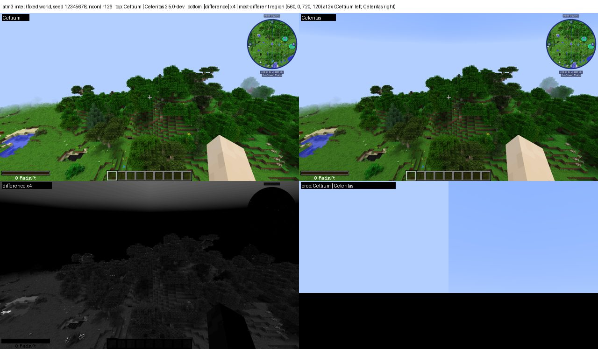
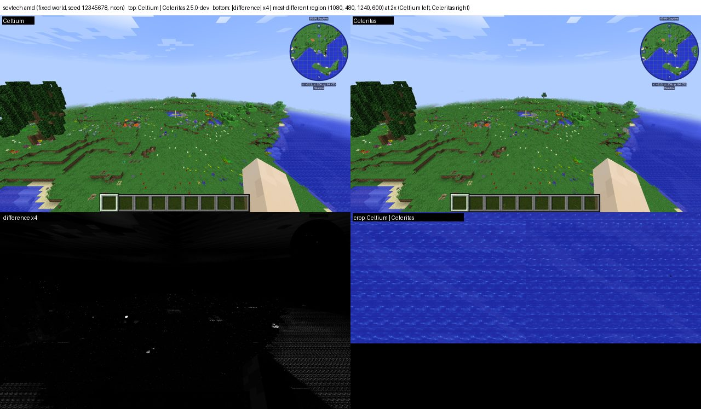
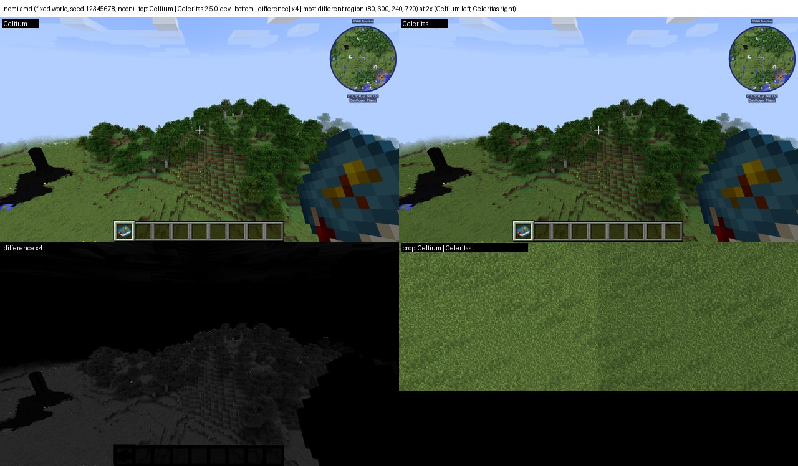
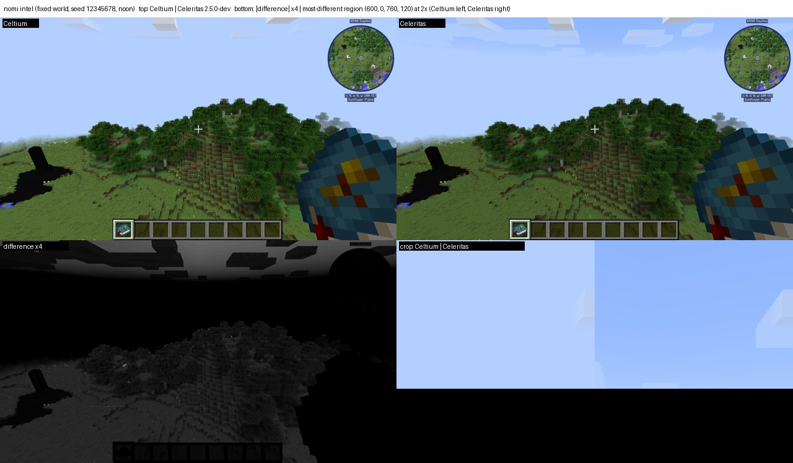
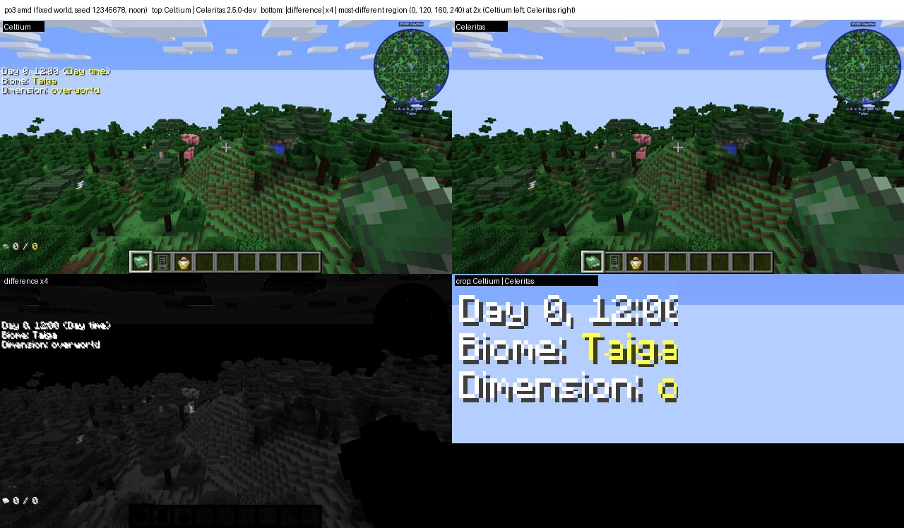

# Modpack re-verification and every problem found (2026-11-06) — handoff

This is the single list of what the full-log, picture-vs-Celeritas re-verification of the modpacks dug up, for
whoever continues the work. Status of each pack lives in [docs/modpacks.md](<../modpacks.md>); the verification
standard ("What verified means") is defined there.

## How the re-verification works (reproduce with these)

- **Batch:** `scripts/modpack-reverify.sh .gv-verify/jars/<stage> sf4 atm3 rlcraft sevtech nomi po3` (log in
  `.gv-verify/modpack-reverify.out`). Per pack: a generation leg writes a world (seed 12345678, generated terrain),
  which is copied into the pack instance as `saves/celtium-gen`; then **Celtium AMD, Celtium Intel and Celeritas
  2.5.0-dev (AMD)** load that same save. A fresh world per arm is useless: RLCraft's mods do not generate the same
  world twice from one seed (the first attempt compared different trees, mean diff 64).
- **Flags on every leg:** `worldType=default`, `cameraY=100` (default pose is underground in a generated world),
  `fixedWorldTime=true worldTime=6000`, `-Dceltium.debug.logLinesPerTag=1000000` (the default 16 lines per tag hides
  most of Celtium's own reports), `-Dceltium.vulkan.frameStats=true`, `-Dceltium.glless.census=true`. Never the
  `fail*`/`refuse*` switches (fault injection).
- **Analysis:** `scripts/pack_verify.py logs RUN` (ERROR/FATAL, exceptions, nonzero Celtium refusal/failure counters,
  classified Celtium vs pack, debug.log duplicates folded) and `scripts/pack_verify.py picture CELTIUM_RUN REF_RUN`
  (mean abs diff, share of pixels > 24 levels, and a Celtium | Celeritas | heatmap composite). Outputs:
  `.gv-verify/w-<pack>-{amd,intel,ref}-logs.json`, `w-<pack>-{amd,intel}-picture.json`, `w-<pack>-*-diff.png`.
- **Pack instances and staged jars:** `~/.local/share/PrismLauncher/instances/celtium-<pack>-<version>`,
  `.celtium-work/modpack-<pack>/staged/mods`, substitutions in `.celtium-work/modpack-<pack>/SUBSTITUTIONS.md` and
  summarised in docs/modpacks.md. Presets: `E2E_PACKS` in `scripts/gv_leg.py`.
- **Builds:** r120 `skips` and r121 `record` (adds `CELTIUM_RECORD`; HEAD then `afc026304` de-duplicates it).
- The user's rule: **qmagnet is for FPS only**; compatibility pictures use the packs' own generated worlds.

## Results so far

| Pack | Celtium vs Celeritas picture (mean abs diff / pixels > 24) | Celtium-origin log findings |
|---|---|---|
| RLCraft 2.9.3 | AMD 10.69 / 9.3 %, Intel 11.18 / 9.3 % | see defects 3, 4, 5 below; 44 degenerate quads refused (zero area, harmless) |
| SkyFactory 4 4.2.4 | AMD 3.60 / 5.5 %, Intel 3.68 / 5.5 % — **AMD 0.67 / 0.02 % after defect 1's fix** (`r123-sf4-final`, same saved world and reference) | defect 2 (FBP particles, 7,260 refusals), defect 1 (leaves), 57 batches dropped at a menu boundary |
| All the Mods 3 6.1.1 | AMD 12.82 / 9.9 %, Intel 12.85 / 9.9 % (r122) — **AMD 7.39 / 6.61 % after the hand, leaf and display-list fixes** (`r125-atm3-amd` vs `r125-atm3-ref`, same saved world) | defect 9 (no first-person hand, fixed), defect 10 (sky gradient, geometry now drawn but the background band is still flat), defect 11 (display list with 0 captured quads, fixed in `r125`/`r126`), 385/295 batches dropped at a menu boundary (defect 5), a depth copy not read back |
| SevTech: Ages 3.2.3 | AMD 0.17 / 0.3 %, Intel 0.25 / 0.4 % — **not a valid scene**: the camera is inside the ground on both renderers (only the HUD and the minimap are visible) | `CELTIUM_MODEL_MISSING list=378` replayed every frame with nothing captured (`unresolvedTop=[378:x1015]`, same shape as defect 11); its logs went to `validation-console.log`, not `latest.log` |
| Nomifactory CEu 1.7.7 | AMD 5.25 / 4.0 %, Intel 5.26 / 4.0 % | defect 10 (flat upper sky, as ATM3); defect 12 (GregTech CEu bloom shaders refused, ~10,000 POSITION_TEX batches); 11 batches dropped at a boundary. Clouds also differ (they move between runs) |
| Project Ozone 3 3.4.11F | AMD 5.16 / 1.1 %, Intel 5.79 / 1.2 % | **no Celtium-origin report at all**; the picture matches (sky gradient, hand, terrain); the residual is cloud motion and HUD text. Pack errors equal to the Celeritas arm (678 vs 679) |

### Pictures (for eyes)

Each sheet: top Celtium | Celeritas at half size; bottom-left the difference ×4; bottom-right the region that differs
most at 2× (Celtium left, Celeritas right). Generated by `scripts/pack_verify.py review` (the batch writes them for
every pack).

**RLCraft** — AMD / Intel: the scene matches; differences are particles and slightly brighter blocks (see defect 1).

**SkyFactory 4** — AMD / Intel: only the tree canopies differ; Celtium's distant leaves are darker (defect 1).

**All the Mods 3** — AMD / Intel: the hand (defect 9) and the display-list geometry (defect 11) are fixed; the remaining
difference is the upper-sky band (defect 10) and leaf/lighting noise. `r125`/`r126` against the same Celeritas reference:
AMD 7.39 / 6.61 %, Intel 7.45 / 6.61 % (was 12.82 / 9.9 %).

**SevTech** (invalid scene, camera in the ground), **Nomifactory** (flat upper sky), **Project Ozone 3** (match):

Every leg: **0 Vulkan validation messages**. Pack-origin log errors (missing models/recipes, signature warnings,
mod config errors) appear identically in the Celeritas arm (e.g. SF4 373 vs 374 ERROR lines, RLCraft 232 vs 233) and
are not Celtium's.

## Celtium defects found (open unless marked)

1. **(Fixed 2026-11-06, `r123`) Distant leaves are darker than Celeritas (both GPUs; SF4, RLCraft).** Close leaves
   match pixel for pixel; the canopy gets darker with distance (SF4 leaf pixels 20,37,12 vs 39,74,23). Solid blocks,
   water, sky, HUD and the minimap match. Never seen before because every earlier picture leg seeded `options.txt` from
   `.celtium-work/options/guiScale3.txt`, which has **`mipmapLevels:0`**; the pack legs use Minecraft's default 4.
   **Cause, measured in three steps.** (a) The mipmap-off discriminator (`mm0-sf4`, both arms seeded with
   `guiScale3.txt`) measured **0.48 / 0.06 %** against 3.60 / 5.5 % with mipmaps on, so the difference is entirely in
   the mip path. (b) The sampler clamp is *not* it: the terrain pass has its own atlas sampler
   (`VulkanTerrainPipeline.ATLAS_MAX_LOD`, `CELTIUM_ATLAS_SAMPLER maxLod=4 ... gameMaxLevel=4`), and raising the
   mirror's own reach from 1 to 4 on one jar (`r123-sf4-clamp4` against `r123-sf4-amd`) changed the frame by
   **0.0002 mean pixel levels, 0 pixels over 24**. (c) The content was it: the atlas's whole-image refresh
   (`CELTIUM_MIRROR size=4096x4096`, `uploadFromGlTexture`'s whole-image branch) ran *after* the per-sprite patches and
   regenerated levels 1..12 by blitting level 0 (`recordMipChain`). That blit averages across sprite borders and
   through transparent black, so it is darker than Minecraft's own mips, which `TextureUtil.generateMipmapData`
   produces in gamma space, skipping fully transparent texels and dropping a texel whose average alpha falls below 96.
   The game's own levels were already in the stub (`CELTIUM_MIRROR_PATCH glTexture=273 ... producerDepth=5
   appliedLevels=5`); the whole-image write replaced them. **Fix:** `VulkanGlTexture.applyCapturedMipLevels` is now
   called from the whole-image branch too (after dropping the applied serials, because the blit just overwrote every
   level), and the mirror's sampler reach follows the deepest level the producer actually wrote
   (`CELTIUM_SAMPLER_REACH glTextureReach=4`). **Result on the same saved world and reference:** AMD
   **3.59 / 5.47 % → 0.67 / 0.02 %** (`r123-sf4-final`, jar `b2c6ab1d…`, validation 0, `gpuRequirementMet=true`).
   Picture: [sf4-amd-ownmips.jpg](modpack-reverify/sf4-amd-ownmips.jpg). Intel and RLCraft are not re-shot yet.
   The old "next discriminator" (compare level-1 texels against `generateMipmapData`) is no longer needed: the
   producer's levels were never wrong, they were being overwritten.
2. **(Fixed in `f0efe0055`, picture confirms on `r122-sf4`) Fancy Block Particles' digging particles are not drawn (SF4).** FBP's `FBPRenderUtil.renderCubeShaded_S` draws
   through the Tessellator with vertex format POSITION(3f) TEX(2f) COLOR(4ub) LMAP(2s) NORMAL(3b) = stride 31.
   Celtium has no mapping: `CELTIUM_UNMAPPED_REFUSED format=unmapped ... size=31` and
   `CELTIUM_REFUSALS_BY_FORMAT {0 format 0 (unmapped) ...=7260}`, `CELTIUM_DRAWARRAYS refused=4096 ... stride 31 with
   client arrays [GL_NORMAL_ARRAY, GL_COLOR_ARRAY, GL_TEXTURE_COORD_ARRAY]`. Fix: add the format to the immediate
   format table (`VulkanImmediateFormats`, `celtium.vulkan.immediateFormats`) with a pipeline that consumes it (the
   lit ITEM family already reads position/uv/colour/normal; the light-map short pair is the new part).
   **Fixed in `f0efe0055`**: its first 28 bytes are PARTICLE, so it maps to PARTICLE and the uploader repacks each
   vertex to 28 bytes, like the existing 32-byte padded particle layout. The same commit maps an ATM3 particle layout
   with the light map before the colour
   (`CELTIUM_UNMAPPED_LAYOUT width=28 elements=[3,Position,Float 2,UV,Float 2,UV,Short 4,Vertex Color,Unsigned Byte]`)
   by swapping the two elements back. **Picture evidence:** `r122-sf4` (jar `52ae0ee5…`, HEAD `1565129a2`) draws the
   pink digging-particle cluster on both sides — [sf4-amd-r122.jpg](modpack-reverify/sf4-amd-r122.jpg), bottom-right
   crop. The log half of the check (`CELTIUM_COMPACTED_BATCH` present, format-0 refusals gone) was not re-read: that
   run's `logs/` was deleted with the run directory before it was classified, so the next SF4 leg must re-confirm it.
3. **Ordering flush fails with "nested immediate command recording" (RLCraft, intermittent).** One run (`rlbm-amd`,
   r120, Bloodmoon + patched Fugue) counted `orderingFlushFailures=741`, `orderingFlushDroppedBatches=18828`: the
   flush at `VulkanTerrainGpuBackend` (`throw new IllegalStateException("nested immediate command recording")` when
   `commandState.recording() && !frameBufferOpen`) is reached while another recording is open, and the catch drops
   every accepted batch. Not reproduced in the next two RLCraft runs. The failure text and frame were invisible until
   `afc026304`/`CELTIUM_RECORD` (record() used to be cleared unprinted) — rerun RLCraft a few times on HEAD and grep
   `CELTIUM_RECORD ordering flush failed` for the frame and stack. The fixed-world legs (RLCraft, SF4, ATM3; AMD and
   Intel) all reported `orderingFlushFailures=0`.
4. **"a destroyed mesh cannot be drawn" in a window flush (RLCraft, intermittent, Intel and AMD).**
   `lastWindowFlushFailure=IllegalStateException: a destroyed mesh cannot be drawn at VulkanDynamicMesh.bindAndDraw:299
   <- VulkanImmediateItemPipeline.draw:388`, `windowFlushFailureFrame=2` (the first world frame). A queued ITEM group
   still references a mesh freed before the flush — look at what frees `VulkanDynamicMesh` around world entry (model
   geometry rebuild, retained geometry, arena). Get the full stack from `CELTIUM_RECORD` on HEAD. Not seen in the
   fixed-world legs (`lastWindowFlushFailure=none` on every one).
5. **Accepted batches dropped at a menu frame boundary (RLCraft 1,126; SF4 57).** `CELTIUM_RECORD menu frame
   boundary dropped N accepted immediate batches whose target never got a pass (targets=[0])` — content accepted for
   the main target during the menu-to-world transition is never drawn (`celtium$dropUnflushedTargetGroups`). One frame
   each, so minor, but it is lost geometry.
6. **The fixture's presented counter stays 0 for hundreds of world frames in RLCraft (both GPUs, intermittent).**
   `picturePresentSkipsAtVerdict_world` 683–2,581 and `firstPresentedWorldFrame` 686–2,584 while the backend's own
   heartbeat (`CELTIUM_PRESENT hookCalls=…`) shows every present succeeding; the picture assertion then fails as
   "-684 away from the world frames". The fixture reads the counter from `TerrainGpuBackends.current()`
   (`ValidationClient.celtium$vulkanBackend`); the hypothesis is that `current()` is not the presenting backend for a
   while (a second backend/RenderGlobal in RLCraft). Black periodic frame dumps (`frameDumpCount`) in the same window
   fit the same cause. Not yet proven: log `TerrainGpuBackends.current()` identity per frame against the presenting
   backend. The world picture itself is correct.
9. **(Fixed in `1565129a2`, picture confirms on `r122-atm3`) First-person hand missing (ATM3, both GPUs).** Celeritas draws the player's arm at the same pose; Celtium's frame
   has none (`docs/evidence/modpack-reverify/atm3-*.jpg`). SF4 and RLCraft draw the hand, so a mod in ATM3 changes how
   the hand is rendered. **Cause found (static, from the AMD leg's log):** the hand batches are model replays
   (`CELTIUM_MODEL_ENQ texture=19086 target=0x1000000008f ... projKind=perspective mvT=0.276,-1.375,-0.863`) whose
   target is the synthesized raw identity of framebuffer 143 - which is the game framebuffer itself (created inside
   `Framebuffer`, `vanillaDepth=1`, colour texture 144 = the main target's `colourTexture=144`), bound by a mod with a
   raw `glBindFramebuffer`. No pass owns that identity (`CELTIUM_TARGET_IMAGE identity=0x1000000008f routedImage=0x0`),
   so every batch was dropped at the frame boundary: `unflushedTargetDropTargets=[1000000008f:frames=1480:
   batches=17748]` - this, not the menu boundary, is ATM3's 18133 `unflushedTargetGroupsDropped`. **Fix
   `1565129a2`**: a raw framebuffer whose colour attachment is the game framebuffer's current colour texture is bound
   as the game framebuffer (`CELTIUM_RAW_BIND_GAME_FRAMEBUFFER`). **Picture evidence:** `r122-atm3` (jar `52ae0ee5…`,
   HEAD `1565129a2`) draws the arm at the same pose as Celeritas —
   [atm3-amd-r122.jpg](modpack-reverify/atm3-amd-r122.jpg). Which mod binds it is still unnamed, and the log half
   (`1000000008f` gone from `unflushedTargetDropTargets`) was not re-read for the same reason as defect 2.
10. **Upper sky is flat fog colour (ATM3 and Nomifactory, both GPUs).** Sampled at x=300: Celtium is
    (179,207,255) from the top row down, Celeritas (152,188,255) at the top grading to (179,207,255) - the sky dome is
    missing or fully fogged, and only the fog colour shows. SF4, RLCraft and PO3 match (useVbo, render distance and
    fancy graphics are identical across all packs, so it is a mod). **Cause of the missing geometry found in round 2
    (see defect 11): the mod's sky lists were never recorded, so their replays drew nothing. The lists are recorded and
    replayed now (`unresolved=937 → 0` on ATM3), and the stars appear, but the sky *background* band is still flat: the
    recorded sky plane is drawn fully fogged (`fogSelector=3 fogStart=0 fogEnd=128`, modelview translation
    `(0,0,-2000)`) while Celeritas shows the plane's own gradient. Next discriminator: compare the clear colour and the
    fog colour between the two renderers, and the modelview's y translation at the sky draw (the census prints
    `mvT=(0,0,-2000)`, i.e. no y translation, which puts the plane 16 above the eye instead of 84 below it).**
11. **(Fixed in round 2, `r125`/`r126`) A display list with no captured quads (ATM3, SevTech).** `CELTIUM_MODEL_MISSING
    list=19119 texture=42 capturedQuads=0 ... (no GPU mesh available; GL-less cannot replay this list)` and
    `CELTIUM_MODEL_BUILD missingMeshes=2..5`: a mod's display list was replayed with nothing captured, so it drew
    nothing. **Two causes, both measured on ATM3 (leg `r124-atm3-amd`):**
    (a) a list compiled through `GlStateManager.glNewList` never reached the stub's own `glNewList` - the mixin cancels
    the GL body - so nothing was recorded and every `glCallList` of it resolved to nothing (`celtium/lists[... 
    unresolved=937]`, and the caller chain named the source: `RenderAstralSkybox.renderSky <- RenderSkybox.render <-
    RenderGlobal.func_174976_a`); (b) a Tessellator draw inside a *recorded* list was offered to the backend at compile
    time and the GL body cancelled, so the list was stored with no draw (`CELTIUM_LIST_COMPILED list=16 commands=1
    draws=0` before, `draws=1 bytes=19152` after).
    **Fix:** `CeltiumModelCapture.onNewList/onEndList` now open and close the stub's recording as well as the hint's
    (`compatibilityNewList`/`compatibilityEndList`, the same order the raw-GL path uses), and
    `WorldVertexBufferUploaderMixin` does not offer a batch while a display list is compiling - the GL body records it
    as `COMPILED_ARRAYS` instead. **Result (leg `r125-atm3-amd`, jar `0bd17ed5…`):** `celtium/lists[compiled=46
    replayed=780 unresolved=0 held=45 heldBytes=162672]`, the Astral skybox lists recorded (`CELTIUM_LIST_COMPILED
    list=19137 ... bytes=8112`) and replayed 660 times, and the stars now differ from the pre-fix frame by 358 pixels.
    A list with a recorded command list is no longer reported as a missing mesh (`CELTIUM_MODEL_RECORDED_REPLAY`), so
    the eight `CELTIUM_MODEL_MISSING` lines and the six `missingMeshes=5` lines are gone from the ATM3 log.
12. **GregTech CEu bloom is refused (Nomifactory).** `CELTIUM_SHADER_PROGRAM_REFUSED program=254/283/284/285
    format=6` from `gregtech.client.shader.Shaders.renderFullImageInFBO <- postprocessing.BloomEffect.blend /
    renderUnreal`; `CELTIUM_REFUSALS_BY_FORMAT {6 no shader program could be prepared for this batch=9990}`. The
    bloom post-process (glowing GT machines) is missing. Needs the custom-program path (translate the mod's GLSL, as
    the post-chain programs are) - a larger piece of work.
7. **(Fixed) SkyFactory 4 sky turned into a flat saturated band while a mod toast was up** — non-ITEM groups carried
   the lit payload over their fog block (`76ff182ee`).
8. **(Fixed) E2E-E atlas left in TRANSFER_DST (5× VUID-09600)** — deferred-region flush overflowed the MemoryStack
   (`d8cb18595`).

## Pack-side problems (not Celtium; recorded so nobody chases them in the renderer)

- **Bloodmoon (RLCraft):** `VerifyError` in `EntityRenderer.updateLightmap` with any renderer — its transformer uses
  vanilla's local slots. Fixed in Fugue: **CleanroomMC/Fugue PR #138** (open; local build used for RLCraft, hooks land
  on slots r=23 g=24 b=25). RLCraft's staging currently carries the patched Fugue and Bloodmoon.
- **Trinity's ICBMEvents (E2E-E):** Cleanroom registers private methods' parameter types — **CleanroomMC/Cleanroom
  PR #720** (ours, open). Until merged E2E-E uses a Trinity without that class.
- ThaumcraftFix needs Fugue ≥ 0.25.5; CodeChickenLib 3.3.8 → 3.3.10; SmoothFont refused by Celtium (SevTech);
  JourneyMap 6.x breaks JourneyMapStages Continuation (use 5.7.1p3); MineColonies' pinned ATM3 file is gone (LDT Team
  maven 0.11.841); Topography crashes on the fixture's superflat options (use generated worlds).
- **Hwyla 1.8.26 (SF4) can fail mod loading with `Comparison method violates its general contract!`** in
  `ProxyCommon.loadComplete`: its plugin comparator returns `-1` for *any* plugin in the `mcp.mobius.waila` package
  instead of comparing, so the order is inconsistent whenever such a plugin is present, and whether TimSort notices
  depends on the `HashMap` iteration order (identity hashes) — intermittent, pack-side, and it aborted one `r123` leg
  before the world. Retry the leg; it is not a renderer fault.
- **Harness pitfalls hit today:** `pgrep -f` patterns that also match the launching shell's own command line; the
  e2e leg's report used to delete `saves` before the world could be copied; `debug.log` repeats `latest.log`.

## Next steps (in order)

1. **Re-shoot every pack's picture on the current jar** (`r125`+): defect 1's fix changes the atlas mips for all of
   them, and defects 9/11 change ATM3's frame, so the numbers in the results table above are pre-fix except SF4's AMD
   row and ATM3's AMD row. Intel has not been re-shot for any pack. The batch is
   `scripts/modpack-reverify.sh .gv-verify/jars/<stage> sf4 atm3 rlcraft sevtech nomi po3`.
2. **The sky background band (defect 10) is the remaining large picture difference on ATM3 and Nomifactory.** The
   geometry is recorded and replayed now; the band is a fog/clear-colour difference on the sky plane. Discriminators, in
   order: (a) one leg with `-Dceltium.vulkan.immediateFog=false` - if the band becomes the plane's flat colour, the fog
   is the cause; (b) compare the clear colour the stub records (`recordClearColor`) with the fog colour at the sky draw;
   (c) the census prints `mvT=(0,0,-2000)` at the sky draw, i.e. no y translation, which puts the plane 16 above the eye
   instead of 84 below it - check the modelview mirror against the game's own `orientCamera` translation.
3. Re-confirm the log half of defects 2 and 9 on the next SF4/ATM3 legs (`CELTIUM_COMPACTED_BATCH` present and
   format-0 refusals gone; `1000000008f` gone from `unflushedTargetDropTargets`).
4. Re-shoot SevTech from above the ground (`-Dceltium.validation.cameraY=` above the spawn terrain, on the same
   saved world) - the current pair is HUD-only.
5. Reproduce defects 3 and 4 on HEAD with `CELTIUM_RECORD` and fix them.
6. Only then mark packs verified in docs/modpacks.md and the README.
