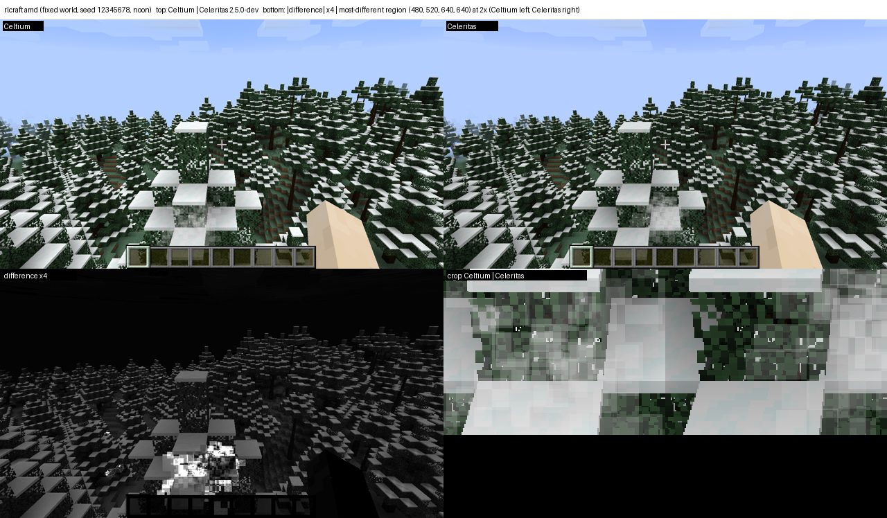
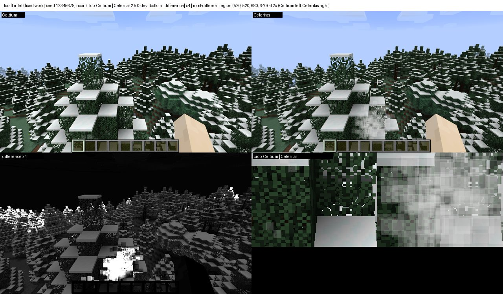
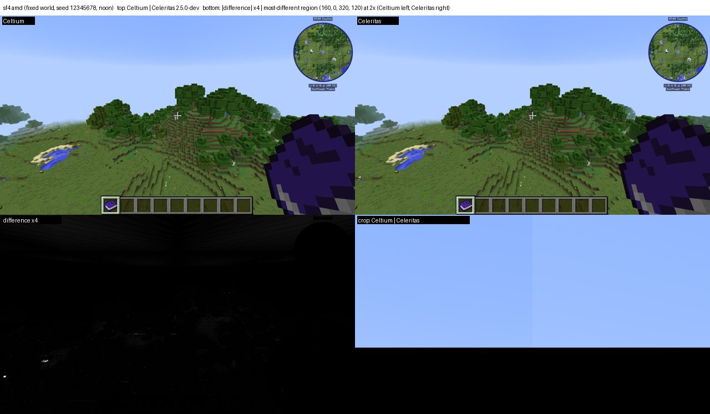
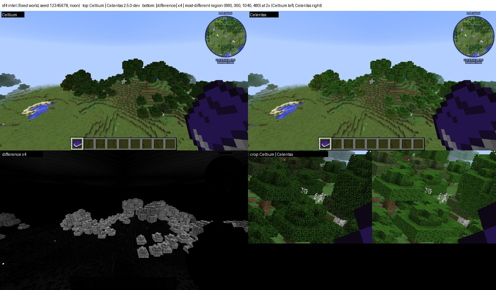
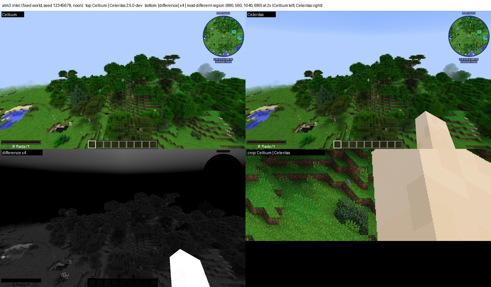

# Modpack re-verification and every problem found (2026-11-06) — handoff

This is the single list of what the full-log, picture-vs-Celeritas re-verification of the modpacks dug up, for
whoever continues the work. Status of each pack lives in [docs/modpacks.md](<../modpacks.md>); the verification
standard ("What verified means") is defined there.

## How the re-verification works (reproduce with these)

- **Batch:** `scripts/modpack-reverify.sh .gv-verify/jars/<stage> sf4 atm3 rlcraft sevtech nomi po3` (log in
  `.gv-verify/modpack-reverify.out`). Per pack: a generation leg writes a world (seed 12345678, generated terrain),
  which is copied into the pack instance as `saves/celtium-gen`; then **Celtium AMD, Celtium Intel and Celeritas
  2.5.0-dev (AMD)** load that same save. A fresh world per arm is useless: RLCraft's mods do not generate the same
  world twice from one seed (the first attempt compared different trees, mean diff 64).
- **Flags on every leg:** `worldType=default`, `cameraY=100` (default pose is underground in a generated world),
  `fixedWorldTime=true worldTime=6000`, `-Dceltium.debug.logLinesPerTag=1000000` (the default 16 lines per tag hides
  most of Celtium's own reports), `-Dceltium.vulkan.frameStats=true`, `-Dceltium.glless.census=true`. Never the
  `fail*`/`refuse*` switches (fault injection).
- **Analysis:** `scripts/pack_verify.py logs RUN` (ERROR/FATAL, exceptions, nonzero Celtium refusal/failure counters,
  classified Celtium vs pack, debug.log duplicates folded) and `scripts/pack_verify.py picture CELTIUM_RUN REF_RUN`
  (mean abs diff, share of pixels > 24 levels, and a Celtium | Celeritas | heatmap composite). Outputs:
  `.gv-verify/w-<pack>-{amd,intel,ref}-logs.json`, `w-<pack>-{amd,intel}-picture.json`, `w-<pack>-*-diff.png`.
- **Pack instances and staged jars:** `~/.local/share/PrismLauncher/instances/celtium-<pack>-<version>`,
  `.celtium-work/modpack-<pack>/staged/mods`, substitutions in `.celtium-work/modpack-<pack>/SUBSTITUTIONS.md` and
  summarised in docs/modpacks.md. Presets: `E2E_PACKS` in `scripts/gv_leg.py`.
- **Builds:** r120 `skips` and r121 `record` (adds `CELTIUM_RECORD`; HEAD then `afc026304` de-duplicates it).
- The user's rule: **qmagnet is for FPS only**; compatibility pictures use the packs' own generated worlds.

## Results so far

| Pack | Celtium vs Celeritas picture (mean abs diff / pixels > 24) | Celtium-origin log findings |
|---|---|---|
| RLCraft 2.9.3 | AMD 10.69 / 9.3 %, Intel 11.18 / 9.3 % | see defects 3, 4, 5 below; 44 degenerate quads refused (zero area, harmless) |
| SkyFactory 4 4.2.4 | AMD 3.60 / 5.5 %, Intel 3.68 / 5.5 % | defect 2 (FBP particles, 7,260 refusals), defect 1 (leaves), 57 batches dropped at a menu boundary |
| All the Mods 3 6.1.1 | AMD 12.82 / 9.9 %, Intel 12.85 / 9.9 % | defect 9 (no first-person hand), defect 10 (sky gradient), `CELTIUM_MODEL_MISSING` (display list with 0 captured quads), `missingMeshes` 2–5 in model builds, 385/295 batches dropped at a menu boundary (defect 5), a depth copy not read back |
| SevTech: Ages 3.2.3 | (batch running) | |
| Nomifactory CEu 1.7.7 | (batch running) | |
| Project Ozone 3 3.4.11F | (batch running) | |

### Pictures (for eyes)

Each sheet: top Celtium | Celeritas at half size; bottom-left the difference ×4; bottom-right the region that differs
most at 2× (Celtium left, Celeritas right). Generated by `scripts/pack_verify.py review` (the batch writes them for
every pack).

**RLCraft** — AMD / Intel: the scene matches; differences are particles and slightly brighter blocks (see defect 1).

**SkyFactory 4** — AMD / Intel: only the tree canopies differ; Celtium's distant leaves are darker (defect 1).

**All the Mods 3** — AMD / Intel: Celtium has no first-person hand (defect 9) and a lighter upper sky (defect 10).

Every leg: **0 Vulkan validation messages**. Pack-origin log errors (missing models/recipes, signature warnings,
mod config errors) appear identically in the Celeritas arm (e.g. SF4 373 vs 374 ERROR lines, RLCraft 232 vs 233) and
are not Celtium's.

## Celtium defects found (open unless marked)

1. **Distant leaves are darker than Celeritas (both GPUs; SF4, RLCraft).** Close leaves match pixel for pixel; the
   canopy gets darker with distance (SF4 leaf pixels 20,37,12 vs 39,74,23). Solid blocks, water, sky, HUD and the
   minimap match. Never seen before because every earlier picture leg seeded `options.txt` from
   `.celtium-work/options/guiScale3.txt`, which has **`mipmapLevels:0`**; the pack legs use Minecraft's default 4.
   The atlas sampler is `min=NEAREST mipmapMode=LINEAR maxLod=1` (`CELTIUM_SAMPLER_FILTER glTexture=<atlas>`), and the
   level 1+ data are the game's own captured mips (`VulkanGlTexture.uploadFromGlTexture`, the `appliedMipSerials`
   loop). **Next discriminator (queued in the session, may not have run):** the same saved SF4 world with
   `CELTIUM_LEG_SEED_OPTIONS=.celtium-work/options/guiScale3.txt` (mipmaps off) on both renderers — if the difference
   vanishes, the cause is mip data or LOD selection for `cutout_mipped`; then compare level-1 texels of a leaf sprite
   against Minecraft's `TextureUtil.generateMipmapData` (gamma-space average excluding transparent texels).
2. **Fancy Block Particles' digging particles are not drawn (SF4).** FBP's `FBPRenderUtil.renderCubeShaded_S` draws
   through the Tessellator with vertex format POSITION(3f) TEX(2f) COLOR(4ub) LMAP(2s) NORMAL(3b) = stride 31.
   Celtium has no mapping: `CELTIUM_UNMAPPED_REFUSED format=unmapped ... size=31` and
   `CELTIUM_REFUSALS_BY_FORMAT {0 format 0 (unmapped) ...=7260}`, `CELTIUM_DRAWARRAYS refused=4096 ... stride 31 with
   client arrays [GL_NORMAL_ARRAY, GL_COLOR_ARRAY, GL_TEXTURE_COORD_ARRAY]`. Fix: add the format to the immediate
   format table (`VulkanImmediateFormats`, `celtium.vulkan.immediateFormats`) with a pipeline that consumes it (the
   lit ITEM family already reads position/uv/colour/normal; the light-map short pair is the new part).
3. **Ordering flush fails with "nested immediate command recording" (RLCraft, intermittent).** One run (`rlbm-amd`,
   r120, Bloodmoon + patched Fugue) counted `orderingFlushFailures=741`, `orderingFlushDroppedBatches=18828`: the
   flush at `VulkanTerrainGpuBackend` (`throw new IllegalStateException("nested immediate command recording")` when
   `commandState.recording() && !frameBufferOpen`) is reached while another recording is open, and the catch drops
   every accepted batch. Not reproduced in the next two RLCraft runs. The failure text and frame were invisible until
   `afc026304`/`CELTIUM_RECORD` (record() used to be cleared unprinted) — rerun RLCraft a few times on HEAD and grep
   `CELTIUM_RECORD ordering flush failed` for the frame and stack.
4. **"a destroyed mesh cannot be drawn" in a window flush (RLCraft, intermittent, Intel and AMD).**
   `lastWindowFlushFailure=IllegalStateException: a destroyed mesh cannot be drawn at VulkanDynamicMesh.bindAndDraw:299
   <- VulkanImmediateItemPipeline.draw:388`, `windowFlushFailureFrame=2` (the first world frame). A queued ITEM group
   still references a mesh freed before the flush — look at what frees `VulkanDynamicMesh` around world entry (model
   geometry rebuild, retained geometry, arena). Get the full stack from `CELTIUM_RECORD` on HEAD.
5. **Accepted batches dropped at a menu frame boundary (RLCraft 1,126; SF4 57).** `CELTIUM_RECORD menu frame
   boundary dropped N accepted immediate batches whose target never got a pass (targets=[0])` — content accepted for
   the main target during the menu-to-world transition is never drawn (`celtium$dropUnflushedTargetGroups`). One frame
   each, so minor, but it is lost geometry.
6. **The fixture's presented counter stays 0 for hundreds of world frames in RLCraft (both GPUs, intermittent).**
   `picturePresentSkipsAtVerdict_world` 683–2,581 and `firstPresentedWorldFrame` 686–2,584 while the backend's own
   heartbeat (`CELTIUM_PRESENT hookCalls=…`) shows every present succeeding; the picture assertion then fails as
   "-684 away from the world frames". The fixture reads the counter from `TerrainGpuBackends.current()`
   (`ValidationClient.celtium$vulkanBackend`); the hypothesis is that `current()` is not the presenting backend for a
   while (a second backend/RenderGlobal in RLCraft). Black periodic frame dumps (`frameDumpCount`) in the same window
   fit the same cause. Not yet proven: log `TerrainGpuBackends.current()` identity per frame against the presenting
   backend. The world picture itself is correct.
9. **First-person hand missing (ATM3, both GPUs).** Celeritas draws the player's arm at the same pose; Celtium's frame
   has none (`docs/evidence/modpack-reverify/atm3-*.jpg`). SF4 and RLCraft draw the hand, so a mod in ATM3 changes how
   the hand is rendered (check which mod hooks `ItemRenderer.renderItemInFirstPerson` / `renderArmFirstPerson`, and
   whether the hand pass is refused: grep `CELTIUM_` refusal lines around `renderHand`).
10. **Upper-sky gradient differs (ATM3, both GPUs).** The difference heatmap shows a band across the top of the sky:
    Celtium's upper sky is lighter than Celeritas'. Compare the sky dome / void plane colour and fog at the zenith;
    may share a cause with defect 7's family (sky groups and their fog block).
11. **A display list with no captured quads (ATM3).** `CELTIUM_MODEL_MISSING list=19119 texture=42 capturedQuads=0
    ... (no GPU mesh available; GL-less cannot replay this list)` and `CELTIUM_MODEL_BUILD missingMeshes=2..5`: some
    mod's display list is replayed with nothing captured, so it draws nothing.
7. **(Fixed) SkyFactory 4 sky turned into a flat saturated band while a mod toast was up** — non-ITEM groups carried
   the lit payload over their fog block (`76ff182ee`).
8. **(Fixed) E2E-E atlas left in TRANSFER_DST (5× VUID-09600)** — deferred-region flush overflowed the MemoryStack
   (`d8cb18595`).

## Pack-side problems (not Celtium; recorded so nobody chases them in the renderer)

- **Bloodmoon (RLCraft):** `VerifyError` in `EntityRenderer.updateLightmap` with any renderer — its transformer uses
  vanilla's local slots. Fixed in Fugue: **CleanroomMC/Fugue PR #138** (open; local build used for RLCraft, hooks land
  on slots r=23 g=24 b=25). RLCraft's staging currently carries the patched Fugue and Bloodmoon.
- **Trinity's ICBMEvents (E2E-E):** Cleanroom registers private methods' parameter types — **CleanroomMC/Cleanroom
  PR #720** (ours, open). Until merged E2E-E uses a Trinity without that class.
- ThaumcraftFix needs Fugue ≥ 0.25.5; CodeChickenLib 3.3.8 → 3.3.10; SmoothFont refused by Celtium (SevTech);
  JourneyMap 6.x breaks JourneyMapStages Continuation (use 5.7.1p3); MineColonies' pinned ATM3 file is gone (LDT Team
  maven 0.11.841); Topography crashes on the fixture's superflat options (use generated worlds).
- **Harness pitfalls hit today:** `pgrep -f` patterns that also match the launching shell's own command line; the
  e2e leg's report used to delete `saves` before the world could be copied; `debug.log` repeats `latest.log`.

## Next steps (in order)

1. Finish the batch for ATM3, SevTech, Nomifactory and PO3 (and add Supersymmetry/E2E-E with the same script), fill
   the results table, and add each pack's Celtium findings here.
2. Run the mipmap discriminator (defect 1) and fix the leaf darkening.
3. Add the FBP vertex format (defect 2).
4. Reproduce defects 3 and 4 on HEAD with `CELTIUM_RECORD` and fix them.
5. Only then mark packs verified in docs/modpacks.md and the README.
