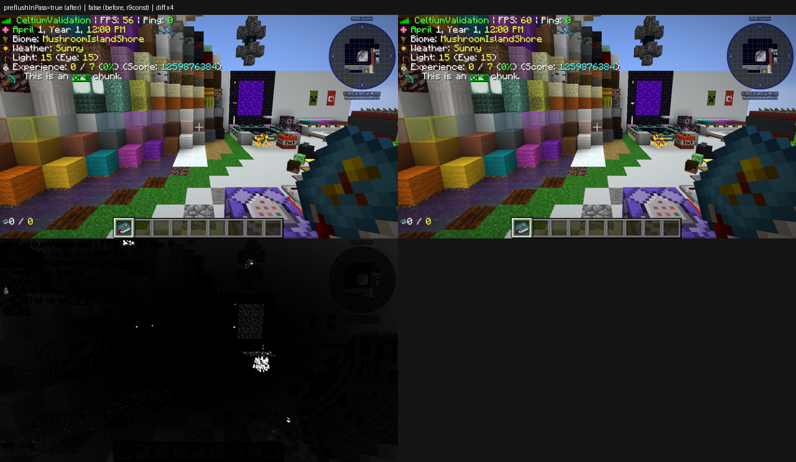

# The settled frame's absolute costs, and the pre-terrain flush's window (2026-11-07)

Round 9 of phase 4. Round 8 removed the entity gather walk and left the p99 at parity on AMD. This round asked a
different question - *what does this renderer cost every frame* - and found that the report which was supposed to
answer it could not: `CELTIUM_FRAME_TICK_PERCENTILES` prints only the brackets whose p99 rank differs from the plain
p79, so a bracket that costs the same on both frame kinds is invisible however large it is. The offer path, the window
machinery and the terrain prepare are all in that blind spot. The new line prints them, and the first thing it showed
was a whole window spent on the sky.

## What was added

| switch | what it prints |
|---|---|
| `-Dceltium.vulkan.tickPercentiles=true` (existing) | `CELTIUM_FRAME_TICK_PERCENTILES`, unchanged |
| the same switch | **`CELTIUM_FRAME_TICK_CONSTANTS`**: every bracket whose tick p50 is at least 10 us, as tick p50 / plain p50. The absolute cost, not the difference. |
| `-Dceltium.vulkan.preflushInPass` (default `true`) | where the pre-terrain flush is recorded: inside the terrain pass's own render pass, or (off) in a window of its own at the head of the pass |

## The settled frame, by absolute cost

`r9const-amd` (renderer `27534f46…`, AMD RX 6400, world scene, guiScale 3, validation off, warm ticks [400,600),
`fixtureStatus=PASSED`, `validations=0`, picture present). Last percentile block (`tickFrames=44 plainFrames=980`),
microseconds, **tick p50 / plain p50**:

| bracket | tick p50 | plain p50 | owner |
|---|---|---|---|
| frame | 1 992 | 1 524 | |
| world | 1 555 | 1 145 | |
| worldPass | 1 498 | 1 133 | the game's `renderWorldPass` |
| **entities** | **557** | **403** | |
| **entBlockEntities** | **520** | **381** | the pack's TESRs (offer path ~5 %) |
| **flush** | **309** | **248** | ours: the immediate window |
| **gui** | **371** | **331** | the HUD |
| **terrain** | **185** | **110** | ours: the terrain pass |
| particles | 53 | 32 | the game's |
| hand | 52 | 41 | the game's |
| lightmap | 41 | 0 | the game's `updateLightmap`, tick-gated |
| sky | 33 | 16 | the game's |
| setupTerrain | 37 | 27 | the game's |

Inside `flush` and `terrain`, the brackets the old report could not show:

| bracket | tick p50 | plain p50 | what it is |
|---|---|---|---|
| **wrecLoop** | **191** | **164** | the group loop: ~165 groups, 2 driver calls each |
| grpDraw | 99 | 83 | the pipeline's own draw call |
| rcPrepared | 25 | 23 | descriptor and texture resolution per group |
| rcPush | 22 | 20 | the push-constant block fill |
| winRecord | 220 | 183 | the window's recording (contains wrecLoop) |
| winBarrier | 43 | 27 | the acquire and release barriers, per window |
| wfpMiddle | 33 | 9 | target resolution, group filtering, the queued clear |
| **terrainPreflush** | **102** | **47** | the pre-terrain flush, in a window of its own |
| terrainRecord | 64 | 51 | the terrain recording |
| guiBatch | 92 | 87 | the HUD's accept path |
| guiFlush | 73 | 80 | the HUD's window recording |
| offCapture + offPrepare + offAppend + offPreflight | 84 | 72 | the offer path, all batches |

Two readings follow, and both matter for the p99:

1. **The group loop is not the flush's cost.** `wrecLoop` is 191 us of the flush's 309, and `grpDraw` is 99 of that -
   ~0.6 us a group for one `vkCmdDraw`, which is the driver's floor, not ours. The other 110 us is the window: the
   barriers, the target routing, the transitions and the recording around the loop.
2. **The pre-terrain flush is a window for the sky.** `terrainPreflush` is 102 us of the terrain pass's 185, and the
   group loop inside it is ~52 - the rest is a render pass begin and end, the acquire and release barriers, the target
   routing and the sampling-side transitions, all for the handful of groups the sky, the void plane and the sun are.

## The fix: record the pre-terrain flush inside the terrain pass

The flush itself is not optional: the sky, the void plane and the sun are queued immediate work that has to reach the
image before the terrain, or the void plane paints over the terrain it is hidden behind. What was optional is *where*
it is recorded. `flushPendingBeforeGlDraw` already has an in-pass path - when a render pass is open it calls
`drawPendingImmediate` instead of opening a window - so the change is to make the call after the terrain pass's own
`vkCmdBeginRenderPass` rather than at the head of the pass, where no pass is open.

Three details make it correct:

- **The render pass is the same one.** `recordImmediateOnlyPass` already used `terrain.renderPass()` for the window,
  and every terrain pipeline builds its render pass with the same `buildFrameRenderPass`, so the immediate pipelines
  are compatible with the pass they now draw in.
- **The viewport and scissor move after the groups.** Each group carries its own rectangle; the terrain draws need the
  pass's full-target one, so `setViewportAndScissor` has to run after the last group has set its own.
- **Every early return flushes.** A pass that returns before the in-pass site (no geometry for this pass, no pipeline,
  no frame target, a stalled GPU, a failed `beginFrame`) would leave the sky queued behind whatever draws next, so
  each of those paths calls the same flush - which is the window the head of the method used to open.

## The result

`r9preflush2-amd` (renderer `19d68cfb…`, same scene, same flags, same GPU). Last percentile block
(`tickFrames=50 plainFrames=974`), microseconds, **tick p50 / plain p50**:

| bracket | before (`r9const`) | after (`r9preflush2`) | delta |
|---|---|---|---|
| **terrainPreflush** | 102 / 47 | **31 / 20** | **-71 / -27** |
| **flush** | 309 / 248 | **216 / 219** | **-93 / -29** |
| winBarrier | 43 / 27 | **15 / 15** | -28 / -12 |
| winRecord | 220 / 183 | **162 / 158** | -58 / -25 |
| wrecLoop | 191 / 164 | **149 / 147** | -42 / -17 |
| terrainRecord | 64 / 51 | 110 / 85 | +46 / +34 |
| terrain | 185 / 110 | **153 / 105** | -32 / -5 |
| **flush + terrain** | **494 / 358** | **369 / 324** | **-125 / -34** |
| frame | 1 992 / 1 524 | **1 791 / 1 535** | -201 / +11 |

`terrainRecord` rises because the pre-flush's group loop is now recorded inside the terrain pass, which is where the
work went; the sum is what moved. **One window a frame disappears**: `winBarrier` and `winRecord` each lose a
window's share, and `terrainPreflush` loses the render pass begin and end it used to pay.

The frame's -201 is larger than the -125 the brackets account for, and the plain frame is flat (+11), so the honest
reading is **-125 us of renderer work on a tick frame** with the rest of the frame delta inside the run-to-run spread
this scene has shown all along (the same build read 1 992 and 1 954 on two earlier legs).

## The picture is the A/B's positive control

The same jar, the same scene, `-Dceltium.vulkan.preflushInPass=false` against `true`:

| comparison | mean abs diff | pixels over 24 levels |
|---|---|---|
| `r9preflush2` (in-pass) vs `r9const` (window) | **1.29** | **0.23 %** |
| `r9preflush` (first in-pass run) vs `r9const` | 6.61 | 5.19 % |
| `r9preflush` vs `r9preflush2` (same jar, two runs) | 7.57 | 5.42 % |

The first in-pass run read 6.6 / 5.2 % and its sky was ~6 % darker, which looked like a regression until the repeat
run: **two runs of the same jar differ by more than the change does** (7.57 / 5.42 %), because the fixture captures the
world picture at a tick that varies (323, 341, 346 across these three legs) and the pose and the sky's phase move with
it. The repeat against the before-run is 1.29 / 0.23 %, which is the FPS counter and the entity positions. The A/B
switch is what makes that separable; without it the first run would have been read as a picture regression.



## What this says to do next

1. **The window machinery is now the largest Celtium-owned item after the group loop**: `winBarrier` 15 + `winRecord`
   162 + `wfpMiddle` 33 + `winHead`/`winPrefix`/`winPublish`/`winPassEnd` (each under 10) over the frame's remaining
   windows. The next window to question is the GUI's: `guiFlush` is 69 us and the HUD's groups are recorded in a
   window of their own at the end of the frame.
2. **`entBlockEntities` is 473-520 us, 26 % of the frame, and it is the pack's TESRs.** The offer path inside it is
   ~5 %, so no batch-path change moves it. It needs a census of how many block entities render and what each costs
   before anything is claimed about it.
3. **`lightmap` is 38-41 us on every tick frame and 0 on plain frames** - the game's `updateLightmap`, dirtied by the
   tick. It is the game's work, and Celeritas pays it too.
4. **Every KPI evidence table must state the regime** (world-load wave or settled), and now also whether it is a
   difference or an absolute cost: the two reports answer different questions and the difference form hides the
   constants.

## Reproduce

```sh
scripts/gv-leg.sh r9preflush2-amd .gv-verify/jars/r9-preflush world amd 240 \
  -Dceltium.vulkan.validation=false -Dceltium.vulkan.presentReadback=false \
  -Dceltium.vulkan.presentedDumpEvery=0 -Dceltium.validation.warmFromTick=400 \
  -Dceltium.validation.warmToTick=600 -Dceltium.validation.holdUntilTick=620 \
  -Dceltium.validation.guiScale=3 -Dceltium.vulkan.frameStats=true \
  -Dceltium.debug.logLinesPerTag=1000000 -Dceltium.vulkan.passSplit=true \
  -Dceltium.vulkan.tickPercentiles=true -Dceltium.vulkan.tickPercentileFrames=1024
```

The before leg is the same command with `.gv-verify/jars/r9-const`; the A/B control adds
`-Dceltium.vulkan.preflushInPass=false` to the after jar.
