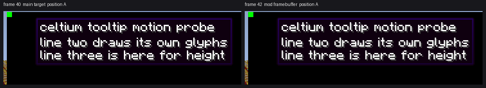

# a tooltip drawn while a mod framebuffer is bound is neither lost nor ghosted (2026-11-03)

The reported tooltip afterimage was measured in motion on 2026-11-02 ([evidence](tooltip-motion-2026-11-02.md)) and the
answer there was "one frame holds one tooltip". That measurement had one arm it explicitly did not cover: **a tooltip
drawn while a mod's framebuffer is bound** - the case the retained-glyph-run drop (`84d325fbf`) was written for, because
a run written for a target that is not current is retained and offered again when that target returns, and a run whose
target never returns is dropped at the frame boundary. If that machinery is wrong in either direction, the text is
either **missing** (dropped) or **drawn a frame late at the previous frame's position** (the ghost shape). This round
measures that arm, in the same run as the main-target arm, and the answer is that both are clean.

## The two arms

`TooltipMotionScreen` now draws the same commands twice, two consecutive frames each:

| frames | arm | what draws |
|---|---|---|
| 40, 41 | `main` | the panel, its markers and the tooltip straight onto the main target |
| 42, 43 | `fbo` | the same three draws into a framebuffer the screen creates with raw `glGenFramebuffers` + `glFramebufferTexture2D`, then the panel's rectangle composited back onto the main target |

The framebuffer is the window's own size (1280x720), so the GUI projection and viewport are unchanged and the two arms
draw at the same pixels. It is cleared to **opaque** black and composited **unblended**: a transparent clear would
double-blend the tooltip's own alpha borders and make the arms differ for a reason that is not the renderer's. The
composite is a `POSITION_TEX` quad over the panel's rectangle with the vertical texture coordinates flipped (the
framebuffer's origin is bottom-left, the GUI's top-left).

Two frames per arm is what makes the test decisive: the second frame of an arm is the one where a run retained for the
first frame's target would be offered again - at the first frame's position, which is the *other* slot, so the ghost
would put two tooltips in one frame.

## The run

| | |
|---|---|
| Leg | `r27a-tooltipfbo` - `plain`/`terrain`, Supersymmetry, AMD Radeon RX 6400 (RADV NAVI24), `gpuRequirementMet=true` |
| Renderer / fixture | `e34480edeebc3351ce789fa50d188aec545d469315a49f83165ff7657714cdb2` / `60ee33b2ed7e51f6d8c06da38a6abf870f4da5fb69b86a10057205632e3bc626` |
| Scene | 1280x720, `guiScale3.txt` (GUI 427x240), validation ON, `-Dceltium.validation.screen=tooltipmotion` |
| Framebuffer | `tooltipMotionFbo=complete frames=49` - the mod target was created and drawn through on 49 frames |
| Dumps | 4, all `completed=true`, `frameBinding=observed present`, `completionError=none`: f40-a-main (presented 43), f41-b-main (44), f42-a-fbo (45), f43-b-fbo (46) |
| Errors | `celtium/vulkan-check passes=2533 skipped=0 errors=0`, zero `VUID` lines, `CELTIUM_REFUSALS_BY_FORMAT {}` |

The leg's verdict is `UNCALIBRATED_PRESENTED_IMAGE` (exit 2) **by construction**: its calibration key differs from the
reference only in `screen=named:tooltipmotion` against `screen=none`, so the run is not the variant the terrain floors
describe. The verdict is not the measurement here; the checker below is. The renderer JAR is byte-identical to round
26's, which passed the calibrated world scene with `sceneCalibrationKeyMatches=true` on legs `r46b-gateoff` and
`r46c-gateon`.

## The measurement

`python3 scripts/cpu-contract/tooltip-motion-check.py --run .gv-verify/run-r27a-tooltipfbo` reads the run's report and
pictures. Per frame it requires exactly one tooltip (one band carries ink, the other and the gap carry none); per arm it
requires both positions; across arms it requires the same picture at the same position.

| frame | arm | position | ink at A | ink at B | gap | one tooltip |
|---|---|---|---|---|---|---|
| `f40-a-main` | main | A | **17163** | 0 | 0 | yes |
| `f41-b-main` | main | B | 0 | **17163** | 0 | yes |
| `f42-a-fbo` | fbo | A | **19035** | 0 | 0 | yes |
| `f43-b-fbo` | fbo | B | 0 | **19035** | 0 | yes |
| control (A with B pasted into B's band) | - | - | 17163 | 17163 | 0 | **no** |

| position | ink energy main | ink energy fbo | delta | ink box delta |
|---|---|---|---|---|
| A | 3088380 | 3090621 | **0.07%** | 1 px |
| B | 3088380 | 3090621 | **0.07%** | 1 px |

The ink *count* differs by 10.9% and the ink *energy* by 0.07%, and that gap is the whole story of the composite: the
framebuffer arm's panel lands on a slightly different sub-pixel grid than the main target's own drawing, so antialiased
glyph edges move across the ink threshold without any content changing. The energy is what a resample preserves, so the
arm comparison is on energy and on the ink bounding box, not on the count. A lost glyph run is ~80% of the energy and a
ghost doubles it; 0.07% is neither.

The sub-pixel offset is measured, not explained: the box's right border is fully covered at x=735 in the main arm and
45% covered at x=735 with 30% at x=738 in the framebuffer arm, which is a shift of about half a pixel to the right, and
the vertical borders are identical. The cause is not identified this round (the off-target pass's viewport is the
window's size, and the published attachment's extent is the texture's own 1280x720, so the two obvious candidates are
excluded). It is invisible at 0.3-0.6 px and it does not affect the conclusion; it is recorded so a later round does not
re-derive it.

## What this does not claim

* Scope: one pack (Supersymmetry), AMD, GUI scale 3, 1280x720, a `GuiScreen` tooltip. Intel is not run this round.
* The sign-text afterimage (the same report's ⑤, "text left behind while the view moves") is still unmeasured: it is
  the world pass, not the GUI pass, and it needs a world with a sign at a known position and a moving camera.
* The framebuffer arm composites in the **same** frame it draws in. A mod that renders into a target in one frame and
  composites it in a later one is a different lifetime (the target spans frames) and is not in this set.
* No performance claim: this leg is a probe screen, not a timing arm.
