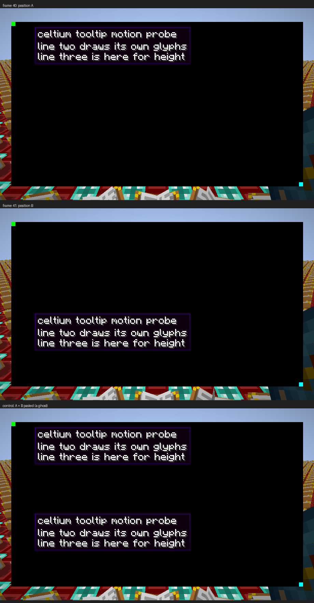

# a moving tooltip leaves nothing of the previous frame (2026-11-02)

The reported tooltip afterimage is the last of rc.26's four fidelity reports that had no measurement in the place the
defect can appear: **motion**. At rest it was already refuted twice - the game's own screenshot and the presented dump
are the same pixels for a still camera (leg `shot-test6`, zero differing pixels), and no frame reaches its boundary
without a clear (`framesNoClear=0`) - and the retained glyph run that was left over from a refused target got a
frame-boundary drop on 2026-11-01 (`84d325fbf`), never measured in motion.

This round measures it: a real vanilla tooltip is moved between two positions on **consecutive frames**, the frames are
dumped by the screen itself, and the black panel makes "ink" countable without a reference picture. The answer for the
main target is that every frame holds exactly one tooltip - the previous frame's box and glyphs are not drawn again.



## The scene and the run

* `-Dceltium.validation.screen=tooltipmotion` opens `TooltipMotionScreen` (new, fixture only): an opaque black panel
  with a green marker at its top-left corner and a cyan one at its bottom-right, and a vanilla tooltip - the same
  `GuiScreen.drawHoveringText` -> Forge `GuiUtils.drawHoveringText` path the pack's tooltips use - drawn at the upper
  position on even frames and the lower one on odd frames. Every frame therefore has to hold exactly one box; a glyph
  run left over from the previous frame would put the other position's box in the same frame, which is the ghost shape.
* The screen asks for its own presented dumps (`celtium$dumpPresentedImage`) at three consecutive frames, so both
  parities are in the set whatever frame a leg's own screenshot catches, and each picture's frame is bound by the
  renderer's written-frame record (`completed=true`, `frameBinding=observed present`, `completionError=none`).
* Leg `r25i-tooltip`: AMD Radeon RX 6400 (RADV NAVI24), `plain`/`terrain`, Supersymmetry, 1280x720, `guiScale3.txt`
  (GUI 427x240), validation ON, `-Dceltium.validation.screenshotAtTick=120`.
  Renderer JAR `d8000677573a0ed0dd9fb98fdfe06b757a39d246d65dae8a649217cfe3a34118` (unchanged since `55de35b5c`),
  fixture `740ea060986905fd0cdb99a75e72df25706fed70011719f1ccb52672c2623b97`.
* `celtium/vulkan-check passes=2083 skipped=0 errors=0`, zero `VUID` lines, no Celtium exception.
* The leg's verdict is `UNCALIBRATED_PRESENTED_IMAGE` (exit 2) **by construction**: its picture is the probe screen, so
  the terrain scene gate sees the 39 % black panel and fails its black ceiling. The verdict is not the measurement
  here; the checker below is, and the round's scene gate ran on a separate leg (see the end).

## The measurement

`python3 scripts/cpu-contract/tooltip-motion-check.py --run .gv-verify/run-r25i-tooltip` reads the run's report
(`tooltipMotionLayout`, in GUI units), scales it by `picture_width / tooltipMotionGuiWidth`, and counts ink (any channel
>= 16) in the two tooltip bands and in the gap between them. The layout of this run was
`gui=427x240 panel=71,40,356,200 slots=60,144 textX=85`; the bands are two GUI units wider than the box, which vanilla
draws sixteen above the origin it is given, so a band is `origin-18 .. origin+32`.

| frame | presented frame | world tick | ink at A | ink at B | ink in gap | box height | one tooltip |
|---|---|---|---|---|---|---|---|
| `tooltipmotion-f40-a` | 43 | 205 | **17163** | 0 | 0 | 107 px | yes |
| `tooltipmotion-f41-b` | 44 | 208 | 0 | **17163** | 0 | 107 px | yes |
| `tooltipmotion-f42-a` | 45 | 212 | **17163** | 0 | 0 | 107 px | yes |
| control (A, with B pasted into B's band) | - | - | 17163 | 17163 | 0 | - | **no** |

The two positions carry the *same* 17163 ink pixels, which is what one tooltip drawn once at either position has to
produce, and the other position and the gap between them are exactly 0. The control is built from the run's own pixels:
the other frame's occupied band is pasted into this frame's empty band, and the same analysis reports both bands
carrying, `one_tooltip=false`. The check therefore can fail, and does not pass a picture that holds the ghost shape.

## Two defects in the probe itself, found and fixed here

* **The fixture reported `tooltipMotionDumpCount=0` for a leg whose three pictures were on disk.** The completion path
  *moves* an answered request out of `celtium$pendingDumps` into `celtium$evidence`; the report read only the pending
  list. The report now reads both, de-duplicated by stage (`r25i` reports `dumps=3` with each picture's presented frame
  and completion state).
* **The upper box's top border was drawn outside the black panel.** Vanilla draws the box sixteen GUI units above the
  origin, and the first layout put the upper origin twenty below the panel's top edge: on leg `r25g-tooltip` the border
  sat at y=102 with the panel starting at 120, and the sky above the panel was counted as the *other* band's ink
  (20496 pixels, "both positions carry"). The origins are now `panelTop + max(20, h/8)` and
  `panelBottom - max(56, h/4)`, and the checker refuses any layout whose bands are not wholly inside the panel, naming
  the two numbers - so this cannot recur as a silent misreading.

## What this does not claim

* Scope: a `GuiScreen` tooltip drawn on the **main** target, GUI scale 3, 1280x720, AMD, one pack. A tooltip drawn while
  a mod's framebuffer is bound (the case whose refused run the retained-drop fix was written for) is not in this set,
  and no claim is made about it.
* The sign-text afterimage (the same report's ⑤, "text left behind while the view moves") is the same *class* but a
  different producer: the world pass, not the GUI pass. It is not measured here.
* Intel is not run this round.

## The same JAR's scene gate still passes

Before the probe, the same renderer JAR ran the calibrated world scene: leg `r25c-world` (world, AMD, `qmagnet`,
`sceneCalibrationKeyMatches=true`, `sceneGateCalibrated=true`, floors enforced) is **PASSED**, `problems` 0,
`fixtureStatus=PASSED`, `celtium/vulkan-check passes=31367 errors=0`, zero `VUID` lines. That leg is the regression
check for the previous round's line-topology fix, which changes every untextured batch (`POSITION` sky/horizon,
`POSITION_COLOR` overlays): the world picture carries terrain, sky and HUD, and the calibrated key matches. Its run
directory was removed when this round's set replaced it, per the one-set rule; the numbers above are the result file's.

## Re-running

```sh
CELTIUM_INSTANCE_COHORT=$HOME/.local/share/PrismLauncher/instances/Supersymmetry \
CELTIUM_LEG_SEED_OPTIONS=$PWD/.celtium-work/options/guiScale3.txt \
scripts/gv-leg.sh <fresh> .gv-verify/jars/<stage> plain amd 200 \
  -Dceltium.validation.screen=tooltipmotion -Dceltium.validation.screenshotAtTick=120
python3 scripts/cpu-contract/tooltip-motion-check.py --run .gv-verify/run-<fresh>
```
